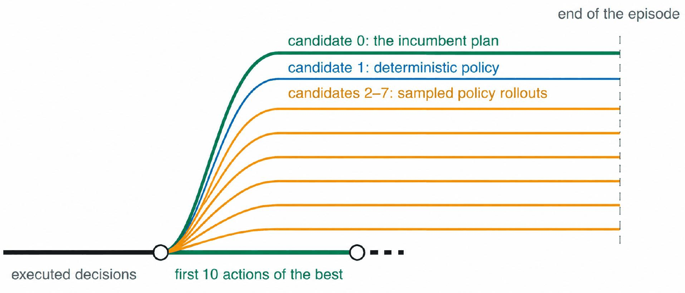

# Evaluate the published models

!!! abstract "Summary"
    The paper evaluates each single-agent policy on 100 seeded scenarios of 20 arrivals, with 21
    attempts per scenario, once with the policy alone and once with rollout search. Both runs can be
    repeated with the public code: `python -m analysis.score_windowed` scores the policy alone and
    `python -m evaluation.run_search` adds the search (8 candidates, replanning every 10 actions).
    An episode is *solved* when every flight lands within 60 s of its target and no loss of
    separation occurs. The supplied seeds were also used to select the published models, so the
    numbers are not an estimate on unseen scenarios.

Complete the [setup](index.md#setup) first, including the aircraft performance file. All commands
are run from `single-agent/`.

## The two models { #models }

The published policies are in `artifacts/single_agent/`.

| Procedure | Bundle | `TADA_ACTION_SET` | `TADA_AIRPORT_MASK` | `--procedure` |
|---|---|---|---|---|
| TMB, Milan Malpensa (LIMC) | `mxp/` | `v2` | `procedure` | `tmb` |
| PMS, Milan Bergamo (LIME) | `pms/` | `v2pms` | empty | `pms` |

Each bundle holds three files that must stay together:

- `final_model.zip`, the policy as a Stable-Baselines3 PPO checkpoint;
- `vecnormalize.pkl`, the reward-normalisation statistics saved with it;
- `run_meta.json`, the settings the policy was trained with. The evaluation tools read this file
  from the model's directory to build the same environment.

Both policies use the windowed environment with 20-flight streams, sequence observations, two
picks per 45 s decision interval and the same reward settings. They differ in the clearance set
and in the airport mask: the TMB policy was trained with the `procedure` mask, which blocks two
of the 15 clearances (the smallest speed reduction and the larger speed increase), and the PMS
policy without a mask.

Verify the files from the repository root:

```sh
(cd artifacts/single_agent && sha256sum -c SHA256SUMS)
```

## Environment variables { #environment }

Several settings size the observation and action spaces, so the code reads them from the
environment when it is imported. They cannot be command-line flags. Set these once per shell:

```sh
export CUDA_VISIBLE_DEVICES= TADA_GENERATOR=procedure
export TADA_SEQUENCE_OBS=1 TADA_MAX_PICKS=2 TADA_MASK_FRAME_FIX=1
```

| Variable | Value | Meaning | Default in the code |
|---|---|---|---|
| `TADA_ACTION_SET` | `v2` or `v2pms` | The clearance set: `v2` for the trombone, `v2pms` for point merge. See [Actions](../how/actions.md). | `v2` |
| `TADA_AIRPORT_MASK` | `procedure` or empty | An optional mask that blocks some clearances of the set for one procedure. | none |
| `TADA_SEQUENCE_OBS` | `1` | Adds four AMAN-sequence features to each aircraft's observation. See [Observations](../how/observations.md). | `0` |
| `TADA_MAX_PICKS` | `2` | Up to two clearances per decision interval ([reselection](../how/actions.md#reselection)). | `1` |
| `TADA_MASK_FRAME_FIX` | `1` | The coordinate frame used when clearance legality is computed. | `1` |
| `TADA_GENERATOR` | `procedure` | Scenarios are generated from the per-procedure configuration in `config/simulation_config_mxp/` and `config/simulation_config_bgy/`. | `procedure` |
| `CUDA_VISIBLE_DEVICES` | empty | Hides any GPU. Evaluation runs on the CPU, one process per worker. | |

`TADA_ACTION_SET` and `TADA_AIRPORT_MASK` differ between the two models and are set on each
command line below. Before an evaluation starts, the tools compare both with the model's
`run_meta.json` and stop with a message naming the right value if they do not match. The sequence
observations, the number of picks and the mask frame are then set from the checkpoint and its
`run_meta.json`.

## The scenarios { #seeds }

`evaluation/seeds.txt` lists the 100 scenario seeds of the paper, one per line. A seed determines
the whole scenario: the 20 arrivals, their routes and spawn times, and the AMAN sequence and
target landing times. Random extra time-to-lose is disabled in the supplied generator
configuration.

Pass the file with `--seed-file evaluation/seeds.txt` on every command. Without it the tools take
the first seeds of `config/eval_seeds.txt`, which is a different list.

!!! warning "The evaluation seeds were used for model selection"
    Training does not draw these seeds: the supplied training pool contains none of them. They
    were, however, used to choose which trained policy to publish. Results on them are therefore
    optimistic compared with scenarios that played no part in development. Report success, safety
    and timing as separate metrics, as the repository's guides ask.

## Policy only { #policy-only }

`analysis/score_windowed.py` flies each scenario with the policy alone and prints a summary.

```sh
mkdir -p runs/policy
TADA_ACTION_SET=v2 TADA_AIRPORT_MASK=procedure \
  python -m analysis.score_windowed \
  --models ../artifacts/single_agent/mxp/final_model.zip \
  --seed-file evaluation/seeds.txt --attempts 20 \
  --csv runs/policy/tmb_scores.csv
TADA_ACTION_SET=v2pms TADA_AIRPORT_MASK= \
  python -m analysis.score_windowed \
  --models ../artifacts/single_agent/pms/final_model.zip \
  --seed-file evaluation/seeds.txt --attempts 20 \
  --csv runs/policy/pms_scores.csv
```

Attempt 0 is the deterministic policy: at every decision it takes the most probable legal action.
`--attempts 20` adds 20 sampled attempts per seed, in which actions are drawn from the policy's
distribution. All attempts of a seed fly the same scenario, and each sampled attempt has its own
fixed random seed, so a run is repeatable. The procedure is read from `run_meta.json`; no
procedure flag is needed.

The main options:

| Option | Default | Meaning |
|---|---|---|
| `--models` | required | One or more checkpoints. With several, the first is the reference and the others are compared with it seed by seed. They must share the same environment settings. |
| `--seed-file` | none | File of scenario seeds, one per line. |
| `--seeds` | 100 | Use only the first N seeds. |
| `--attempts` | 0 | Sampled attempts per seed after the deterministic one. |
| `--flights` | 20 | Arrivals per scenario. |
| `--workers` | CPU count minus 2 | Parallel processes. |
| `--csv` | none | Write one row per seed and attempt. The directory must exist. |
| `--flights-csv` | none | Write one row per flight of the deterministic attempt, by position in the AMAN sequence. |

`python -m analysis.score_windowed --help` lists the remaining options, which belong to
development experiments (stitched streams, a critic-guided lookahead, a conflict shield) and are
not part of the paper's protocol.

For each model the summary gives the number of solved seeds, the loss-of-separation rate with a
95% confidence interval, the share of flights on time, the clearances per episode and the mean
landing deviation. With `--attempts` it also gives the share of seeds solved by at least one
attempt.

To record the per-aircraft data that the [CSV export](#export) needs, run the same episodes
through `analysis/evaluation_records.py`:

```sh
TADA_ACTION_SET=v2 TADA_AIRPORT_MASK=procedure \
  python -m analysis.evaluation_records \
  --model ../artifacts/single_agent/mxp/final_model.zip \
  --seed-file evaluation/seeds.txt --attempts 20 \
  --out-prefix runs/policy/policy_tmb
```

Use `v2pms`, an empty mask, the `pms/` model and `--out-prefix runs/policy/policy_pms` for point
merge. Its `--attempts` defaults to 10, so state 20 explicitly.

## Policy with rollout search { #search }

[Rollout search](../how/search.md) uses the simulator to look ahead. At each planning point it
rolls several candidate continuations to the end of the episode on copies of the simulation,
keeps the best, executes its first actions and plans again.

<figure class="tada-paper-fig" markdown>

<figcaption>Rollout search with K = 8 candidates and M = 10. The first 10 actions of the best
candidate are executed; the rest of it becomes the incumbent plan at the next planning
point.</figcaption>
</figure>

```sh
TADA_ACTION_SET=v2 TADA_AIRPORT_MASK=procedure \
  python -m evaluation.run_search --procedure tmb \
  --model ../artifacts/single_agent/mxp/final_model.zip \
  --seed-file evaluation/seeds.txt --out runs/search
TADA_ACTION_SET=v2pms TADA_AIRPORT_MASK= \
  python -m evaluation.run_search --procedure pms \
  --model ../artifacts/single_agent/pms/final_model.zip \
  --seed-file evaluation/seeds.txt --out runs/search
```

Output file names start with the procedure, so both runs can share one directory. That is what the
CSV export expects.

| Option | Default | Meaning |
|---|---|---|
| `--model` | required | The checkpoint. |
| `--procedure` | required | `tmb` or `pms`. |
| `--seed-file` | none | File of scenario seeds. |
| `--seeds` | 100 | Use only the first N seeds. |
| `--attempts` | `0-20` | Attempt indices: a range such as `0-20` or `1-5`, or a single index such as `0`. |
| `--K` | 8 | Candidates per planning point, including the incumbent plan. |
| `--M` | 10 | Policy actions executed between planning points. A second pick within a decision interval counts as an action, so 10 actions can span fewer than 10 intervals. |
| `--flights` | 20 | Arrivals per scenario. |
| `--workers` | 12 | Parallel processes. |
| `--out` | `runs/search` | Output directory. |
| `--picks` | off | Also write one row per executed action. |
| `--resume` | off | Continue an interrupted run. |

The defaults give 100 seeds times 21 attempts, 2100 episodes per procedure. Episodes are flown
attempt by attempt, so a partial run already covers every seed at attempt 0.

How the search behaves, as implemented in `analysis/rollout_search.py`:

- At the first planning point the incumbent plan is the deterministic policy's rollout and the
  other seven candidates are sampled. At later points the candidates are the incumbent, one
  deterministic rollout and six sampled rollouts.
- Candidates are ranked by their outcome at the end of the episode, in this order: no loss of
  separation, more flights within 60 s, smaller total absolute deviation, fewer clearances. A new
  candidate replaces the incumbent only if it is strictly better.
- No further candidates are generated at a planning point once the best one solves the episode.
  A rollout is abandoned as soon as it can no longer match the best candidate's number of on-time
  flights; this pruning does not change which candidate is chosen.
- The attempt index only changes the random seeds of the sampled candidates. Attempt 0 uses the
  base seeding; attempts 1 to 20 repeat the search on the same scenario with different samples.
  Every attempt starts from the deterministic rollout, so with search an attempt is never a purely
  sampled episode.

## Outputs { #outputs }

`run_search` writes these files to the output directory, where `<proc>` is `tmb` or `pms`:

| File | Rows | Main columns |
|---|---|---|
| `<proc>_episodes.csv` | One per seed and attempt | `solved`, `sep` (loss of separation), `on_time` (share of flights within 60 s), `all_on_time`, `hard_solved` (as solved, within 30 s), `landed`, `n_flights`, `mean_dev`, `max_dev`, `end_reason`, `clearances`, `warning_pairs`, the search cost (`n_plans`, `n_rollouts`, `rollout_steps`, `wall_s`) and one count per clearance (`n_SLOW_DOWN_SMALL`, ...). |
| `<proc>_aircraft.csv` | One per flight | `aircraft_index` (position in the AMAN sequence, 0 to 19), `aman_ttl_s` (TTL positive, TTG negative), `initial_dev_s`, `final_dev_s`, `final_source`, `clearances`. |
| `<proc>_picks.csv` | One per executed action, with `--picks` | `t_s`, `pick_in_interval` (1 or 2), `callsign`, `clearance`, `kind`. |
| `<proc>_run_settings.json` | | The seeds, attempts, K, M and environment settings of the run, with SHA-256 checksums of the model, its metadata, the scenario configuration, the sector files and the simulator library. |

Deviations are in seconds, landing time minus target, so a positive value is late.
`initial_dev_s` is the deviation forecast at the start of the episode if no clearance is ever
issued. `final_dev_s` is the realised deviation when `final_source` is `landed`; if the episode
ended before the flight landed it is a forecast (`predicted`) or unknown (`unresolved`).
`warning_pairs` counts the aircraft pairs with an infringement that did not become a loss of
separation. `end_reason` is one of `success`, `delayed`, `timeout`, `airspace_exit` and
`separation`.

`evaluation_records` writes `<prefix>_extra.csv` and `<prefix>_extra_aircraft.csv` with the same
information for the policy alone, and two summary sheets, `<prefix>_per_episode.csv` and
`<prefix>_per_aircraft.csv`.

## Resuming { #resume }

An interrupted search run can be continued. Start it again with exactly the same command plus
`--resume`:

```sh
TADA_ACTION_SET=v2 TADA_AIRPORT_MASK=procedure \
  python -m evaluation.run_search --procedure tmb \
  --model ../artifacts/single_agent/mxp/final_model.zip \
  --seed-file evaluation/seeds.txt --out runs/search --resume
```

The run continues only if its settings are identical to those in `<proc>_run_settings.json`,
checksums included. Seed and attempt pairs whose episode and aircraft rows are complete are
skipped; rows of an episode that was cut off are removed and the episode is flown again. Without
`--resume` the tool refuses to write into a directory that already holds results for that
procedure.

## CSV export { #export }

`evaluation/export_csv.py` converts the raw files into two sheets, one row per episode and one
row per aircraft. The first column of each sheet is the agent type, so single- and multi-agent
results can be combined in one table.

```sh
python -m evaluation.export_csv --agent search --raw runs --out runs/sheets
python -m evaluation.export_csv --agent policy --raw runs/policy --out runs/sheets
```

| `--agent` | Reads from `--raw` |
|---|---|
| `search` | `search/<proc>_episodes.csv` and `search/<proc>_aircraft.csv` |
| `best` (default) | `<proc>_episodes.csv` and `<proc>_aircraft.csv` directly in `--raw` |
| `policy` | `policy_<proc>_extra.csv` and `policy_<proc>_extra_aircraft.csv` |

`--seed-file` sets the row order and defaults to `evaluation/seeds.txt`; `--attempts` keeps
attempts 0 to N and defaults to 20. For each agent the tool writes
`TADA_single_agent_<agent> - Per Episode.csv` and `TADA_single_agent_<agent> - Per Aircraft.csv`,
and a copy of each without the header row. The per-episode sheet has the end reason, the total
initial and final absolute deviation, whether the AMAN sequence was met, whether an infringement
without loss of separation occurred, and the number of clearances by type. The per-aircraft sheet
has the TTL or TTG, the initial and final absolute deviation, whether the flight landed in its
AMAN position and its number of clearances.

An episode whose aircraft rows are incomplete is skipped with a count in the output. Check that
every expected seed and attempt is present before using the sheets.

## Metrics { #metrics }

The paper reports three outcomes per episode. They are computed by the environment from the live
simulation, not from forecasts.

| Metric | Definition | Column |
|---|---|---|
| Solved | Every flight landed within 60 s of its AMAN target landing time, and no loss of separation occurred. | `solved` |
| Loss of separation | Two aircraft came closer than 3 NM horizontally and 500 ft vertically at the same time. The episode ends there, and flights still airborne count as not on time. | `sep` |
| On time | The share of all flights in the scenario that landed within 60 s of their target. | `on_time` |

Counting, for each seed, whether any of its attempts solved it gives the share of episodes solved
with at least one attempt, which the paper plots against the number of attempts. The figures
themselves are on the [Results](../results.md) page.

When single- and multi-agent results are compared, the search budgets differ and should be
stated: the multi-agent guide evaluates its search with K = 8 and M = 1.
