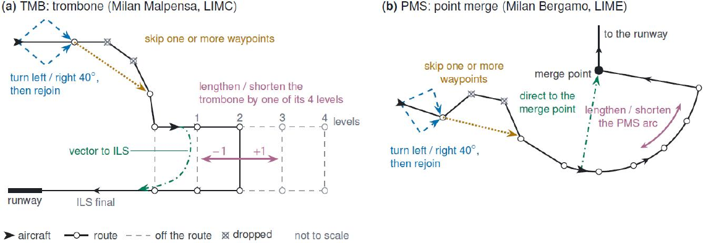
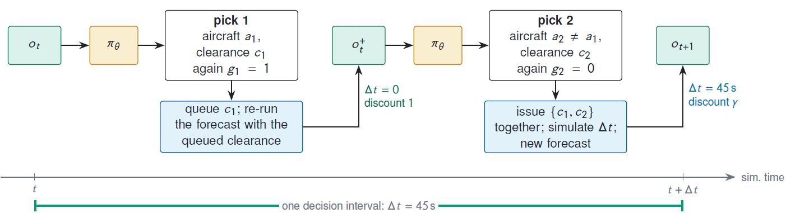

# Actions and reselection

!!! abstract "Summary"
    A decision is a pair, **(aircraft, clearance)**, drawn from a discrete set of 15 clearances.
    There are two sets, one per procedure: `v2` for the trombone and `v2pms` for point merge. They
    differ in the clearances that work on the delay-absorption structure. Masks remove every
    choice that cannot be flown before the policy samples. The policy picks the aircraft first,
    then a clearance for that aircraft, then decides whether to pick **again**. With
    **reselection** it can clear a second aircraft inside the same 45 s interval, after seeing the
    forecast effect of the first clearance.

Source: `single-agent/actions/` (`actions_v2.py`, `actions_v2pms.py`, `action_mask_v2.py`,
`action_mask_v2pms.py`, `action_set.py`), `single-agent/network/autoregressive_policy.py`,
`single-agent/atc_env/windowed_env.py`.

## What a decision is

The action is a triple of integers, `(aircraft, clearance, again)`:

- **aircraft**: one of the 10 [window slots](environments.md#windowed);
- **clearance**: one of 15 clearances, to be applied to the aircraft in that slot;
- **again**: 1 to request another pick before simulated time advances, 0 to execute now.

The action space is `MultiDiscrete([10, 15, 2])`. The third component exists when reselection is
enabled (`TADA_MAX_PICKS=2`), as it is for both published policies.

## The two clearance sets

Clearances depend on the procedure, so each published policy has its own set. Both sets have 15
entries and share the slot numbers, which keeps the network the same size for both procedures.

<figure class="tada-paper-fig" markdown>

<figcaption>Route-related clearances on (a) the trombone and (b) the point merge system. The
single-agent point merge set does not lengthen or shorten the arc: its flights start on the full
arc and leave it with a direct to the merge point.</figcaption>
</figure>

| # | clearance | effect | TMB (`v2`) | PMS (`v2pms`) |
|---|---|---|---|---|
| 0 | `DO_NOTHING` | no command; the aircraft keeps its speed and route | yes | yes |
| 1 | `SLOW_DOWN_SMALL` | target speed −10 kt | blocked by the airport mask | yes |
| 2 | `SLOW_DOWN_MEDIUM` | target speed −20 kt | yes | yes |
| 3 | `SLOW_DOWN_LARGE` | target speed −30 kt | yes | yes |
| 4 | `SPEED_UP_SMALL` | target speed +10 kt | yes | yes |
| 5 | `SPEED_UP_MEDIUM` | target speed +20 kt | blocked by the airport mask | yes |
| 6 | `TURN_LEFT_AND_RETURN_TO_ROUTE` | 40° left for 10 NM, then rejoin | yes | yes |
| 7 | `TURN_RIGHT_AND_RETURN_TO_ROUTE` | 40° right for 10 NM, then rejoin | yes | yes |
| 8 | `LENGTHEN_TROMBONE` | add one trombone level | yes | never legal |
| 9 | `SHORTEN_TROMBONE` | remove one added trombone level | yes | never legal |
| 10 | `SKIP_1_WAYPOINT` | drop the next waypoint | yes | yes |
| 11 | `SKIP_2_WAYPOINTS_NOT_NEXT` | keep the next waypoint, drop the 2 after it | yes | yes |
| 12 | `SKIP_3_WAYPOINTS_NOT_NEXT` | keep the next waypoint, drop the 3 after it | yes | yes |
| 13 | `SKIP_4_WAYPOINTS_NOT_NEXT` | keep the next waypoint, drop the 4 after it | yes | yes |
| 14 | `VECTOR_TO_ILS` (TMB) / `DIRECT_TO_MERGE_POINT` (PMS) | leave the structure for the final approach | vector to ILS | direct to merge point |

"Yes" means the clearance belongs to the set that the published policy uses. Whether it is legal
for a given aircraft at a given moment is decided by the [masks](#masking).

The two sets differ in three slots:

- **Slot 14** is `VECTOR_TO_ILS` on the trombone and `DIRECT_TO_MERGE_POINT` on point merge.
- **Slots 8 and 9** lengthen and shorten the trombone. They have no meaning on point merge and are
  never legal there. They keep their slots and names so that both sets have the same width.
- **The starting route differs.** A trombone flight starts on the short AMAN route and is delayed
  by lengthening the trombone. A point merge flight starts with its whole sequencing leg and is
  taken off it by the direct-to
  ([The problem](problem.md#the-short-aman-route-and-the-full-procedure)).

The speed, turn and skip clearances are the same code in both sets.

The set is chosen by the environment variable `TADA_ACTION_SET` (`v2` or `v2pms`, default `v2`),
which is read when the code is imported. A model records its set in `run_meta.json`, and loading
it under the other set stops with an error that names the variable to change. The design history
of the set, including an earlier one with 22 clearances, is in the
[Research notes](../notes/archive/clearance-sets.md).

### What each clearance does

**Do nothing.** No command is issued. The aircraft keeps its current speed and route. It is free:
only real clearances carry the [action cost](objective.md).

**Change speed.** The clearance moves the aircraft's target speed by −10, −20, −30, +10 or +20 kt.
There are three steps down and two up. A slow-down is legal when the new target stays at or above
the aircraft's minimum speed. A speed-up is legal when the new target stays at or below its
maximum speed and does not exceed the target speed of the next waypoint.

**Turn and rejoin.** The aircraft leaves its route on a heading 40° to the left or right of its
target heading, flies that heading for the time it takes to cover 10 NM, and then resumes the
route towards the same next waypoint. The clearance delays the aircraft and moves it sideways,
which makes it the tool for opening lateral spacing. A turn is legal when the leg is flyable: from
the end of the 10 NM leg, the turn back to the next waypoint is at most 90°, and the track change
at that waypoint is at most 95°. The direction convention of this test is selected by
`TADA_TURN_MASK_FIX`; a model's `run_meta.json` decides the setting when the model is loaded, and
the published policies use the default. The rejoin is a command scheduled for later, so a decision
step that issues a turn lasts until the rejoin plus the usual 45 s.

**Lengthen or shorten the trombone** (TMB). *Lengthen* adds one level to the downwind leg: one
waypoint outbound and its partner inbound. It can be repeated up to the trombone's four levels and
is legal while the aircraft has not passed the point where the next level begins. *Shorten* removes
the most recently added level and is legal while that level is still entirely ahead of the
aircraft. The two are exact inverses. Shortening cannot go below the short AMAN route.

**Skip waypoints.** `SKIP_1_WAYPOINT` drops the next waypoint, so the aircraft flies direct to the
one after it. The other three keep the next waypoint and drop the 2, 3 or 4 that follow it. A skip
is legal when at least four waypoints remain beyond the point where the route is rejoined and the
track change there is at most 95°. A skip shortens the route when the dropped waypoints formed a
detour.

**Vector to ILS** (TMB). The aircraft's route is replaced by its last four waypoints, which takes
it off the downwind leg and onto the final approach. It is legal once the aircraft is on the
trombone and has not yet started the leg back towards the airport, subject to the same 95° limit.

**Direct to merge point** (PMS). The aircraft leaves the sequencing arc and flies to the merge
point, then continues on the rest of its route. It is legal while the aircraft is on its
sequencing leg: it has passed the arc point where its leg begins, and only arc points lie between
it and the merge point.

Every route clearance (turn, skip, lengthen, shorten, vector to ILS, direct to merge point)
also requires more than four waypoints left in the route.

### The `procedure` airport mask { #airport-mask }

An optional mask can block clearances for a whole procedure. It is selected with
`TADA_AIRPORT_MASK` and defined in `AIRPORT_MASKS` in `single-agent/actions/action_set.py`. The
one mask defined there is called `procedure`.

For the trombone set it blocks two clearances at Malpensa:

- `SLOW_DOWN_SMALL` (−10 kt);
- `SPEED_UP_MEDIUM` (+20 kt).

The published TMB policy was trained and is evaluated with this mask, so its speed clearances are
−20 kt, −30 kt and +10 kt. The mask is combined with the legality mask below by a logical AND. If
that leaves an aircraft with no legal clearance, `DO_NOTHING` is made legal again.

The published PMS policy uses no airport mask (`AIRPORT_MASKS` also has a row for `v2pms`, which
that policy does not use). A model's mask is recorded in its `run_meta.json` together with the
clearance set, and loading the model under a different mask stops with an error.

## Masking

Masks decide what can be sampled. They serve two purposes: they keep commands that cannot be flown
out of the simulator, and they keep the learning algorithm from spending probability on choices
that the environment would reject or ignore. The masks are not an oracle. They test whether a
clearance can be executed, not whether it is a good idea.

The observation carries three masks:

| mask | shape | allows |
|---|---|---|
| `mask_action_per_ac` | 10 × 15 | the clearances that are legal for each slot |
| `mask_select` | 10 | the slots that may be picked at this pick |
| `mask_again` | 1 | whether another pick may be requested |

**Clearance mask.** A row starts from the rules in the previous section: aircraft speed limits,
waypoint constraints, route geometry and what is left of the delay-absorption structure. Four
further rules apply:

- A flight that the [forecast](environments.md#live-and-predicted) puts in a conflict within the
  next 2880 s cannot be left alone: `DO_NOTHING` is removed from its row.
- A [pending](environments.md#pending-flights) flight, which has not entered the terminal area,
  can only be given `DO_NOTHING`.
- A [released](environments.md#release) flight that is shown at the tail of a stream can only be
  given `DO_NOTHING`.
- A flight that was already cleared in this decision interval can only be given `DO_NOTHING` until
  the clock moves.

**Selection mask.** Only flights under control that have not yet been cleared in this decision
interval can be picked. If no flight in the window is under control, any occupied slot can be
picked, and its only legal clearance is `DO_NOTHING`.

**Again mask.** Another pick can be requested only if the pick budget is not used up (two picks per
interval) and another aircraft would still be available to clear.

The policy reads the masks from the observation and applies them to its logits before sampling,
and again when the learner evaluates the stored actions. A masked choice is never sampled.

## Sampling an action

An action is sampled in three stages. Each stage is conditioned on the stages before it, and each
is masked to what is legal at that point.

<figure class="tada-fig-wrap"><svg class="tada-dg" viewBox="0 0 760 300" role="img" aria-label="Sampling one action: aircraft, then clearance conditioned on it, then the again flag">
<defs>
  <marker id="aa" viewBox="0 0 8 8" refX="7" refY="4" markerWidth="7" markerHeight="7" orient="auto-start-reverse"><path class="arrowhead" d="M0,0 L8,4 L0,8 z"/></marker>
</defs>
<!-- stage 1 -->
<text class="h" x="16" y="22">1 · which aircraft</text>
<rect class="box head" x="10" y="32" width="230" height="182" rx="5"/>
<g>
  <!-- ten slot logits as bars; masked ones hollow -->
  <rect class="slot" x="24" y="120" width="16" height="40"/><rect class="slot" x="44" y="95" width="16" height="65"/>
  <rect class="slot off" x="64" y="150" width="16" height="10"/><rect class="slot" x="84" y="70" width="16" height="90"/>
  <rect class="slot" x="104" y="130" width="16" height="30"/><rect class="slot off" x="124" y="150" width="16" height="10"/>
  <rect class="slot off" x="144" y="150" width="16" height="10"/><rect class="slot" x="164" y="110" width="16" height="50"/>
  <rect class="slot off" x="184" y="150" width="16" height="10"/><rect class="slot off" x="204" y="150" width="16" height="10"/>
</g>
<text class="s" x="24" y="176">slots 1 … 10 (AMAN order)</text>
<text class="s" x="24" y="192">hollow = masked: pending / cleared</text>
<text class="t b c-head" x="84" y="62">a</text>

<!-- stage 2 -->
<text class="h" x="276" y="22">2 · which clearance, given a</text>
<rect class="box head" x="270" y="32" width="230" height="182" rx="5"/>
<g>
  <rect class="slot" x="282" y="100" width="11" height="60"/><rect class="slot" x="296" y="120" width="11" height="40"/>
  <rect class="slot" x="310" y="135" width="11" height="25"/><rect class="slot off" x="324" y="152" width="11" height="8"/>
  <rect class="slot" x="338" y="140" width="11" height="20"/><rect class="slot off" x="352" y="152" width="11" height="8"/>
  <rect class="slot" x="366" y="145" width="11" height="15"/><rect class="slot" x="380" y="148" width="11" height="12"/>
  <rect class="slot" x="394" y="70" width="11" height="90"/><rect class="slot off" x="408" y="152" width="11" height="8"/>
  <rect class="slot" x="422" y="138" width="11" height="22"/><rect class="slot off" x="436" y="152" width="11" height="8"/>
  <rect class="slot off" x="450" y="152" width="11" height="8"/><rect class="slot off" x="464" y="152" width="11" height="8"/>
  <rect class="slot" x="478" y="146" width="11" height="14"/>
</g>
<text class="s" x="282" y="176">15 clearances · row a of the head</text>
<text class="s" x="282" y="192">hollow = illegal for this aircraft</text>
<text class="t b c-head" x="390" y="62">c</text>
<text class="s" x="282" y="92">DO_NOTHING</text>

<!-- stage 3 -->
<text class="h" x="536" y="22">3 · ask again? (reselection)</text>
<rect class="box head" x="530" y="32" width="220" height="182" rx="5"/>
<rect class="slot" x="560" y="90" width="50" height="70"/><rect class="slot off" x="640" y="130" width="50" height="30"/>
<text class="s" x="560" y="176">again = 1 · again = 0</text>
<text class="s" x="544" y="192">Bernoulli at (a, c); 0 if no budget</text>
<text class="s" x="544" y="206">left or c = DO_NOTHING</text>

<path class="e" d="M240,117 H268" marker-end="url(#aa)"/>
<path class="e" d="M500,117 H528" marker-end="url(#aa)"/>

<!-- to env -->
<rect class="box env fill-env" x="10" y="232" width="740" height="52" rx="5"/>
<text class="t b" x="24" y="253">to the environment: (a, c, again)</text>
<text class="s" x="24" y="272">log π = log p(a) + log p(c | a) + log p(again | a, c) · entropy: exact, over the whole tree</text>
<path class="e" d="M640,214 V230" marker-end="url(#aa)"/>
</svg>
</figure>

1. **Which aircraft.** The aircraft head scores every slot. The selection mask is applied and one
   slot is sampled.
2. **Which clearance.** The clearance head scores the 15 clearances for the chosen aircraft. That
   aircraft's row of the clearance mask is applied and one clearance is sampled. Conditioning on
   the aircraft matters because two aircraft in similar states can have very different legal
   clearances.
3. **Again?** A binary flag is sampled, conditioned on the chosen aircraft and clearance. It is
   forced to 0 when the again mask is off or the clearance is `DO_NOTHING`.

The probability of the action is the product of the three stages:

```
π(a, c, g | o) = π_A(a | o) · π_C(c | a, o) · π_G(g | a, c, o)
```

In deterministic mode every stage takes its most likely choice instead of sampling. The network
that produces the scores is described on [Policy network](policy.md).

## Reselection { #reselection }

With one clearance per 45 s the agent cannot act on two flights that both need a clearance now.
Reselection lets it clear up to two aircraft in one decision interval, and lets the second choice
depend on the first.

<figure class="tada-paper-fig" markdown>

<figcaption>Reselection. The first pick is queued and the forecast is re-run with it; the second
pick is made on the new observation; both clearances are then issued together and the clock
advances 45 s.</figcaption>
</figure>

The steps inside one decision interval are:

1. From the observation `o`, the policy picks an aircraft and a clearance `(a1, c1)` and sets the
   again flag `g1`.
2. If `g1 = 0`, or `c1` is `DO_NOTHING`, the clearance is executed and the live world advances
   45 s. This is an ordinary one-pick step.
3. If `g1 = 1`, the clearance is **queued**. The live clock does not move. The no-operation
   rollout is recomputed with the queued clearance applied, and the policy receives a new
   observation `o+`. In it, aircraft `a1` is flagged as cleared in this interval, and all
   predictions include the effect of `c1`.
4. From `o+` the policy picks a second pair `(a2, c2)` with `a2 ≠ a1`. The again flag is now forced
   to 0, because the budget of two picks is spent.
5. Both clearances are executed together and the live world advances 45 s.

The environment never offers a second pick on its own: only the policy asks for one.

<figure class="tada-fig-wrap"><svg class="tada-dg" viewBox="0 0 760 330" role="img" aria-label="Reselection: two picks within one 45-second step">
<defs>
  <marker id="ra" viewBox="0 0 8 8" refX="7" refY="4" markerWidth="7" markerHeight="7" orient="auto-start-reverse"><path class="arrowhead" d="M0,0 L8,4 L0,8 z"/></marker>
</defs>
<!-- time axis -->
<line class="clock" x1="40" y1="290" x2="720" y2="290"/>
<text class="s" x="660" y="276">simulated time →</text>
<line class="e" x1="120" y1="282" x2="120" y2="298"/><text class="t b" x="108" y="318">t</text>
<line class="e" x1="640" y1="282" x2="640" y2="298"/><text class="t b" x="616" y="318">t + 45 s</text>
<text class="s" x="250" y="276">the clock does not move between pick 1 and pick 2</text>

<!-- pick 1 -->
<rect class="box head fill-head" x="30" y="30" width="200" height="96" rx="5"/>
<text class="h" x="42" y="48">pick 1 · observation o</text>
<text class="t" x="42" y="68">flight 4: SLOW_DOWN_MEDIUM</text>
<text class="t b c-head" x="42" y="88">again = 1</text>
<text class="s" x="42" y="106">clearance is queued, not flown</text>
<text class="s" x="42" y="119">reward −0.006 + Φ(o+) − Φ(o)</text>

<!-- re-predict -->
<rect class="box enc" x="270" y="30" width="200" height="96" rx="5"/>
<text class="h" x="282" y="48">re-predict</text>
<text class="t" x="282" y="68">no-operation rollout</text>
<text class="t" x="282" y="86">with the queued clearance</text>
<text class="s" x="282" y="106">o+: flight 4 now flagged</text>
<text class="s" x="282" y="119">"cleared in this interval"</text>

<!-- pick 2 -->
<rect class="box head fill-head" x="510" y="30" width="220" height="96" rx="5"/>
<text class="h" x="522" y="48">pick 2 · observation o+</text>
<text class="t" x="522" y="68">flight 6: LENGTHEN_TROMBONE</text>
<text class="t b c-head" x="522" y="88">again = 0 (budget spent)</text>
<text class="s" x="522" y="106">flight 4 is masked: it can only</text>
<text class="s" x="522" y="119">be left alone until the clock moves</text>

<path class="e" d="M230,78 H268" marker-end="url(#ra)"/>
<path class="e" d="M470,78 H508" marker-end="url(#ra)"/>

<!-- apply -->
<rect class="box env fill-env" x="270" y="166" width="460" height="74" rx="5"/>
<text class="h" x="282" y="184">apply and advance</text>
<text class="t" x="282" y="204">both clearances fly together; the simulator advances 45 s</text>
<text class="s" x="282" y="222">reward −0.006 + landing values − 100 · [conflict] + γΦ(o′) − Φ(o+)</text>
<path class="e" d="M620,126 V164" marker-end="url(#ra)"/>
<path class="e dash" d="M640,240 V280" marker-end="url(#ra)"/>

<!-- discounting note -->
<rect class="box muted" x="30" y="166" width="220" height="74" rx="5"/>
<text class="h" x="42" y="184">discounting</text>
<text class="s" x="42" y="202">pick 1 → pick 2: discount 1</text>
<text class="s" x="42" y="216">(no simulated time passes)</text>
<text class="s" x="42" y="232">pick 2 → next step: discount γ</text>
<path class="e dash" d="M120,126 V282" marker-end="url(#ra)"/>
</svg>
</figure>

In the diagram, flights 4 and 6 both need a clearance. The first pick asks for another: its
clearance is queued and the forecast is re-run with it, so the second pick already sees flight 4
slowed. The second pick ends the interval. The flight numbers and clearances are illustrative.

This design has two advantages over a joint action. It adds decision bandwidth without building a
combinatorial space of clearance pairs: the network still has one aircraft head and one clearance
head. And the second decision is conditional on the forecast effect of the first, where two
independently sampled clearances could work against each other.

### The zero-time transition

A queued pick is a transition of the decision process like any other: it has an observation, an
action, a reward and a next observation. It differs in that it consumes no simulated time. Two
consequences follow.

**Its discount is one.** In a semi-Markov decision process a transition that lasts a time τ is
discounted by γ<sup>τ</sup>. With τ = 0 the factor is exactly 1. Applying the ordinary per-step
discount γ would decay the reward artificially each time the policy asked for a second pick, and
would skew the critic's value estimates. Equivalently, the two picks can be seen as one temporally
extended action, an *option*: the policy picks `(a1, c1)`, optionally re-selects `(a2, c2)` after
the forecast, and the option ends when the 45 s step has been executed.

**Its reward contains no outcome.** Nothing moves, so nothing can land and no conflict can occur.
The reward of a queued pick is the action cost of its clearance (0.006) plus the change in the
shaping potential, `Φ(o+) − Φ(o)`, taken with discount 1. The ordinary transition that follows uses
`γ Φ(o′) − Φ(o+)` with γ = 0.998. Because the shaping uses the same per-transition discount as the
learner, it still sums to a difference of potentials over an episode
([Objective and reward](objective.md#reselection-discount)).

In the code, the environment marks a queued pick with `info["zero_time"] = True`, and the learner
in `single-agent/jax_ppo/ppo.py` discounts that transition by 1 in the advantage recursion and in
the bootstrap at truncation. `single-agent/tests/test_multi_pick.py` checks that the environment
with the again flag always 0 reproduces the one-pick environment exactly, that the masks hold at
every pick, and that the shaping telescopes under the per-transition discount.

Reselection is enabled with `TADA_MAX_PICKS=2`, read at import because it adds the again flag to
the action, the two masks to the observation, and one per-aircraft feature ("cleared in the
current decision interval", see [Observations](observations.md)). Its measured effect during
development is in the [Research notes](../notes/findings/reselection.md).
