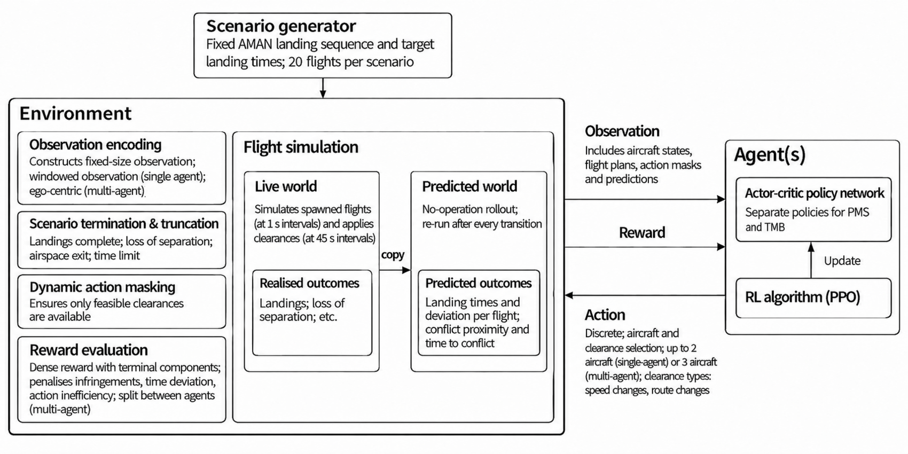
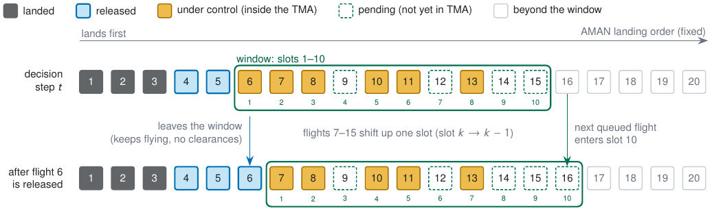

# Episodes and temporal windowing

!!! abstract "Summary"
    An episode is one stream of 20 arrivals to one airport. The policy does not see the whole
    stream: **temporal windowing** shows it the next 10 flights in the AMAN sequence, in 10 fixed
    slots. When a flight at the head of the queue lands or is released, the flights behind it move
    up and the next flight in the queue takes the last slot. Nothing the policy observes, and
    nothing its critic has to predict, depends on how long the stream is, so the same policy can be
    run on longer streams. The environment keeps two copies of the traffic: the **live world**,
    where clearances are executed, and the **predicted world**, a do-nothing forecast of it.

Source: `single-agent/atc_env/windowed_env.py` (class `WindowedATCEnv`),
`single-agent/config/windowed_config.py`, and the base class in
`single-agent/atc_env/single_agent_env.py`.

## One episode

An episode starts from a generated [scenario](problem.md#scenarios): 20 flights bound for one
airport, each with an AMAN target landing time. The flights enter the terminal area one after
another, the policy issues clearances, and the episode runs until every flight has landed or the
episode fails.

The policy acts once every 45 s of simulated time (`Config.TIME_BETWEEN_ACTIONS`). At each
decision it picks one aircraft and one clearance for it, and may ask for a second pick before the
clock moves ([reselection](actions.md#reselection)). The environment then applies the clearances,
advances the simulation, and returns a new observation and a reward.

<figure class="tada-paper-fig" markdown>

<figcaption>The reinforcement-learning loop. The environment simulates the live world, forecasts
it in the predicted world, and builds the observation, the masks and the reward from
both.</figcaption>
</figure>

## Live world and predicted world { #live-and-predicted }

The simulation runs at two levels.

The **live world** is the traffic as it actually develops. It is integrated in 1 s steps, and
clearances are applied to it at the 45 s decision points. Everything that counts as an outcome
is read from the live world: landings and their time deviations, conflicts, and aircraft leaving
the airspace.

The **predicted world** is a copy of the live world that is simulated forward with no further
clearances. This **no-operation rollout** shows what will happen if the policy does nothing from
now on. It is re-run after every transition, and it provides:

- the predicted landing time of every flight, and so its predicted time deviation;
- every predicted proximity event between two aircraft, with its time.

These predictions feed the [observation](observations.md), the shaping terms of the
[reward](objective.md), the release rule below and one of the [action masks](actions.md#masking).
The predicted world never ends an episode and never decides whether an episode is solved.

The rollout has a receding horizon. It covers 2880 s, or the time until the last flight in the
window is due if that is longer, plus a margin of 20 decision steps (900 s) for late flights, and
never more than 200 steps. Its length therefore depends on the window and not on the stream. Two
details of how landing times are read from it:

- the simulator reports a landing as mistimed only beyond a tolerance of 10 s, so a flight that the
  rollout lands within 10 s of its target is predicted exactly on target;
- a flight that the rollout does not land is placed at the rollout's end, meaning "at least that
  late".

During reselection the rollout is repeated with the queued clearance applied, so the second pick
sees the predicted effect of the first.

## The window { #windowed }

<figure class="tada-paper-fig" markdown>

<figcaption>Temporal windowing. The window holds the next 10 flights in AMAN order. When the flight
at its head leaves, the others shift up one slot and the next queued flight enters the last
slot.</figcaption>
</figure>

### Who is in the window

All flights that have not landed and have not been released form a queue, ordered by AMAN target
landing time. The window is the first 10 of them.

| | rule |
|---|---|
| membership | the next 10 flights in AMAN order that have neither landed nor been released, whether or not they have entered the terminal area |
| slots | slot 1 is the head of the queue; slot order is queue order |
| a flight lands or is released | it leaves the window; the flights behind it shift up one slot and the next flight in the queue enters the last slot |
| end of the stream | when fewer than 10 flights remain, the trailing slots are empty and masked |

The slot index carries no meaning beyond the order: the [policy network](policy.md) applies the
same encoders to every slot.

### Pending flights

A flight can hold a slot before it has spawned. Such a **pending** flight is not yet under control.
It is visible to the policy and contributes its schedule and its route, so the policy can plan
around it, but it cannot receive a clearance:

- its row of the clearance mask allows only `DO_NOTHING`;
- the aircraft-selection mask offers only flights under control whenever at least one exists.

The policy therefore acts only on flights that are both inside the window and under control.

### Release

A flight does not have to stay in the window until it touches down. Once its landing is settled it
is **released**: it leaves the window, receives no further clearances, and keeps flying to the
runway in the live world. This frees its slot for a flight that still needs attention.

Release works from the head of the queue. After each 45 s step the environment walks down the
queue and releases every flight that is *locked*, stopping at the first one that is not. A flight
is locked when all of the following hold:

- it is under control;
- the predicted world lands it within the rollout;
- its predicted landing is within 30 s of its AMAN target (`release_dev_s`);
- it is not part of any predicted proximity event.

A released flight is still part of the episode. The flights behind it continue to see it through
their landing-gap and conflict features, a conflict that involves it still ends the episode, and
its actual landing still counts towards whether the episode is solved. Its landing reward is paid
at release from the predicted deviation and corrected at touchdown if the outcome differs
([Objective and reward](objective.md)).

At the tail of a stream every airborne flight may already be released. The window then shows those
flights again, with only `DO_NOTHING` legal, so that there is always a slot to pick.

Release is switched on per environment (config key `release_locked`, with `release_dev_s` and
`pay_at_release`). Both published policies were trained with it, and the evaluation tools read
these keys from each model's `run_meta.json` so that a policy is always run in the environment it
was trained in.

### What the window hides

The price of a fixed window is explicit partial observability: a flight that is under control but
more than ten places behind the head of the queue is not represented. The environment counts the
decision steps on which this happens and reports the fraction in the episode metrics as
`window_overflow_frac`.

## Stream-stationary observables

The design rule of the windowed environment is that nothing the policy observes, and nothing its
critic has to predict, may depend on how many flights the stream has. A 20-flight scenario is
treated as a finite excerpt of an endless arrival stream. Five things follow from the rule:

- **The forecast** covers the window, not the scenario (the receding horizon above).
- **Time features** are relative. Each flight carries its scheduled time to its target, and the
  global time feature is the time until the last flight in the window is due. Absolute scenario
  time does not appear.
- **Counts and maxima** are taken over the window. The global count is the number of window
  flights under control, not the number of occupied slots, which would only fall as the stream
  ran out. The global conflict feature is the maximum over the flights in the window.
- **The reward** is paid per flight, once, and the penalty for a conflict is a constant. Neither
  scales with the number of flights left.
- **The end of the stream is not a terminal state** (next section).

The observation features themselves are described on
[Observations](observations.md#windowed).

## Termination and truncation

| event in the live world | signal | `end_reason` |
|---|---|---|
| a conflict: two aircraft within 3 NM and 500 ft | terminated | `separation` |
| an aircraft leaves the airspace | terminated | `airspace_exit` |
| every flight has landed | truncated | `success` if every flight is within 60 s of its target, otherwise `delayed` |
| the step limit is reached | truncated | `timeout` |

A conflict or an airspace exit is a true termination. The episode stops at once and the reward
carries a fixed penalty. Only realised events count: a *predicted* conflict never terminates an
episode ([Separation rules](separation.md)).

The stream running dry is reported as a **truncation**, not a termination. In a continuing stream
more flights would follow, and the critic sees only the window, not how many flights remain. PPO
therefore bootstraps from the critic's value at that point instead of treating it as an absorbing
end. An episode with `end_reason = "success"` is a solved episode.

The step limit is sized per scenario: the number of 45 s steps to the last target landing time,
plus 6, and at least 48. Training caps it at 200 steps per 20-flight segment. The evaluation
scripts lift the cap, so every stream runs to its own horizon.

A zero-time reselection pick cannot end an episode, because nothing moves.

## The scenario for each procedure

One environment class serves both procedures. The procedure is a property of the scenario, chosen
by the **use case**:

| | TMB | PMS |
|---|---|---|
| airport, procedure | Milan Malpensa, trombone | Milan Bergamo, point merge |
| use case | 1 (`MissionDifficulty.VALIDATION_USE_CASE_1`, the default) | 2 (`MissionDifficulty.VALIDATION_USE_CASE_2`) |
| generator settings | `single-agent/config/simulation_config_mxp/` | `single-agent/config/simulation_config_bgy/` |
| clearance set (`TADA_ACTION_SET`) | `v2` | `v2pms` |
| routes at the start of an episode | cut to the short AMAN route; trombone levels stored for *lengthen* | the whole sequencing leg kept; shortened by *direct to merge point* |

The use case is selected in three places:

- the environment config key `use_case` (1 or 2), recorded in the model's `run_meta.json`;
- `python main_jax.py --use-case 1|2` when training;
- `python -m evaluation.run_search --procedure tmb|pms`, or `--use-case` on
  `analysis.score_windowed`, when evaluating.

With `TADA_GENERATOR=procedure` (the default) the scenario generator reads the settings directory
that belongs to the use case, and the first scenario that a seed draws is used: there is no
rejection filter.
The clearance set has to match the procedure: `v2pms` refuses a route without a merge point, and
loading a model under a clearance set other than the one in its `run_meta.json` stops with an
error. The clearance sets are described on [Actions and reselection](actions.md).

## Longer and stitched streams { #stitching }

Because of the design rule above, stream length is only a setting of the environment
(`scenario_aircraft_count`). Training uses this for its curriculum, which starts on 10-flight
streams and then moves to 20 ([Train a policy](../code/train.md)). The published policies were
evaluated on single 20-flight streams. The public code also supports two kinds of longer stream.

**A longer generated stream.** `--flights 40` on `analysis.score_windowed` generates 40 flights in
one sequence.

**A stitched stream.** A stream is built from several independently generated 20-flight segments
(`Simulator._stitched_scenario` in `single-agent/simulator/simulator.py`):

- the first target landing of each further segment comes a random cooling gap after the last
  target landing of the previous one, drawn uniformly from 120 to 900 s by default;
- the spawn times and targets of a segment shift together, so its internal spacing is untouched;
- callsigns and stored trombone sections are renumbered to continue the queue.

For a fixed seed the segments and the gaps are deterministic. With stitching, the step limit grows
with the number of segments, and the cost of a clearance is divided by it, so that the priority
order of the objectives is kept on the longer stream.

| | option |
|---|---|
| training | `python main_jax.py --stitch-segments 2 --stitch-gap 120 900` |
| scoring | `python -m analysis.score_windowed --segments 2 --gap 120 900` |
| rendering | `python render_policy.py --env windowed --segments 2` |

`analysis/long_stream_seeds.py` screens seeds for stitched streams that are feasible: by default,
streams in which no flight is predicted to land more than 650 s early when no clearance is given.
The experiments with long streams during development are in the
[Research notes](../notes/findings/long-streams.md).

## Configuration

Defaults from `single-agent/config/windowed_config.py` (`WindowedConfig`) and
`single-agent/config/config.py` (`Config`):

| setting | value | meaning |
|---|---|---|
| `SCENARIO_AIRCRAFT_COUNT` | 20 | flights per scenario |
| `WINDOW_SIZE` | 10 | slots; equal to `Config.N_AIRCRAFT_MAX` |
| `Config.TIME_BETWEEN_ACTIONS` | 45 s | decision interval |
| `DIFFICULTY` | `VALIDATION_USE_CASE_1` | default scenario: the Malpensa trombone |
| `WINDOW_UNDER_CONTROL_ONLY` | `False` | pending flights hold their place in the window |
| `PENDING_ACTIONABLE` | `False` | pending flights can only be left alone |
| `ROLLOUT_LOOKAHEAD_S` | 2880 s | minimum span of the forecast |
| `ROLLOUT_MARGIN_STEPS` | 20 | margin added to the forecast (900 s) |
| `ROLLOUT_MAX_STEPS` | 200 | upper bound on the forecast |
| `TIME_SCALE_S` | 7200 s | scale of the window's time features |
| `MAX_EPISODE_STEPS` | 200 | training cap on episode length, per segment |
| `MIN_EPISODE_STEPS` / `HORIZON_STEP_MARGIN` | 48 / 6 | floor and margin of the step limit |
| `CONTINUING_TASK` | `True` | the end of the stream is a truncation |
| `STITCH_SEGMENTS` / `STITCH_GAP_S` | 1 / (120, 900) s | no stitching by default |

Settings that the published policies change, recorded under `windowed_config` in
`artifacts/single_agent/mxp/run_meta.json` and `artifacts/single_agent/pms/run_meta.json`:

| key | value | described in |
|---|---|---|
| `scenario_aircraft_count` | 20 | this page |
| `stitch_segments` | 1 | [stitched streams](#stitching) |
| `use_case` | 2 for the PMS policy; absent (use case 1) for the TMB policy | [the scenario for each procedure](#the-scenario-for-each-procedure) |
| `release_locked`, `release_dev_s`, `pay_at_release` | `true`, 30.0, `true` | [release](#release) |
| `reward_mode`, `landing_brackets`, `pbrs_flat_deviation` | `outcome_pbrs`, a ladder with a 30 s top bracket, `true` | [Objective and reward](objective.md) |

Both also record `max_picks: 2` (reselection) and `sequence_obs: true` (the AMAN-sequence
features in the observation). These two are read from environment variables when the code is
imported, `TADA_MAX_PICKS` and `TADA_SEQUENCE_OBS`, because they size the observation and action
spaces. The commands that set them are on [Evaluate the published models](../code/evaluate.md).
