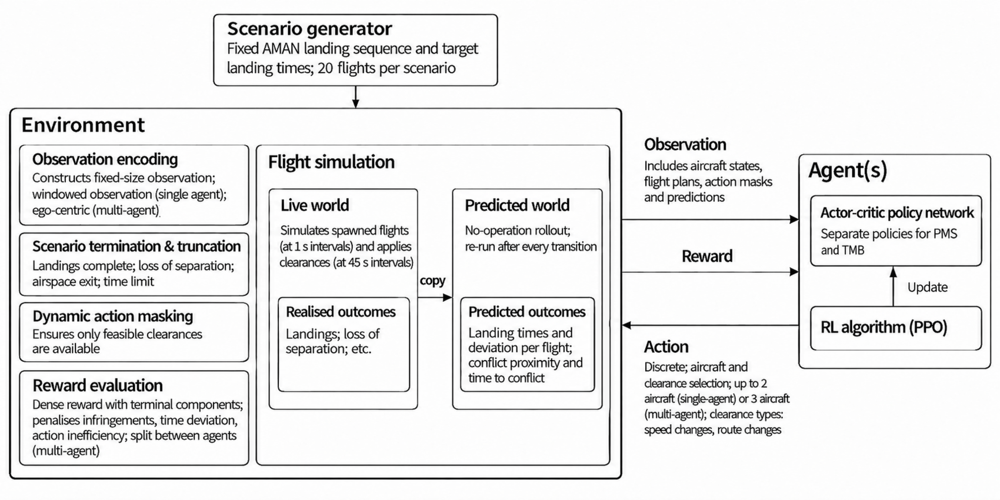
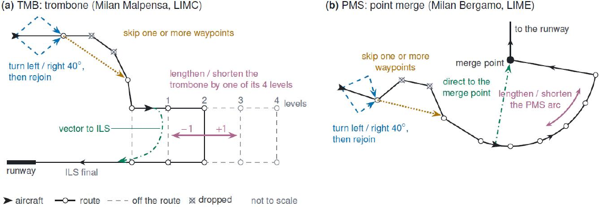

# How it works

!!! abstract "Summary"
    Both approaches use the same framework: a deterministic flight simulator wrapped in an environment that
    encodes observations, masks infeasible clearances, evaluates the reward and ends the episode. A
    decision is taken every 45 s. Policies are actor-critic networks trained with PPO, one per procedure.
    The approaches differ in their view of the airspace: the single agent sees a window of ten flights and
    chooses both the aircraft and its clearance; in the multi-agent approach every aircraft is an agent of
    one shared policy and a rule chooses which aircraft act.

<figure class="tada-paper-fig" markdown>

<figcaption>The framework shared by both approaches. The predicted world is a copy of the live world that is rolled forward without new clearances after every transition.</figcaption>
</figure>

## One framework, two views of the airspace

| | Single-agent | Multi-agent |
|---|---|---|
| Agent | one, for the whole airspace | one per aircraft, sharing one policy |
| Observation | a window of the next 10 flights in the AMAN sequence, in one aircraft tensor, with action history | ego-centric: one aircraft, its route and its five most relevant neighbours |
| Who acts | the policy picks the aircraft, then its clearance | a rule picks the aircraft; the policy picks the clearance |
| Clearances per 45 s | up to 2 ([reselection](actions.md#reselection)) | up to 3, one per sector group |
| Policy network | larger, sees more flights; simpler credit assignment | compact, recurrent; generalises across callsigns, routes and traffic density |
| Implementation | JAX PPO, policies loadable with Stable-Baselines3 | Ray RLlib and PyTorch |

Separate policies are trained for Milan Malpensa (LIMC, trombone, **TMB**) and Milan Bergamo (LIME, point
merge, **PMS**). Proximal Policy Optimisation (PPO) with an actor-critic network was chosen for its stable
updates, its robustness in high-dimensional state spaces and its fit with discrete action spaces.

## Live world and predicted world

The simulator runs at two levels. The **live world** flies the spawned aircraft and applies clearances.
The **predicted world** is a copy of it that is rolled forward with no further clearances (the
*no-operation rollout*, or do-nothing forecast). It tells the environment what would happen if the agent
stopped acting now: each flight's predicted landing time and deviation, and every predicted infringement
with its severity and its time. Observations and rewards are built from that forecast, so the agent is
shown, and paid for, the consequences of its clearances rather than the current positions alone.

## Decisions and clearances

The environment is acted on once every 45 s, which reflects how often a controller can issue clearances.
A decision selects one or more aircraft and then a clearance for each. Choosing the clearance *given* the
aircraft matters because the feasible clearances differ a great deal between two aircraft in the same
situation, and it avoids spending probability on aircraft-clearance combinations that cannot be executed.

On the trombone the clearance types are:

- **Do nothing.** No command; the aircraft keeps its speed and route.
- **Change speed.** Indicated airspeed up or down in multiples of 10 kt: the main control for timing and
  gentle spacing.
- **Turn and rejoin.** Steer 40° off course, fly a fixed distance, then rejoin the route further
  downstream. It delays the aircraft and creates lateral spacing.
- **Extend or retract the trombone.** Lengthen or shorten the downwind leg by one segment.
- **Skip waypoints.** Cut one or more upcoming waypoints, where that is a shortcut within the planned route.
- **Vector to ILS.** Intercept the ILS and join the final approach.

On the point merge, *extend or retract trombone* becomes *extend or retract the PMS arc* (multi-agent
only) and *vector to ILS* becomes *direct to merge point*: the aircraft leaves the sequencing leg and flies
straight to the merge point.

<figure class="tada-paper-fig" markdown>

<figcaption>Route-related clearances on (a) the trombone and (b) the point merge.</figcaption>
</figure>

The exact single-agent action sets are on [Actions and reselection](actions.md); the multi-agent set is on
[Multi-agent approach](multi-agent.md).

## Action masking

At every decision the environment computes which clearances are legal for each aircraft, from aircraft
limits, waypoint constraints, route geometry and waypoint availability. Masking is not an oracle: it
removes commands that are physically or procedurally invalid, not commands that turn out badly. For
example, a speed change is offered only if it respects the speed restrictions, a waypoint can be skipped
only if the route still has it, and in the multi-agent solution an aircraft on the PMS arc cannot be
vectored. Illegal actions are given a vanishing probability, so they are never sampled and PPO never
learns from probability mass placed on choices the environment would have rejected.

## Reward priorities

Both approaches use a dense, shaped reward with the same order of priorities:

1. **Safety.** The dominant term penalises predicted infringements, weighted by their geometry and by how
   soon they are predicted, and a realised loss of separation ends the episode.
2. **Landing precision.** Reducing the predicted absolute time deviation is rewarded, per aircraft and
   over the whole set.
3. **Action efficiency.** Every active clearance costs a small penalty. In the multi-agent solution the
   cost depends on the type of clearance.

The single-agent reward is on [Objective and reward](objective.md).

## Episodes

An episode ends when all aircraft have landed, when a conflict occurs, when an aircraft leaves the
airspace, or when the step limit is reached. Details for the single agent are on
[Episodes and windowing](environments.md).

## At inference: policy alone or with rollout search

A trained policy can be used on its own, deterministically or by sampling, or as the proposal
distribution of a [rollout search](search.md): a policy-guided form of model predictive control that
compares several full continuations of the episode in the simulator and executes the start of the best one.
