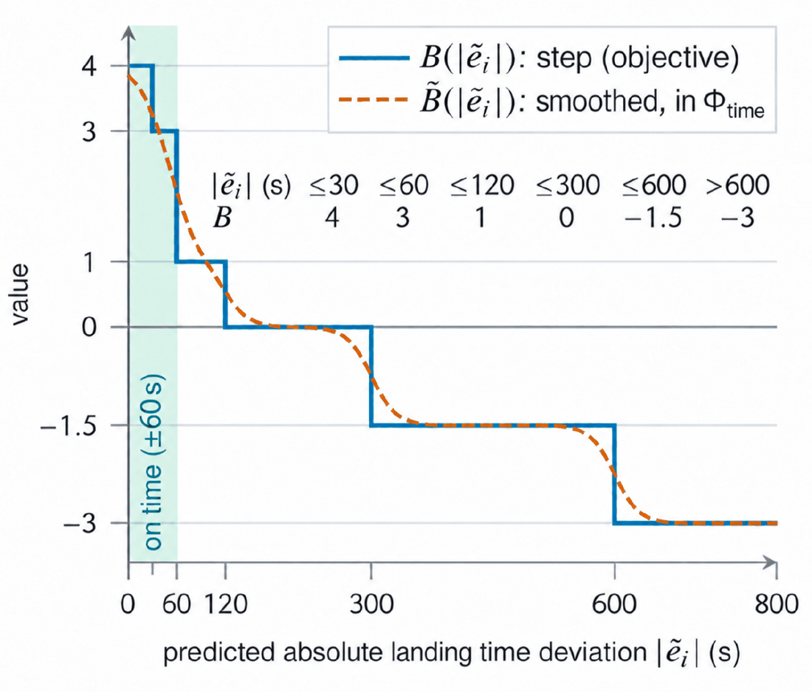

# Objective and reward

!!! abstract "Summary"
    The reward states the objective directly, in order of priority: no loss of separation, each
    flight in the best achievable landing-time bracket, and as few clearances as possible. A flight
    earns a bracket value between 4 (within 30 s of its AMAN target landing time) and −3 (more than
    600 s off). Every clearance other than *do nothing* costs 0.006. A realised loss of separation
    costs 100 and ends the episode. The sizes are chosen so that a lower priority can never pay for
    a higher one. A fourth term, potential-based shaping computed from the no-operation rollout,
    gives a learning signal at every step without changing which policy is optimal. A zero-time
    reselection transition is discounted by 1, an ordinary 45 s transition by γ = 0.998.

Source: `single-agent/atc_env/windowed_env.py` (reward mode `outcome_pbrs`: `landing_value`,
`landing_value_smooth`, `_potential`, `step`, `_queue_pick`), `single-agent/config/windowed_config.py`
and `single-agent/config/config.py` (constants), `single-agent/actions/rewards.py`
(`infringement_reward_from_world`), `single-agent/jax_ppo/ppo.py` (per-transition discount).

## The step reward

```
r = Σ B(|e_i|)      over the flights that land in the decision interval
    − 0.006 · m     m = 1 for a real clearance, 0 for do nothing
    − 100 · α       α = 1 on a realised loss of separation
    + F             F = δ · Φ(s') − Φ(s), potential-based shaping
```

| Term | Purpose | Value |
|---|---|---|
| Landing-time performance | score each flight once, by the bracket of its realised time deviation | `B` from +4 to −3 |
| Action efficiency | reach a timing outcome with fewer interventions | −0.006 per real clearance |
| Safety | make an unsafe outcome worse than any timing outcome | −100, terminal |
| Intermediate learning signal | reward a change in the predicted outcome | `F`, sums to a constant along an episode |

`e_i` is the time deviation of flight `i`: the difference between its AMAN target landing time
and its actual landing time. Only its absolute value enters the reward.

## Landing bracket

| Absolute time deviation | ≤ 30 s | ≤ 60 s | ≤ 120 s | ≤ 300 s | ≤ 600 s | > 600 s |
|---|---|---|---|---|---|---|
| `B` | 4 | 3 | 1 | 0 | −1.5 | −3 |

`B` is a step function (`landing_value`): where a flight lands inside a bracket does not change
its score. The score measures the realised outcome and each flight earns it exactly once.

<figure class="tada-paper-fig" markdown>

<figcaption>The bracket value B (step function, the objective) and its smoothed version B̃ used
inside the shaping potential, against the absolute landing-time deviation. The shaded band marks
landings within 60 s of the target.</figcaption>
</figure>

**Payment at release.** In the published configuration a flight at the head of the queue is
released from the window once it is under control and the forecast shows it landing within 30 s of
its target, clear of any predicted separation event
([Episodes and windowing](environments.md#windowed)). Its bracket value is
paid at that moment, from the predicted deviation, and the flight leaves the time potential
below. Release requires a predicted deviation within 30 s, so the amount paid is the top value, 4.
At touchdown only the difference between the realised bracket and the amount already paid is
added, so every flight still earns exactly `B` of its realised deviation. If the episode ends in
a loss of separation before a released flight has landed, its payment is taken back.

## Action cost

Every clearance other than *do nothing* costs β = 0.006 (`WindowedConfig.CLEARANCE_COST`). The
cost is a count: it does not depend on the type of clearance or on when it is issued. A clearance
queued by reselection is charged when it is queued.

## Loss-of-separation penalty

A realised loss of separation, two aircraft closer than 3 NM and 500 ft in the live world
([Separation rules](separation.md)), ends the episode with a penalty of 100. An aircraft leaving
the airspace is treated in the same way. The value follows from the bracket ladder:

```
penalty = 30 + (4 − (−3)) × 10 = 100
```

that is, a base of 30 (`Config.REWARD_VIOLATION_PENALTY`) plus the difference between the best
and the worst bracket for all ten flights of the window. The penalty is a constant: it does not
depend on how many flights or steps remain in the stream, which the policy cannot observe.

## Why the order is strict

<figure class="tada-fig-wrap"><svg class="tada-dg" viewBox="0 0 760 250" role="img" aria-label="The magnitudes of the reward terms on a logarithmic axis">
<text class="h" x="14" y="20">reward magnitudes · logarithmic scale</text>
<line class="e" x1="60" y1="206" x2="700" y2="206"/>
<g>
  <line class="e" x1="60" y1="202" x2="60" y2="210"/><text class="s" x="48" y="224">0.001</text>
  <line class="e" x1="188" y1="202" x2="188" y2="210"/><text class="s" x="180" y="224">0.01</text>
  <line class="e" x1="316" y1="202" x2="316" y2="210"/><text class="s" x="310" y="224">0.1</text>
  <line class="e" x1="444" y1="202" x2="444" y2="210"/><text class="s" x="441" y="224">1</text>
  <line class="e" x1="572" y1="202" x2="572" y2="210"/><text class="s" x="566" y="224">10</text>
  <line class="e" x1="700" y1="202" x2="700" y2="210"/><text class="s" x="690" y="224">100</text>
</g>
<rect class="box in fill-in" x="60" y="40" width="96" height="18" rx="2"/><text class="t" x="164" y="54">action cost: one real clearance, 0.006</text>
<rect class="box in fill-in" x="60" y="66" width="382" height="18" rx="2"/><text class="t" x="450" y="80">one clearance at each of 160 steps: 0.96</text>
<rect class="box enc fill-enc" x="60" y="100" width="384" height="18" rx="2"/><text class="t" x="452" y="114">smallest step between two brackets: 1</text>
<rect class="box enc fill-enc" x="60" y="126" width="492" height="18" rx="2"/><text class="t" x="560" y="140">one flight, best to worst: 7</text>
<rect class="box head fill-head" x="60" y="160" width="640" height="18" rx="2"/><text class="t b" x="60" y="194">a loss of separation: 100 = 30 + a whole window of 10 flights × 7 (70)</text>
<line class="e dash" x1="444" y1="32" x2="444" y2="186"/>
</svg>
</figure>

- **Clearances cannot buy a worse bracket.** The action cost is sized for one clearance per 45 s
  interval over a 20-flight stream of about 160 intervals: 160 × 0.006 = 0.96, less than the
  smallest step between two brackets (1). Between two outcomes with the same brackets, the one
  with fewer clearances always scores higher. With reselection up to two clearances can be issued
  per interval, so this bound is not guaranteed by construction; it holds for any episode with
  fewer than 167 clearances.
- **Brackets cannot buy a loss of separation.** The penalty of 100 exceeds the largest aggregate
  improvement in bracket value available to the ten flights of the visible window (10 × 7 = 70).

## Shaping { #shaping }

The bracket values arrive only when flights land, and the penalty only when it is too late. The
shaping term provides the intermediate signal:

```
F = δ · Φ(s') − Φ(s)
```

`Φ` is a potential computed from the predicted world, the same no-operation rollout that the
[observation](observations.md) is built from. `Φ(s)` therefore measures the quality of the
forecast if nothing more is done, and `F` rewards an action when it improves that forecast and
penalises it when the forecast worsens. For example, slowing a flight that was heading for a 150 s
miss so that it is now predicted on time pays the difference between the two forecasts at once.

Because `F` has the potential-based form, its discounted sum along an episode depends only on the
first and last state, not on the actions in between, so it cannot change which policy is optimal
(Ng, Harada and Russell, 1999). After a loss of separation `Φ(s')` is 0.

The potential has four components:

```
Φ(s) = Φ_time(s) + Φ_sep(s) + Φ_seq(s) + Φ_gap(s)
```

| Component | Definition | Constants |
|---|---|---|
| `Φ_time`, predicted landing accuracy | `+ Σ w_i · B̃(d_i)` over the flights not yet landed whose landing the forecast resolves; `d_i` is the absolute predicted time deviation | smoothing width 15 s |
| `Φ_sep`, separation | `− 10 · Σ q_ij · max(0.005, 2^(−TTI_ij / 240 s))` over the aircraft pairs with a predicted infringement and at least one aircraft in the window | weight 10, half-life 240 s, floor 0.005 |
| `Φ_seq`, AMAN order | `− Σ w` over the pairs of flights, neither yet landed, that are predicted to land in the reverse of their AMAN order; `w` is taken at the earlier predicted landing | 1 per inversion |
| `Φ_gap`, landing gap | `− Σ w_j · max(0, 90 s − gap_ij) / 60 s` over consecutive flights `(i, j)` of the AMAN sequence with `j` not yet landed; `gap_ij = max(0, t̃_j − t̃_i)` | 90 s minimum gap, 1 per minute |

`t̃_i` is the predicted landing time of flight `i` and `t` the current time. For a flight that
has already landed the actual landing time is used.

### Proximity weight

```
w(t̃) = clip(1 − (t̃ − t) / 2880 s, 0, 1)
```

The weight rises linearly from 0, for a landing predicted 2880 s or more ahead, to 1 at touchdown
(`WindowedConfig.DEVIATION_RAMP_S`). A predicted reversal or a compressed gap counts more the
closer it is to happening.

In `Φ_time` the published policies use `w_i = 1` for every flight whose landing the forecast
resolves (setting `pbrs_flat_deviation`), so a correction made early is credited as soon as it
changes the forecast. Without that setting `Φ_time` uses the proximity weight as well. A flight
whose bracket has been paid at release is no longer part of `Φ_time`.

### Smoothed bracket

Inside `Φ_time` each step of `B` is replaced by a sigmoid of width 15 s
(`landing_value_smooth`, `WindowedConfig.LANDING_SMOOTH_KAPPA_S`), so that the potential still
changes when a predicted deviation moves within a bracket:

```
B̃(d) = −3 + ω((30 − d)/15) + 2·ω((60 − d)/15) + ω((120 − d)/15)
          + 1.5·ω((300 − d)/15) + 1.5·ω((600 − d)/15),      ω(x) = 1 / (1 + e^(−x))
```

with `d` in seconds. `B̃` is the dashed curve in the figure above. It appears only in the
potential; the objective itself uses the step function.

### Separation potential

For each aircraft pair, the earliest predicted infringement at time `τ_ij` defines the
time to infringement `TTI_ij = τ_ij − t` and the severity

```
q_ij = ( min( clip((5 NM − d_H) / 2 NM, 0, 1), clip((1000 ft − d_V) / 500 ft, 0, 1) ) )²
```

from the horizontal and vertical separation at that time. The severity is 0 at or beyond the
infringement boundary (5 NM, 1000 ft) and 1 at the conflict boundary (3 NM, 500 ft); see
[Separation rules](separation.md#severity). The factor `2^(−TTI/240 s)` halves the weight of a
predicted infringement for every four minutes of warning, with a floor of 0.005
(`Config.CONFLICT_HALF_LIFE_S`, `Config.CONFLICT_FAR_FLOOR`).

The contribution of one aircraft pair at the same altitude, by how close the pair is predicted to
come and how soon. A conflict predicted two minutes ahead contributes about −7 and an imminent one
−10, more than the whole bracket range of one flight (7). Resolving it returns that amount at
once:

<figure class="tada-fig-wrap"><svg class="tada-fig tada-heat" viewBox="0 0 640 300" role="img" aria-label="predicted horizontal separation at closest approach (NM), same altitude by time to the predicted conflict (s)"><rect class="cell neg" x="58.0" y="252.0" width="216.9" height="4.3" fill-opacity="1.000"><title>time to the predicted conflict (s) 0, predicted horizontal separation at closest approach (NM), same altitude 0–3: -10</title></rect><rect class="cell neg" x="274.6" y="252.0" width="7.3" height="4.3" fill-opacity="0.875"><title>time to the predicted conflict (s) 0, predicted horizontal separation at closest approach (NM), same altitude 3.1: -9.03</title></rect><rect class="cell neg" x="281.5" y="252.0" width="7.3" height="4.3" fill-opacity="0.812"><title>time to the predicted conflict (s) 0, predicted horizontal separation at closest approach (NM), same altitude 3.2: -8.1</title></rect><rect class="cell neg" x="288.5" y="252.0" width="7.3" height="4.3" fill-opacity="0.750"><title>time to the predicted conflict (s) 0, predicted horizontal separation at closest approach (NM), same altitude 3.3: -7.22</title></rect><rect class="cell neg" x="295.5" y="252.0" width="7.3" height="4.3" fill-opacity="0.625"><title>time to the predicted conflict (s) 0, predicted horizontal separation at closest approach (NM), same altitude 3.4: -6.4</title></rect><rect class="cell neg" x="302.5" y="252.0" width="7.3" height="4.3" fill-opacity="0.562"><title>time to the predicted conflict (s) 0, predicted horizontal separation at closest approach (NM), same altitude 3.5: -5.62</title></rect><rect class="cell neg" x="309.5" y="252.0" width="7.3" height="4.3" fill-opacity="0.500"><title>time to the predicted conflict (s) 0, predicted horizontal separation at closest approach (NM), same altitude 3.6: -4.9</title></rect><rect class="cell neg" x="316.5" y="252.0" width="7.3" height="4.3" fill-opacity="0.438"><title>time to the predicted conflict (s) 0, predicted horizontal separation at closest approach (NM), same altitude 3.7: -4.22</title></rect><rect class="cell neg" x="323.5" y="252.0" width="7.3" height="4.3" fill-opacity="0.375"><title>time to the predicted conflict (s) 0, predicted horizontal separation at closest approach (NM), same altitude 3.8: -3.6</title></rect><rect class="cell neg" x="330.5" y="252.0" width="7.3" height="4.3" fill-opacity="0.312"><title>time to the predicted conflict (s) 0, predicted horizontal separation at closest approach (NM), same altitude 3.9: -3.02</title></rect><rect class="cell neg" x="337.4" y="252.0" width="7.3" height="4.3" fill-opacity="0.250"><title>time to the predicted conflict (s) 0, predicted horizontal separation at closest approach (NM), same altitude 4: -2.5</title></rect><rect class="cell neg" x="344.4" y="252.0" width="14.3" height="4.3" fill-opacity="0.188"><title>time to the predicted conflict (s) 0, predicted horizontal separation at closest approach (NM), same altitude 4.1–4.2: -2.02 to -1.6</title></rect><rect class="cell neg" x="358.4" y="252.0" width="7.3" height="4.3" fill-opacity="0.125"><title>time to the predicted conflict (s) 0, predicted horizontal separation at closest approach (NM), same altitude 4.3: -1.23</title></rect><rect class="cell neg" x="365.4" y="252.0" width="42.2" height="4.3" fill-opacity="0.062"><title>time to the predicted conflict (s) 0, predicted horizontal separation at closest approach (NM), same altitude 4.4–4.9: -0.9 to -0.025</title></rect><rect class="cell neg" x="58.0" y="248.1" width="216.9" height="4.3" fill-opacity="0.938"><title>time to the predicted conflict (s) 30, predicted horizontal separation at closest approach (NM), same altitude 0–3: -9.17</title></rect><rect class="cell neg" x="274.6" y="248.1" width="7.3" height="4.3" fill-opacity="0.812"><title>time to the predicted conflict (s) 30, predicted horizontal separation at closest approach (NM), same altitude 3.1: -8.28</title></rect><rect class="cell neg" x="281.5" y="248.1" width="7.3" height="4.3" fill-opacity="0.750"><title>time to the predicted conflict (s) 30, predicted horizontal separation at closest approach (NM), same altitude 3.2: -7.43</title></rect><rect class="cell neg" x="288.5" y="248.1" width="7.3" height="4.3" fill-opacity="0.688"><title>time to the predicted conflict (s) 30, predicted horizontal separation at closest approach (NM), same altitude 3.3: -6.63</title></rect><rect class="cell neg" x="295.5" y="248.1" width="7.3" height="4.3" fill-opacity="0.562"><title>time to the predicted conflict (s) 30, predicted horizontal separation at closest approach (NM), same altitude 3.4: -5.87</title></rect><rect class="cell neg" x="302.5" y="248.1" width="7.3" height="4.3" fill-opacity="0.500"><title>time to the predicted conflict (s) 30, predicted horizontal separation at closest approach (NM), same altitude 3.5: -5.16</title></rect><rect class="cell neg" x="309.5" y="248.1" width="7.3" height="4.3" fill-opacity="0.438"><title>time to the predicted conflict (s) 30, predicted horizontal separation at closest approach (NM), same altitude 3.6: -4.49</title></rect><rect class="cell neg" x="316.5" y="248.1" width="7.3" height="4.3" fill-opacity="0.375"><title>time to the predicted conflict (s) 30, predicted horizontal separation at closest approach (NM), same altitude 3.7: -3.87</title></rect><rect class="cell neg" x="323.5" y="248.1" width="7.3" height="4.3" fill-opacity="0.312"><title>time to the predicted conflict (s) 30, predicted horizontal separation at closest approach (NM), same altitude 3.8: -3.3</title></rect><rect class="cell neg" x="330.5" y="248.1" width="14.3" height="4.3" fill-opacity="0.250"><title>time to the predicted conflict (s) 30, predicted horizontal separation at closest approach (NM), same altitude 3.9–4: -2.77 to -2.29</title></rect><rect class="cell neg" x="344.4" y="248.1" width="7.3" height="4.3" fill-opacity="0.188"><title>time to the predicted conflict (s) 30, predicted horizontal separation at closest approach (NM), same altitude 4.1: -1.86</title></rect><rect class="cell neg" x="351.4" y="248.1" width="14.3" height="4.3" fill-opacity="0.125"><title>time to the predicted conflict (s) 30, predicted horizontal separation at closest approach (NM), same altitude 4.2–4.3: -1.47 to -1.12</title></rect><rect class="cell neg" x="365.4" y="248.1" width="42.2" height="4.3" fill-opacity="0.062"><title>time to the predicted conflict (s) 30, predicted horizontal separation at closest approach (NM), same altitude 4.4–4.9: -0.825 to -0.0229</title></rect><rect class="cell neg" x="58.0" y="244.1" width="216.9" height="4.3" fill-opacity="0.812"><title>time to the predicted conflict (s) 60, predicted horizontal separation at closest approach (NM), same altitude 0–3: -8.41</title></rect><rect class="cell neg" x="274.6" y="244.1" width="7.3" height="4.3" fill-opacity="0.750"><title>time to the predicted conflict (s) 60, predicted horizontal separation at closest approach (NM), same altitude 3.1: -7.59</title></rect><rect class="cell neg" x="281.5" y="244.1" width="7.3" height="4.3" fill-opacity="0.688"><title>time to the predicted conflict (s) 60, predicted horizontal separation at closest approach (NM), same altitude 3.2: -6.81</title></rect><rect class="cell neg" x="288.5" y="244.1" width="7.3" height="4.3" fill-opacity="0.625"><title>time to the predicted conflict (s) 60, predicted horizontal separation at closest approach (NM), same altitude 3.3: -6.08</title></rect><rect class="cell neg" x="295.5" y="244.1" width="7.3" height="4.3" fill-opacity="0.562"><title>time to the predicted conflict (s) 60, predicted horizontal separation at closest approach (NM), same altitude 3.4: -5.38</title></rect><rect class="cell neg" x="302.5" y="244.1" width="7.3" height="4.3" fill-opacity="0.500"><title>time to the predicted conflict (s) 60, predicted horizontal separation at closest approach (NM), same altitude 3.5: -4.73</title></rect><rect class="cell neg" x="309.5" y="244.1" width="7.3" height="4.3" fill-opacity="0.438"><title>time to the predicted conflict (s) 60, predicted horizontal separation at closest approach (NM), same altitude 3.6: -4.12</title></rect><rect class="cell neg" x="316.5" y="244.1" width="7.3" height="4.3" fill-opacity="0.375"><title>time to the predicted conflict (s) 60, predicted horizontal separation at closest approach (NM), same altitude 3.7: -3.55</title></rect><rect class="cell neg" x="323.5" y="244.1" width="7.3" height="4.3" fill-opacity="0.312"><title>time to the predicted conflict (s) 60, predicted horizontal separation at closest approach (NM), same altitude 3.8: -3.03</title></rect><rect class="cell neg" x="330.5" y="244.1" width="7.3" height="4.3" fill-opacity="0.250"><title>time to the predicted conflict (s) 60, predicted horizontal separation at closest approach (NM), same altitude 3.9: -2.54</title></rect><rect class="cell neg" x="337.4" y="244.1" width="14.3" height="4.3" fill-opacity="0.188"><title>time to the predicted conflict (s) 60, predicted horizontal separation at closest approach (NM), same altitude 4–4.1: -2.1 to -1.7</title></rect><rect class="cell neg" x="351.4" y="244.1" width="14.3" height="4.3" fill-opacity="0.125"><title>time to the predicted conflict (s) 60, predicted horizontal separation at closest approach (NM), same altitude 4.2–4.3: -1.35 to -1.03</title></rect><rect class="cell neg" x="365.4" y="244.1" width="42.2" height="4.3" fill-opacity="0.062"><title>time to the predicted conflict (s) 60, predicted horizontal separation at closest approach (NM), same altitude 4.4–4.9: -0.757 to -0.021</title></rect><rect class="cell neg" x="58.0" y="240.1" width="216.9" height="4.3" fill-opacity="0.750"><title>time to the predicted conflict (s) 90, predicted horizontal separation at closest approach (NM), same altitude 0–3: -7.71</title></rect><rect class="cell neg" x="274.6" y="240.1" width="7.3" height="4.3" fill-opacity="0.688"><title>time to the predicted conflict (s) 90, predicted horizontal separation at closest approach (NM), same altitude 3.1: -6.96</title></rect><rect class="cell neg" x="281.5" y="240.1" width="7.3" height="4.3" fill-opacity="0.625"><title>time to the predicted conflict (s) 90, predicted horizontal separation at closest approach (NM), same altitude 3.2: -6.25</title></rect><rect class="cell neg" x="288.5" y="240.1" width="7.3" height="4.3" fill-opacity="0.562"><title>time to the predicted conflict (s) 90, predicted horizontal separation at closest approach (NM), same altitude 3.3: -5.57</title></rect><rect class="cell neg" x="295.5" y="240.1" width="7.3" height="4.3" fill-opacity="0.500"><title>time to the predicted conflict (s) 90, predicted horizontal separation at closest approach (NM), same altitude 3.4: -4.94</title></rect><rect class="cell neg" x="302.5" y="240.1" width="7.3" height="4.3" fill-opacity="0.438"><title>time to the predicted conflict (s) 90, predicted horizontal separation at closest approach (NM), same altitude 3.5: -4.34</title></rect><rect class="cell neg" x="309.5" y="240.1" width="7.3" height="4.3" fill-opacity="0.375"><title>time to the predicted conflict (s) 90, predicted horizontal separation at closest approach (NM), same altitude 3.6: -3.78</title></rect><rect class="cell neg" x="316.5" y="240.1" width="7.3" height="4.3" fill-opacity="0.312"><title>time to the predicted conflict (s) 90, predicted horizontal separation at closest approach (NM), same altitude 3.7: -3.26</title></rect><rect class="cell neg" x="323.5" y="240.1" width="14.3" height="4.3" fill-opacity="0.250"><title>time to the predicted conflict (s) 90, predicted horizontal separation at closest approach (NM), same altitude 3.8–3.9: -2.78 to -2.33</title></rect><rect class="cell neg" x="337.4" y="240.1" width="7.3" height="4.3" fill-opacity="0.188"><title>time to the predicted conflict (s) 90, predicted horizontal separation at closest approach (NM), same altitude 4: -1.93</title></rect><rect class="cell neg" x="344.4" y="240.1" width="21.3" height="4.3" fill-opacity="0.125"><title>time to the predicted conflict (s) 90, predicted horizontal separation at closest approach (NM), same altitude 4.1–4.3: -1.56 to -0.945</title></rect><rect class="cell neg" x="365.4" y="240.1" width="42.2" height="4.3" fill-opacity="0.062"><title>time to the predicted conflict (s) 90, predicted horizontal separation at closest approach (NM), same altitude 4.4–4.9: -0.694 to -0.0193</title></rect><rect class="cell neg" x="58.0" y="236.2" width="216.9" height="4.3" fill-opacity="0.688"><title>time to the predicted conflict (s) 120, predicted horizontal separation at closest approach (NM), same altitude 0–3: -7.07</title></rect><rect class="cell neg" x="274.6" y="236.2" width="7.3" height="4.3" fill-opacity="0.625"><title>time to the predicted conflict (s) 120, predicted horizontal separation at closest approach (NM), same altitude 3.1: -6.38</title></rect><rect class="cell neg" x="281.5" y="236.2" width="7.3" height="4.3" fill-opacity="0.562"><title>time to the predicted conflict (s) 120, predicted horizontal separation at closest approach (NM), same altitude 3.2: -5.73</title></rect><rect class="cell neg" x="288.5" y="236.2" width="7.3" height="4.3" fill-opacity="0.500"><title>time to the predicted conflict (s) 120, predicted horizontal separation at closest approach (NM), same altitude 3.3: -5.11</title></rect><rect class="cell neg" x="295.5" y="236.2" width="7.3" height="4.3" fill-opacity="0.438"><title>time to the predicted conflict (s) 120, predicted horizontal separation at closest approach (NM), same altitude 3.4: -4.53</title></rect><rect class="cell neg" x="302.5" y="236.2" width="14.3" height="4.3" fill-opacity="0.375"><title>time to the predicted conflict (s) 120, predicted horizontal separation at closest approach (NM), same altitude 3.5–3.6: -3.98 to -3.46</title></rect><rect class="cell neg" x="316.5" y="236.2" width="7.3" height="4.3" fill-opacity="0.312"><title>time to the predicted conflict (s) 120, predicted horizontal separation at closest approach (NM), same altitude 3.7: -2.99</title></rect><rect class="cell neg" x="323.5" y="236.2" width="7.3" height="4.3" fill-opacity="0.250"><title>time to the predicted conflict (s) 120, predicted horizontal separation at closest approach (NM), same altitude 3.8: -2.55</title></rect><rect class="cell neg" x="330.5" y="236.2" width="14.3" height="4.3" fill-opacity="0.188"><title>time to the predicted conflict (s) 120, predicted horizontal separation at closest approach (NM), same altitude 3.9–4: -2.14 to -1.77</title></rect><rect class="cell neg" x="344.4" y="236.2" width="14.3" height="4.3" fill-opacity="0.125"><title>time to the predicted conflict (s) 120, predicted horizontal separation at closest approach (NM), same altitude 4.1–4.2: -1.43 to -1.13</title></rect><rect class="cell neg" x="358.4" y="236.2" width="49.2" height="4.3" fill-opacity="0.062"><title>time to the predicted conflict (s) 120, predicted horizontal separation at closest approach (NM), same altitude 4.3–4.9: -0.866 to -0.0177</title></rect><rect class="cell neg" x="58.0" y="232.2" width="216.9" height="4.3" fill-opacity="0.625"><title>time to the predicted conflict (s) 150, predicted horizontal separation at closest approach (NM), same altitude 0–3: -6.48</title></rect><rect class="cell neg" x="274.6" y="232.2" width="7.3" height="4.3" fill-opacity="0.562"><title>time to the predicted conflict (s) 150, predicted horizontal separation at closest approach (NM), same altitude 3.1: -5.85</title></rect><rect class="cell neg" x="281.5" y="232.2" width="7.3" height="4.3" fill-opacity="0.500"><title>time to the predicted conflict (s) 150, predicted horizontal separation at closest approach (NM), same altitude 3.2: -5.25</title></rect><rect class="cell neg" x="288.5" y="232.2" width="14.3" height="4.3" fill-opacity="0.438"><title>time to the predicted conflict (s) 150, predicted horizontal separation at closest approach (NM), same altitude 3.3–3.4: -4.68 to -4.15</title></rect><rect class="cell neg" x="302.5" y="232.2" width="7.3" height="4.3" fill-opacity="0.375"><title>time to the predicted conflict (s) 150, predicted horizontal separation at closest approach (NM), same altitude 3.5: -3.65</title></rect><rect class="cell neg" x="309.5" y="232.2" width="7.3" height="4.3" fill-opacity="0.312"><title>time to the predicted conflict (s) 150, predicted horizontal separation at closest approach (NM), same altitude 3.6: -3.18</title></rect><rect class="cell neg" x="316.5" y="232.2" width="14.3" height="4.3" fill-opacity="0.250"><title>time to the predicted conflict (s) 150, predicted horizontal separation at closest approach (NM), same altitude 3.7–3.8: -2.74 to -2.33</title></rect><rect class="cell neg" x="330.5" y="232.2" width="14.3" height="4.3" fill-opacity="0.188"><title>time to the predicted conflict (s) 150, predicted horizontal separation at closest approach (NM), same altitude 3.9–4: -1.96 to -1.62</title></rect><rect class="cell neg" x="344.4" y="232.2" width="14.3" height="4.3" fill-opacity="0.125"><title>time to the predicted conflict (s) 150, predicted horizontal separation at closest approach (NM), same altitude 4.1–4.2: -1.31 to -1.04</title></rect><rect class="cell neg" x="358.4" y="232.2" width="49.2" height="4.3" fill-opacity="0.062"><title>time to the predicted conflict (s) 150, predicted horizontal separation at closest approach (NM), same altitude 4.3–4.9: -0.794 to -0.0162</title></rect><rect class="cell neg" x="58.0" y="228.2" width="216.9" height="4.3" fill-opacity="0.625"><title>time to the predicted conflict (s) 180, predicted horizontal separation at closest approach (NM), same altitude 0–3: -5.95</title></rect><rect class="cell neg" x="274.6" y="228.2" width="7.3" height="4.3" fill-opacity="0.562"><title>time to the predicted conflict (s) 180, predicted horizontal separation at closest approach (NM), same altitude 3.1: -5.37</title></rect><rect class="cell neg" x="281.5" y="228.2" width="7.3" height="4.3" fill-opacity="0.500"><title>time to the predicted conflict (s) 180, predicted horizontal separation at closest approach (NM), same altitude 3.2: -4.82</title></rect><rect class="cell neg" x="288.5" y="228.2" width="7.3" height="4.3" fill-opacity="0.438"><title>time to the predicted conflict (s) 180, predicted horizontal separation at closest approach (NM), same altitude 3.3: -4.3</title></rect><rect class="cell neg" x="295.5" y="228.2" width="7.3" height="4.3" fill-opacity="0.375"><title>time to the predicted conflict (s) 180, predicted horizontal separation at closest approach (NM), same altitude 3.4: -3.81</title></rect><rect class="cell neg" x="302.5" y="228.2" width="14.3" height="4.3" fill-opacity="0.312"><title>time to the predicted conflict (s) 180, predicted horizontal separation at closest approach (NM), same altitude 3.5–3.6: -3.34 to -2.91</title></rect><rect class="cell neg" x="316.5" y="228.2" width="7.3" height="4.3" fill-opacity="0.250"><title>time to the predicted conflict (s) 180, predicted horizontal separation at closest approach (NM), same altitude 3.7: -2.51</title></rect><rect class="cell neg" x="323.5" y="228.2" width="14.3" height="4.3" fill-opacity="0.188"><title>time to the predicted conflict (s) 180, predicted horizontal separation at closest approach (NM), same altitude 3.8–3.9: -2.14 to -1.8</title></rect><rect class="cell neg" x="337.4" y="228.2" width="21.3" height="4.3" fill-opacity="0.125"><title>time to the predicted conflict (s) 180, predicted horizontal separation at closest approach (NM), same altitude 4–4.2: -1.49 to -0.951</title></rect><rect class="cell neg" x="358.4" y="228.2" width="49.2" height="4.3" fill-opacity="0.062"><title>time to the predicted conflict (s) 180, predicted horizontal separation at closest approach (NM), same altitude 4.3–4.9: -0.728 to -0.0149</title></rect><rect class="cell neg" x="58.0" y="224.3" width="216.9" height="4.3" fill-opacity="0.562"><title>time to the predicted conflict (s) 210, predicted horizontal separation at closest approach (NM), same altitude 0–3: -5.45</title></rect><rect class="cell neg" x="274.6" y="224.3" width="7.3" height="4.3" fill-opacity="0.500"><title>time to the predicted conflict (s) 210, predicted horizontal separation at closest approach (NM), same altitude 3.1: -4.92</title></rect><rect class="cell neg" x="281.5" y="224.3" width="7.3" height="4.3" fill-opacity="0.438"><title>time to the predicted conflict (s) 210, predicted horizontal separation at closest approach (NM), same altitude 3.2: -4.42</title></rect><rect class="cell neg" x="288.5" y="224.3" width="14.3" height="4.3" fill-opacity="0.375"><title>time to the predicted conflict (s) 210, predicted horizontal separation at closest approach (NM), same altitude 3.3–3.4: -3.94 to -3.49</title></rect><rect class="cell neg" x="302.5" y="224.3" width="7.3" height="4.3" fill-opacity="0.312"><title>time to the predicted conflict (s) 210, predicted horizontal separation at closest approach (NM), same altitude 3.5: -3.07</title></rect><rect class="cell neg" x="309.5" y="224.3" width="14.3" height="4.3" fill-opacity="0.250"><title>time to the predicted conflict (s) 210, predicted horizontal separation at closest approach (NM), same altitude 3.6–3.7: -2.67 to -2.3</title></rect><rect class="cell neg" x="323.5" y="224.3" width="14.3" height="4.3" fill-opacity="0.188"><title>time to the predicted conflict (s) 210, predicted horizontal separation at closest approach (NM), same altitude 3.8–3.9: -1.96 to -1.65</title></rect><rect class="cell neg" x="337.4" y="224.3" width="14.3" height="4.3" fill-opacity="0.125"><title>time to the predicted conflict (s) 210, predicted horizontal separation at closest approach (NM), same altitude 4–4.1: -1.36 to -1.1</title></rect><rect class="cell neg" x="351.4" y="224.3" width="56.2" height="4.3" fill-opacity="0.062"><title>time to the predicted conflict (s) 210, predicted horizontal separation at closest approach (NM), same altitude 4.2–4.9: -0.872 to -0.0136</title></rect><rect class="cell neg" x="58.0" y="220.3" width="216.9" height="4.3" fill-opacity="0.500"><title>time to the predicted conflict (s) 240, predicted horizontal separation at closest approach (NM), same altitude 0–3: -5</title></rect><rect class="cell neg" x="274.6" y="220.3" width="7.3" height="4.3" fill-opacity="0.438"><title>time to the predicted conflict (s) 240, predicted horizontal separation at closest approach (NM), same altitude 3.1: -4.51</title></rect><rect class="cell neg" x="281.5" y="220.3" width="14.3" height="4.3" fill-opacity="0.375"><title>time to the predicted conflict (s) 240, predicted horizontal separation at closest approach (NM), same altitude 3.2–3.3: -4.05 to -3.61</title></rect><rect class="cell neg" x="295.5" y="220.3" width="7.3" height="4.3" fill-opacity="0.312"><title>time to the predicted conflict (s) 240, predicted horizontal separation at closest approach (NM), same altitude 3.4: -3.2</title></rect><rect class="cell neg" x="302.5" y="220.3" width="14.3" height="4.3" fill-opacity="0.250"><title>time to the predicted conflict (s) 240, predicted horizontal separation at closest approach (NM), same altitude 3.5–3.6: -2.81 to -2.45</title></rect><rect class="cell neg" x="316.5" y="220.3" width="14.3" height="4.3" fill-opacity="0.188"><title>time to the predicted conflict (s) 240, predicted horizontal separation at closest approach (NM), same altitude 3.7–3.8: -2.11 to -1.8</title></rect><rect class="cell neg" x="330.5" y="220.3" width="21.3" height="4.3" fill-opacity="0.125"><title>time to the predicted conflict (s) 240, predicted horizontal separation at closest approach (NM), same altitude 3.9–4.1: -1.51 to -1.01</title></rect><rect class="cell neg" x="351.4" y="220.3" width="56.2" height="4.3" fill-opacity="0.062"><title>time to the predicted conflict (s) 240, predicted horizontal separation at closest approach (NM), same altitude 4.2–4.9: -0.8 to -0.0125</title></rect><rect class="cell neg" x="58.0" y="216.3" width="223.8" height="4.3" fill-opacity="0.438"><title>time to the predicted conflict (s) 270, predicted horizontal separation at closest approach (NM), same altitude 0–3.1: -4.59 to -4.14</title></rect><rect class="cell neg" x="281.5" y="216.3" width="7.3" height="4.3" fill-opacity="0.375"><title>time to the predicted conflict (s) 270, predicted horizontal separation at closest approach (NM), same altitude 3.2: -3.71</title></rect><rect class="cell neg" x="288.5" y="216.3" width="14.3" height="4.3" fill-opacity="0.312"><title>time to the predicted conflict (s) 270, predicted horizontal separation at closest approach (NM), same altitude 3.3–3.4: -3.31 to -2.93</title></rect><rect class="cell neg" x="302.5" y="216.3" width="14.3" height="4.3" fill-opacity="0.250"><title>time to the predicted conflict (s) 270, predicted horizontal separation at closest approach (NM), same altitude 3.5–3.6: -2.58 to -2.25</title></rect><rect class="cell neg" x="316.5" y="216.3" width="14.3" height="4.3" fill-opacity="0.188"><title>time to the predicted conflict (s) 270, predicted horizontal separation at closest approach (NM), same altitude 3.7–3.8: -1.94 to -1.65</title></rect><rect class="cell neg" x="330.5" y="216.3" width="14.3" height="4.3" fill-opacity="0.125"><title>time to the predicted conflict (s) 270, predicted horizontal separation at closest approach (NM), same altitude 3.9–4: -1.39 to -1.15</title></rect><rect class="cell neg" x="344.4" y="216.3" width="63.2" height="4.3" fill-opacity="0.062"><title>time to the predicted conflict (s) 270, predicted horizontal separation at closest approach (NM), same altitude 4.1–4.9: -0.928 to -0.0115</title></rect><rect class="cell neg" x="58.0" y="212.4" width="216.9" height="4.3" fill-opacity="0.438"><title>time to the predicted conflict (s) 300, predicted horizontal separation at closest approach (NM), same altitude 0–3: -4.2</title></rect><rect class="cell neg" x="274.6" y="212.4" width="7.3" height="4.3" fill-opacity="0.375"><title>time to the predicted conflict (s) 300, predicted horizontal separation at closest approach (NM), same altitude 3.1: -3.79</title></rect><rect class="cell neg" x="281.5" y="212.4" width="14.3" height="4.3" fill-opacity="0.312"><title>time to the predicted conflict (s) 300, predicted horizontal separation at closest approach (NM), same altitude 3.2–3.3: -3.41 to -3.04</title></rect><rect class="cell neg" x="295.5" y="212.4" width="14.3" height="4.3" fill-opacity="0.250"><title>time to the predicted conflict (s) 300, predicted horizontal separation at closest approach (NM), same altitude 3.4–3.5: -2.69 to -2.37</title></rect><rect class="cell neg" x="309.5" y="212.4" width="14.3" height="4.3" fill-opacity="0.188"><title>time to the predicted conflict (s) 300, predicted horizontal separation at closest approach (NM), same altitude 3.6–3.7: -2.06 to -1.78</title></rect><rect class="cell neg" x="323.5" y="212.4" width="21.3" height="4.3" fill-opacity="0.125"><title>time to the predicted conflict (s) 300, predicted horizontal separation at closest approach (NM), same altitude 3.8–4: -1.51 to -1.05</title></rect><rect class="cell neg" x="344.4" y="212.4" width="63.2" height="4.3" fill-opacity="0.062"><title>time to the predicted conflict (s) 300, predicted horizontal separation at closest approach (NM), same altitude 4.1–4.9: -0.851 to -0.0105</title></rect><rect class="cell neg" x="58.0" y="208.4" width="223.8" height="4.3" fill-opacity="0.375"><title>time to the predicted conflict (s) 330, predicted horizontal separation at closest approach (NM), same altitude 0–3.1: -3.86 to -3.48</title></rect><rect class="cell neg" x="281.5" y="208.4" width="7.3" height="4.3" fill-opacity="0.312"><title>time to the predicted conflict (s) 330, predicted horizontal separation at closest approach (NM), same altitude 3.2: -3.12</title></rect><rect class="cell neg" x="288.5" y="208.4" width="14.3" height="4.3" fill-opacity="0.250"><title>time to the predicted conflict (s) 330, predicted horizontal separation at closest approach (NM), same altitude 3.3–3.4: -2.79 to -2.47</title></rect><rect class="cell neg" x="302.5" y="208.4" width="21.3" height="4.3" fill-opacity="0.188"><title>time to the predicted conflict (s) 330, predicted horizontal separation at closest approach (NM), same altitude 3.5–3.7: -2.17 to -1.63</title></rect><rect class="cell neg" x="323.5" y="208.4" width="21.3" height="4.3" fill-opacity="0.125"><title>time to the predicted conflict (s) 330, predicted horizontal separation at closest approach (NM), same altitude 3.8–4: -1.39 to -0.964</title></rect><rect class="cell neg" x="344.4" y="208.4" width="63.2" height="4.3" fill-opacity="0.062"><title>time to the predicted conflict (s) 330, predicted horizontal separation at closest approach (NM), same altitude 4.1–4.9: -0.781 to -0.00964</title></rect><rect class="cell neg" x="58.0" y="204.4" width="216.9" height="4.3" fill-opacity="0.375"><title>time to the predicted conflict (s) 360, predicted horizontal separation at closest approach (NM), same altitude 0–3: -3.54</title></rect><rect class="cell neg" x="274.6" y="204.4" width="14.3" height="4.3" fill-opacity="0.312"><title>time to the predicted conflict (s) 360, predicted horizontal separation at closest approach (NM), same altitude 3.1–3.2: -3.19 to -2.86</title></rect><rect class="cell neg" x="288.5" y="204.4" width="14.3" height="4.3" fill-opacity="0.250"><title>time to the predicted conflict (s) 360, predicted horizontal separation at closest approach (NM), same altitude 3.3–3.4: -2.55 to -2.26</title></rect><rect class="cell neg" x="302.5" y="204.4" width="14.3" height="4.3" fill-opacity="0.188"><title>time to the predicted conflict (s) 360, predicted horizontal separation at closest approach (NM), same altitude 3.5–3.6: -1.99 to -1.73</title></rect><rect class="cell neg" x="316.5" y="204.4" width="21.3" height="4.3" fill-opacity="0.125"><title>time to the predicted conflict (s) 360, predicted horizontal separation at closest approach (NM), same altitude 3.7–3.9: -1.49 to -1.07</title></rect><rect class="cell neg" x="337.4" y="204.4" width="70.2" height="4.3" fill-opacity="0.062"><title>time to the predicted conflict (s) 360, predicted horizontal separation at closest approach (NM), same altitude 4–4.9: -0.884 to -0.00884</title></rect><rect class="cell neg" x="58.0" y="200.5" width="223.8" height="4.3" fill-opacity="0.312"><title>time to the predicted conflict (s) 390, predicted horizontal separation at closest approach (NM), same altitude 0–3.1: -3.24 to -2.93</title></rect><rect class="cell neg" x="281.5" y="200.5" width="14.3" height="4.3" fill-opacity="0.250"><title>time to the predicted conflict (s) 390, predicted horizontal separation at closest approach (NM), same altitude 3.2–3.3: -2.63 to -2.34</title></rect><rect class="cell neg" x="295.5" y="200.5" width="21.3" height="4.3" fill-opacity="0.188"><title>time to the predicted conflict (s) 390, predicted horizontal separation at closest approach (NM), same altitude 3.4–3.6: -2.07 to -1.59</title></rect><rect class="cell neg" x="316.5" y="200.5" width="21.3" height="4.3" fill-opacity="0.125"><title>time to the predicted conflict (s) 390, predicted horizontal separation at closest approach (NM), same altitude 3.7–3.9: -1.37 to -0.981</title></rect><rect class="cell neg" x="337.4" y="200.5" width="70.2" height="4.3" fill-opacity="0.062"><title>time to the predicted conflict (s) 390, predicted horizontal separation at closest approach (NM), same altitude 4–4.9: -0.811 to -0.00811</title></rect><rect class="cell neg" x="58.0" y="196.5" width="216.9" height="4.3" fill-opacity="0.312"><title>time to the predicted conflict (s) 420, predicted horizontal separation at closest approach (NM), same altitude 0–3: -2.97</title></rect><rect class="cell neg" x="274.6" y="196.5" width="14.3" height="4.3" fill-opacity="0.250"><title>time to the predicted conflict (s) 420, predicted horizontal separation at closest approach (NM), same altitude 3.1–3.2: -2.68 to -2.41</title></rect><rect class="cell neg" x="288.5" y="196.5" width="21.3" height="4.3" fill-opacity="0.188"><title>time to the predicted conflict (s) 420, predicted horizontal separation at closest approach (NM), same altitude 3.3–3.5: -2.15 to -1.67</title></rect><rect class="cell neg" x="309.5" y="196.5" width="21.3" height="4.3" fill-opacity="0.125"><title>time to the predicted conflict (s) 420, predicted horizontal separation at closest approach (NM), same altitude 3.6–3.8: -1.46 to -1.07</title></rect><rect class="cell neg" x="330.5" y="196.5" width="77.1" height="4.3" fill-opacity="0.062"><title>time to the predicted conflict (s) 420, predicted horizontal separation at closest approach (NM), same altitude 3.9–4.9: -0.899 to -0.00743</title></rect><rect class="cell neg" x="58.0" y="192.5" width="230.8" height="4.3" fill-opacity="0.250"><title>time to the predicted conflict (s) 450, predicted horizontal separation at closest approach (NM), same altitude 0–3.2: -2.73 to -2.21</title></rect><rect class="cell neg" x="288.5" y="192.5" width="14.3" height="4.3" fill-opacity="0.188"><title>time to the predicted conflict (s) 450, predicted horizontal separation at closest approach (NM), same altitude 3.3–3.4: -1.97 to -1.74</title></rect><rect class="cell neg" x="302.5" y="192.5" width="28.2" height="4.3" fill-opacity="0.125"><title>time to the predicted conflict (s) 450, predicted horizontal separation at closest approach (NM), same altitude 3.5–3.8: -1.53 to -0.981</title></rect><rect class="cell neg" x="330.5" y="192.5" width="77.1" height="4.3" fill-opacity="0.062"><title>time to the predicted conflict (s) 450, predicted horizontal separation at closest approach (NM), same altitude 3.9–4.9: -0.825 to -0.00682</title></rect><rect class="cell neg" x="58.0" y="188.6" width="223.8" height="4.3" fill-opacity="0.250"><title>time to the predicted conflict (s) 480, predicted horizontal separation at closest approach (NM), same altitude 0–3.1: -2.5 to -2.26</title></rect><rect class="cell neg" x="281.5" y="188.6" width="21.3" height="4.3" fill-opacity="0.188"><title>time to the predicted conflict (s) 480, predicted horizontal separation at closest approach (NM), same altitude 3.2–3.4: -2.02 to -1.6</title></rect><rect class="cell neg" x="302.5" y="188.6" width="21.3" height="4.3" fill-opacity="0.125"><title>time to the predicted conflict (s) 480, predicted horizontal separation at closest approach (NM), same altitude 3.5–3.7: -1.41 to -1.06</title></rect><rect class="cell neg" x="323.5" y="188.6" width="84.1" height="4.3" fill-opacity="0.062"><title>time to the predicted conflict (s) 480, predicted horizontal separation at closest approach (NM), same altitude 3.8–4.9: -0.9 to -0.00625</title></rect><rect class="cell neg" x="58.0" y="184.6" width="216.9" height="4.3" fill-opacity="0.250"><title>time to the predicted conflict (s) 510, predicted horizontal separation at closest approach (NM), same altitude 0–3: -2.29</title></rect><rect class="cell neg" x="274.6" y="184.6" width="21.3" height="4.3" fill-opacity="0.188"><title>time to the predicted conflict (s) 510, predicted horizontal separation at closest approach (NM), same altitude 3.1–3.3: -2.07 to -1.66</title></rect><rect class="cell neg" x="295.5" y="184.6" width="28.2" height="4.3" fill-opacity="0.125"><title>time to the predicted conflict (s) 510, predicted horizontal separation at closest approach (NM), same altitude 3.4–3.7: -1.47 to -0.969</title></rect><rect class="cell neg" x="323.5" y="184.6" width="84.1" height="4.3" fill-opacity="0.062"><title>time to the predicted conflict (s) 510, predicted horizontal separation at closest approach (NM), same altitude 3.8–4.9: -0.825 to -0.00573</title></rect><rect class="cell neg" x="58.0" y="180.6" width="230.8" height="4.3" fill-opacity="0.188"><title>time to the predicted conflict (s) 540, predicted horizontal separation at closest approach (NM), same altitude 0–3.2: -2.1 to -1.7</title></rect><rect class="cell neg" x="288.5" y="180.6" width="28.2" height="4.3" fill-opacity="0.125"><title>time to the predicted conflict (s) 540, predicted horizontal separation at closest approach (NM), same altitude 3.3–3.6: -1.52 to -1.03</title></rect><rect class="cell neg" x="316.5" y="180.6" width="91.1" height="4.3" fill-opacity="0.062"><title>time to the predicted conflict (s) 540, predicted horizontal separation at closest approach (NM), same altitude 3.7–4.9: -0.888 to -0.00526</title></rect><rect class="cell neg" x="58.0" y="176.7" width="223.8" height="4.3" fill-opacity="0.188"><title>time to the predicted conflict (s) 570, predicted horizontal separation at closest approach (NM), same altitude 0–3.1: -1.93 to -1.74</title></rect><rect class="cell neg" x="281.5" y="176.7" width="35.2" height="4.3" fill-opacity="0.125"><title>time to the predicted conflict (s) 570, predicted horizontal separation at closest approach (NM), same altitude 3.2–3.6: -1.56 to -0.945</title></rect><rect class="cell neg" x="316.5" y="176.7" width="91.1" height="4.3" fill-opacity="0.062"><title>time to the predicted conflict (s) 570, predicted horizontal separation at closest approach (NM), same altitude 3.7–4.9: -0.814 to -0.00482</title></rect><rect class="cell neg" x="58.0" y="172.7" width="223.8" height="4.3" fill-opacity="0.188"><title>time to the predicted conflict (s) 600, predicted horizontal separation at closest approach (NM), same altitude 0–3.1: -1.77 to -1.6</title></rect><rect class="cell neg" x="281.5" y="172.7" width="28.2" height="4.3" fill-opacity="0.125"><title>time to the predicted conflict (s) 600, predicted horizontal separation at closest approach (NM), same altitude 3.2–3.5: -1.43 to -0.994</title></rect><rect class="cell neg" x="309.5" y="172.7" width="98.1" height="4.3" fill-opacity="0.062"><title>time to the predicted conflict (s) 600, predicted horizontal separation at closest approach (NM), same altitude 3.6–4.9: -0.866 to -0.00442</title></rect><rect class="cell neg" x="58.0" y="168.7" width="216.9" height="4.3" fill-opacity="0.188"><title>time to the predicted conflict (s) 630, predicted horizontal separation at closest approach (NM), same altitude 0–3: -1.62</title></rect><rect class="cell neg" x="274.6" y="168.7" width="28.2" height="4.3" fill-opacity="0.125"><title>time to the predicted conflict (s) 630, predicted horizontal separation at closest approach (NM), same altitude 3.1–3.4: -1.46 to -1.04</title></rect><rect class="cell neg" x="302.5" y="168.7" width="105.1" height="4.3" fill-opacity="0.062"><title>time to the predicted conflict (s) 630, predicted horizontal separation at closest approach (NM), same altitude 3.5–4.9: -0.912 to -0.00405</title></rect><rect class="cell neg" x="58.0" y="164.8" width="244.8" height="4.3" fill-opacity="0.125"><title>time to the predicted conflict (s) 660, predicted horizontal separation at closest approach (NM), same altitude 0–3.4: -1.49 to -0.951</title></rect><rect class="cell neg" x="302.5" y="164.8" width="105.1" height="4.3" fill-opacity="0.062"><title>time to the predicted conflict (s) 660, predicted horizontal separation at closest approach (NM), same altitude 3.5–4.9: -0.836 to -0.00372</title></rect><rect class="cell neg" x="58.0" y="160.8" width="237.8" height="4.3" fill-opacity="0.125"><title>time to the predicted conflict (s) 690, predicted horizontal separation at closest approach (NM), same altitude 0–3.3: -1.36 to -0.985</title></rect><rect class="cell neg" x="295.5" y="160.8" width="112.1" height="4.3" fill-opacity="0.062"><title>time to the predicted conflict (s) 690, predicted horizontal separation at closest approach (NM), same altitude 3.4–4.9: -0.872 to -0.00341</title></rect><rect class="cell neg" x="58.0" y="156.8" width="230.8" height="4.3" fill-opacity="0.125"><title>time to the predicted conflict (s) 720, predicted horizontal separation at closest approach (NM), same altitude 0–3.2: -1.25 to -1.01</title></rect><rect class="cell neg" x="288.5" y="156.8" width="119.1" height="4.3" fill-opacity="0.062"><title>time to the predicted conflict (s) 720, predicted horizontal separation at closest approach (NM), same altitude 3.3–4.9: -0.903 to -0.00312</title></rect><rect class="cell neg" x="58.0" y="152.9" width="223.8" height="4.3" fill-opacity="0.125"><title>time to the predicted conflict (s) 750, predicted horizontal separation at closest approach (NM), same altitude 0–3.1: -1.15 to -1.03</title></rect><rect class="cell neg" x="281.5" y="152.9" width="126.0" height="4.3" fill-opacity="0.062"><title>time to the predicted conflict (s) 750, predicted horizontal separation at closest approach (NM), same altitude 3.2–4.9: -0.928 to -0.00287</title></rect><rect class="cell neg" x="58.0" y="148.9" width="223.8" height="4.3" fill-opacity="0.125"><title>time to the predicted conflict (s) 780, predicted horizontal separation at closest approach (NM), same altitude 0–3.1: -1.05 to -0.949</title></rect><rect class="cell neg" x="281.5" y="148.9" width="126.0" height="4.3" fill-opacity="0.062"><title>time to the predicted conflict (s) 780, predicted horizontal separation at closest approach (NM), same altitude 3.2–4.9: -0.851 to -0.00263</title></rect><rect class="cell neg" x="58.0" y="144.9" width="216.9" height="4.3" fill-opacity="0.125"><title>time to the predicted conflict (s) 810, predicted horizontal separation at closest approach (NM), same altitude 0–3: -0.964</title></rect><rect class="cell neg" x="274.6" y="144.9" width="133.0" height="4.3" fill-opacity="0.062"><title>time to the predicted conflict (s) 810, predicted horizontal separation at closest approach (NM), same altitude 3.1–4.9: -0.87 to -0.00241</title></rect><rect class="cell neg" x="58.0" y="141.0" width="349.6" height="4.3" fill-opacity="0.062"><title>time to the predicted conflict (s) 840, predicted horizontal separation at closest approach (NM), same altitude 0–4.9: -0.884 to -0.00221</title></rect><rect class="cell neg" x="58.0" y="137.0" width="349.6" height="4.3" fill-opacity="0.062"><title>time to the predicted conflict (s) 870, predicted horizontal separation at closest approach (NM), same altitude 0–4.9: -0.811 to -0.00203</title></rect><rect class="cell neg" x="58.0" y="133.0" width="349.6" height="4.3" fill-opacity="0.062"><title>time to the predicted conflict (s) 900, predicted horizontal separation at closest approach (NM), same altitude 0–4.9: -0.743 to -0.00186</title></rect><rect class="cell neg" x="58.0" y="129.0" width="349.6" height="4.3" fill-opacity="0.062"><title>time to the predicted conflict (s) 930, predicted horizontal separation at closest approach (NM), same altitude 0–4.9: -0.682 to -0.0017</title></rect><rect class="cell neg" x="58.0" y="125.1" width="349.6" height="4.3" fill-opacity="0.062"><title>time to the predicted conflict (s) 960, predicted horizontal separation at closest approach (NM), same altitude 0–4.9: -0.625 to -0.00156</title></rect><rect class="cell neg" x="58.0" y="121.1" width="349.6" height="4.3" fill-opacity="0.062"><title>time to the predicted conflict (s) 990, predicted horizontal separation at closest approach (NM), same altitude 0–4.9: -0.573 to -0.00143</title></rect><rect class="cell neg" x="58.0" y="117.1" width="349.6" height="4.3" fill-opacity="0.062"><title>time to the predicted conflict (s) 1020, predicted horizontal separation at closest approach (NM), same altitude 0–4.9: -0.526 to -0.00131</title></rect><rect class="cell neg" x="58.0" y="113.2" width="349.6" height="4.3" fill-opacity="0.062"><title>time to the predicted conflict (s) 1050, predicted horizontal separation at closest approach (NM), same altitude 0–4.9: -0.482 to -0.0012</title></rect><rect class="cell neg" x="58.0" y="109.2" width="349.6" height="4.3" fill-opacity="0.062"><title>time to the predicted conflict (s) 1080, predicted horizontal separation at closest approach (NM), same altitude 0–4.9: -0.442 to -0.0011</title></rect><rect class="cell neg" x="58.0" y="105.2" width="349.6" height="4.3" fill-opacity="0.062"><title>time to the predicted conflict (s) 1110, predicted horizontal separation at closest approach (NM), same altitude 0–4.9: -0.405 to -0.00101</title></rect><rect class="cell neg" x="58.0" y="101.3" width="349.6" height="4.3" fill-opacity="0.062"><title>time to the predicted conflict (s) 1140, predicted horizontal separation at closest approach (NM), same altitude 0–4.9: -0.372 to -0.000929</title></rect><rect class="cell neg" x="58.0" y="97.3" width="349.6" height="4.3" fill-opacity="0.062"><title>time to the predicted conflict (s) 1170, predicted horizontal separation at closest approach (NM), same altitude 0–4.9: -0.341 to -0.000852</title></rect><rect class="cell neg" x="58.0" y="93.3" width="349.6" height="4.3" fill-opacity="0.062"><title>time to the predicted conflict (s) 1200, predicted horizontal separation at closest approach (NM), same altitude 0–4.9: -0.312 to -0.000781</title></rect><rect class="cell neg" x="58.0" y="89.4" width="349.6" height="4.3" fill-opacity="0.062"><title>time to the predicted conflict (s) 1230, predicted horizontal separation at closest approach (NM), same altitude 0–4.9: -0.287 to -0.000716</title></rect><rect class="cell neg" x="58.0" y="85.4" width="349.6" height="4.3" fill-opacity="0.062"><title>time to the predicted conflict (s) 1260, predicted horizontal separation at closest approach (NM), same altitude 0–4.9: -0.263 to -0.000657</title></rect><rect class="cell neg" x="58.0" y="81.4" width="349.6" height="4.3" fill-opacity="0.062"><title>time to the predicted conflict (s) 1290, predicted horizontal separation at closest approach (NM), same altitude 0–4.9: -0.241 to -0.000602</title></rect><rect class="cell neg" x="58.0" y="77.5" width="349.6" height="4.3" fill-opacity="0.062"><title>time to the predicted conflict (s) 1320, predicted horizontal separation at closest approach (NM), same altitude 0–4.9: -0.221 to -0.000552</title></rect><rect class="cell neg" x="58.0" y="73.5" width="349.6" height="4.3" fill-opacity="0.062"><title>time to the predicted conflict (s) 1350, predicted horizontal separation at closest approach (NM), same altitude 0–4.9: -0.203 to -0.000507</title></rect><rect class="cell neg" x="58.0" y="69.5" width="349.6" height="4.3" fill-opacity="0.062"><title>time to the predicted conflict (s) 1380, predicted horizontal separation at closest approach (NM), same altitude 0–4.9: -0.186 to -0.000465</title></rect><rect class="cell neg" x="58.0" y="65.6" width="349.6" height="4.3" fill-opacity="0.062"><title>time to the predicted conflict (s) 1410, predicted horizontal separation at closest approach (NM), same altitude 0–4.9: -0.17 to -0.000426</title></rect><rect class="cell neg" x="58.0" y="61.6" width="349.6" height="4.3" fill-opacity="0.062"><title>time to the predicted conflict (s) 1440, predicted horizontal separation at closest approach (NM), same altitude 0–4.9: -0.156 to -0.000391</title></rect><rect class="cell neg" x="58.0" y="57.6" width="349.6" height="4.3" fill-opacity="0.062"><title>time to the predicted conflict (s) 1470, predicted horizontal separation at closest approach (NM), same altitude 0–4.9: -0.143 to -0.000358</title></rect><rect class="cell neg" x="58.0" y="53.7" width="349.6" height="4.3" fill-opacity="0.062"><title>time to the predicted conflict (s) 1500, predicted horizontal separation at closest approach (NM), same altitude 0–4.9: -0.131 to -0.000328</title></rect><rect class="cell neg" x="58.0" y="49.7" width="349.6" height="4.3" fill-opacity="0.062"><title>time to the predicted conflict (s) 1530, predicted horizontal separation at closest approach (NM), same altitude 0–4.9: -0.12 to -0.000301</title></rect><rect class="cell neg" x="58.0" y="45.7" width="349.6" height="4.3" fill-opacity="0.062"><title>time to the predicted conflict (s) 1560, predicted horizontal separation at closest approach (NM), same altitude 0–4.9: -0.11 to -0.000276</title></rect><rect class="cell neg" x="58.0" y="41.8" width="349.6" height="4.3" fill-opacity="0.062"><title>time to the predicted conflict (s) 1590, predicted horizontal separation at closest approach (NM), same altitude 0–4.9: -0.101 to -0.000253</title></rect><rect class="cell neg" x="58.0" y="37.8" width="349.6" height="4.3" fill-opacity="0.062"><title>time to the predicted conflict (s) 1620, predicted horizontal separation at closest approach (NM), same altitude 0–4.9: -0.0929 to -0.000232</title></rect><rect class="cell neg" x="58.0" y="33.8" width="349.6" height="4.3" fill-opacity="0.062"><title>time to the predicted conflict (s) 1650, predicted horizontal separation at closest approach (NM), same altitude 0–4.9: -0.0852 to -0.000213</title></rect><rect class="cell neg" x="58.0" y="29.9" width="349.6" height="4.3" fill-opacity="0.062"><title>time to the predicted conflict (s) 1680, predicted horizontal separation at closest approach (NM), same altitude 0–4.9: -0.0781 to -0.000195</title></rect><rect class="cell neg" x="58.0" y="25.9" width="349.6" height="4.3" fill-opacity="0.062"><title>time to the predicted conflict (s) 1710, predicted horizontal separation at closest approach (NM), same altitude 0–4.9: -0.0716 to -0.000179</title></rect><rect class="cell neg" x="58.0" y="21.9" width="349.6" height="4.3" fill-opacity="0.062"><title>time to the predicted conflict (s) 1740, predicted horizontal separation at closest approach (NM), same altitude 0–4.9: -0.0657 to -0.000164</title></rect><rect class="cell neg" x="58.0" y="18.0" width="349.6" height="4.3" fill-opacity="0.062"><title>time to the predicted conflict (s) 1770, predicted horizontal separation at closest approach (NM), same altitude 0–4.9: -0.0602 to -0.000151</title></rect><rect class="cell neg" x="58.0" y="14.0" width="349.6" height="4.3" fill-opacity="0.062"><title>time to the predicted conflict (s) 1800, predicted horizontal separation at closest approach (NM), same altitude 0–4.9: -0.0552 to -0.000138</title></rect><line class="guide" x1="270.6" x2="270.6" y1="14" y2="256"/><text class="glabel" x="273.6" y="24">3 NM</text><line class="guide" x1="412.3" x2="412.3" y1="14" y2="256"/><text class="glabel" x="415.3" y="24">5 NM</text><line class="guide" x1="58" x2="554" y1="223.7" y2="223.7"/><text class="glabel" x="551" y="220.7" text-anchor="end">half-life 240 s</text><line class="guide" x1="58" x2="554" y1="191.5" y2="191.5"/><text class="glabel" x="551" y="188.5" text-anchor="end"></text><rect class="frame" x="58" y="14" width="496" height="242"/><text class="tick" x="58.0" y="270" text-anchor="middle">0</text><text class="tick" x="128.9" y="270" text-anchor="middle">1</text><text class="tick" x="199.7" y="270" text-anchor="middle">2</text><text class="tick" x="270.6" y="270" text-anchor="middle">3</text><text class="tick" x="341.4" y="270" text-anchor="middle">4</text><text class="tick" x="412.3" y="270" text-anchor="middle">5</text><text class="tick" x="483.1" y="270" text-anchor="middle">6</text><text class="tick" x="554.0" y="270" text-anchor="middle">7</text><text class="tick" x="52" y="259.0" text-anchor="end">0</text><text class="tick" x="52" y="226.7" text-anchor="end">240</text><text class="tick" x="52" y="194.5" text-anchor="end">480</text><text class="tick" x="52" y="138.0" text-anchor="end">900</text><text class="tick" x="52" y="97.7" text-anchor="end">1200</text><text class="tick" x="52" y="17.0" text-anchor="end">1800</text><text class="axis" x="306.0" y="294" text-anchor="middle">predicted horizontal separation at closest approach (NM), same altitude</text><text class="axis" transform="translate(14 135.0) rotate(-90)" text-anchor="middle">time to the predicted conflict (s)</text><rect class="cell pos" x="576" y="14.0" width="14" height="30.6" fill-opacity="1.000"/><rect class="cell pos" x="576" y="44.2" width="14" height="30.6" fill-opacity="0.714"/><rect class="cell pos" x="576" y="74.5" width="14" height="30.6" fill-opacity="0.429"/><rect class="cell pos" x="576" y="104.8" width="14" height="30.6" fill-opacity="0.143"/><rect class="cell neg" x="576" y="135.0" width="14" height="30.6" fill-opacity="0.143"/><rect class="cell neg" x="576" y="165.2" width="14" height="30.6" fill-opacity="0.429"/><rect class="cell neg" x="576" y="195.5" width="14" height="30.6" fill-opacity="0.714"/><rect class="cell neg" x="576" y="225.8" width="14" height="30.6" fill-opacity="1.000"/><rect class="frame" x="576" y="14" width="14" height="242"/><text class="tick" x="594" y="22">+10</text><text class="tick" x="594" y="138.0">0</text><text class="tick" x="594" y="256">−10</text></svg></figure>

### Sequence and gap potentials

`Φ_seq` and `Φ_gap` preserve the AMAN sequence. `Φ_seq` charges one unit, scaled by the proximity
weight, for every pair of flights whose predicted landing order is the reverse of their AMAN
order. `Φ_gap` charges a predicted landing gap between consecutive flights of the sequence
that is shorter than 90 s, the minimum time between consecutive landings, at one unit per minute
of shortfall, scaled by the proximity weight of the later flight. The gap is clipped at 0, because
a reversal is already priced by `Φ_seq`.

The contribution of one pair to `Φ_gap`, by the predicted gap and the time to the later flight's
landing:

<figure class="tada-fig-wrap"><svg class="tada-fig tada-heat" viewBox="0 0 640 300" role="img" aria-label="predicted landing gap to the AMAN predecessor (s) by time to landing (s)"><rect class="cell neg" x="58.0" y="252.0" width="13.4" height="4.3" fill-opacity="1.000"><title>time to landing (s) 0, predicted landing gap to the AMAN predecessor (s) 0–2: -1.5 to -1.47</title></rect><rect class="cell neg" x="71.1" y="252.0" width="19.9" height="4.3" fill-opacity="0.938"><title>time to landing (s) 0, predicted landing gap to the AMAN predecessor (s) 4–8: -1.43 to -1.37</title></rect><rect class="cell neg" x="90.6" y="252.0" width="19.9" height="4.3" fill-opacity="0.875"><title>time to landing (s) 0, predicted landing gap to the AMAN predecessor (s) 10–14: -1.33 to -1.27</title></rect><rect class="cell neg" x="110.2" y="252.0" width="13.4" height="4.3" fill-opacity="0.812"><title>time to landing (s) 0, predicted landing gap to the AMAN predecessor (s) 16–18: -1.23 to -1.2</title></rect><rect class="cell neg" x="123.3" y="252.0" width="19.9" height="4.3" fill-opacity="0.750"><title>time to landing (s) 0, predicted landing gap to the AMAN predecessor (s) 20–24: -1.17 to -1.1</title></rect><rect class="cell neg" x="142.8" y="252.0" width="19.9" height="4.3" fill-opacity="0.688"><title>time to landing (s) 0, predicted landing gap to the AMAN predecessor (s) 26–30: -1.07 to -1</title></rect><rect class="cell neg" x="162.4" y="252.0" width="19.9" height="4.3" fill-opacity="0.625"><title>time to landing (s) 0, predicted landing gap to the AMAN predecessor (s) 32–36: -0.967 to -0.9</title></rect><rect class="cell neg" x="182.0" y="252.0" width="19.9" height="4.3" fill-opacity="0.562"><title>time to landing (s) 0, predicted landing gap to the AMAN predecessor (s) 38–42: -0.867 to -0.8</title></rect><rect class="cell neg" x="201.6" y="252.0" width="13.4" height="4.3" fill-opacity="0.500"><title>time to landing (s) 0, predicted landing gap to the AMAN predecessor (s) 44–46: -0.767 to -0.733</title></rect><rect class="cell neg" x="214.6" y="252.0" width="19.9" height="4.3" fill-opacity="0.438"><title>time to landing (s) 0, predicted landing gap to the AMAN predecessor (s) 48–52: -0.7 to -0.633</title></rect><rect class="cell neg" x="234.2" y="252.0" width="19.9" height="4.3" fill-opacity="0.375"><title>time to landing (s) 0, predicted landing gap to the AMAN predecessor (s) 54–58: -0.6 to -0.533</title></rect><rect class="cell neg" x="253.8" y="252.0" width="19.9" height="4.3" fill-opacity="0.312"><title>time to landing (s) 0, predicted landing gap to the AMAN predecessor (s) 60–64: -0.5 to -0.433</title></rect><rect class="cell neg" x="273.4" y="252.0" width="19.9" height="4.3" fill-opacity="0.250"><title>time to landing (s) 0, predicted landing gap to the AMAN predecessor (s) 66–70: -0.4 to -0.333</title></rect><rect class="cell neg" x="292.9" y="252.0" width="13.4" height="4.3" fill-opacity="0.188"><title>time to landing (s) 0, predicted landing gap to the AMAN predecessor (s) 72–74: -0.3 to -0.267</title></rect><rect class="cell neg" x="306.0" y="252.0" width="19.9" height="4.3" fill-opacity="0.125"><title>time to landing (s) 0, predicted landing gap to the AMAN predecessor (s) 76–80: -0.233 to -0.167</title></rect><rect class="cell neg" x="325.6" y="252.0" width="26.4" height="4.3" fill-opacity="0.062"><title>time to landing (s) 0, predicted landing gap to the AMAN predecessor (s) 82–88: -0.133 to -0.0333</title></rect><rect class="cell neg" x="58.0" y="248.1" width="6.8" height="4.3" fill-opacity="1.000"><title>time to landing (s) 60, predicted landing gap to the AMAN predecessor (s) 0: -1.47</title></rect><rect class="cell neg" x="64.5" y="248.1" width="19.9" height="4.3" fill-opacity="0.938"><title>time to landing (s) 60, predicted landing gap to the AMAN predecessor (s) 2–6: -1.44 to -1.37</title></rect><rect class="cell neg" x="84.1" y="248.1" width="19.9" height="4.3" fill-opacity="0.875"><title>time to landing (s) 60, predicted landing gap to the AMAN predecessor (s) 8–12: -1.34 to -1.27</title></rect><rect class="cell neg" x="103.7" y="248.1" width="19.9" height="4.3" fill-opacity="0.812"><title>time to landing (s) 60, predicted landing gap to the AMAN predecessor (s) 14–18: -1.24 to -1.18</title></rect><rect class="cell neg" x="123.3" y="248.1" width="13.4" height="4.3" fill-opacity="0.750"><title>time to landing (s) 60, predicted landing gap to the AMAN predecessor (s) 20–22: -1.14 to -1.11</title></rect><rect class="cell neg" x="136.3" y="248.1" width="19.9" height="4.3" fill-opacity="0.688"><title>time to landing (s) 60, predicted landing gap to the AMAN predecessor (s) 24–28: -1.08 to -1.01</title></rect><rect class="cell neg" x="155.9" y="248.1" width="19.9" height="4.3" fill-opacity="0.625"><title>time to landing (s) 60, predicted landing gap to the AMAN predecessor (s) 30–34: -0.979 to -0.914</title></rect><rect class="cell neg" x="175.5" y="248.1" width="19.9" height="4.3" fill-opacity="0.562"><title>time to landing (s) 60, predicted landing gap to the AMAN predecessor (s) 36–40: -0.881 to -0.816</title></rect><rect class="cell neg" x="195.1" y="248.1" width="19.9" height="4.3" fill-opacity="0.500"><title>time to landing (s) 60, predicted landing gap to the AMAN predecessor (s) 42–46: -0.783 to -0.718</title></rect><rect class="cell neg" x="214.6" y="248.1" width="19.9" height="4.3" fill-opacity="0.438"><title>time to landing (s) 60, predicted landing gap to the AMAN predecessor (s) 48–52: -0.685 to -0.62</title></rect><rect class="cell neg" x="234.2" y="248.1" width="19.9" height="4.3" fill-opacity="0.375"><title>time to landing (s) 60, predicted landing gap to the AMAN predecessor (s) 54–58: -0.588 to -0.522</title></rect><rect class="cell neg" x="253.8" y="248.1" width="19.9" height="4.3" fill-opacity="0.312"><title>time to landing (s) 60, predicted landing gap to the AMAN predecessor (s) 60–64: -0.49 to -0.424</title></rect><rect class="cell neg" x="273.4" y="248.1" width="13.4" height="4.3" fill-opacity="0.250"><title>time to landing (s) 60, predicted landing gap to the AMAN predecessor (s) 66–68: -0.392 to -0.359</title></rect><rect class="cell neg" x="286.4" y="248.1" width="19.9" height="4.3" fill-opacity="0.188"><title>time to landing (s) 60, predicted landing gap to the AMAN predecessor (s) 70–74: -0.326 to -0.261</title></rect><rect class="cell neg" x="306.0" y="248.1" width="19.9" height="4.3" fill-opacity="0.125"><title>time to landing (s) 60, predicted landing gap to the AMAN predecessor (s) 76–80: -0.228 to -0.163</title></rect><rect class="cell neg" x="325.6" y="248.1" width="26.4" height="4.3" fill-opacity="0.062"><title>time to landing (s) 60, predicted landing gap to the AMAN predecessor (s) 82–88: -0.131 to -0.0326</title></rect><rect class="cell neg" x="58.0" y="244.1" width="19.9" height="4.3" fill-opacity="0.938"><title>time to landing (s) 120, predicted landing gap to the AMAN predecessor (s) 0–4: -1.44 to -1.37</title></rect><rect class="cell neg" x="77.6" y="244.1" width="19.9" height="4.3" fill-opacity="0.875"><title>time to landing (s) 120, predicted landing gap to the AMAN predecessor (s) 6–10: -1.34 to -1.28</title></rect><rect class="cell neg" x="97.2" y="244.1" width="19.9" height="4.3" fill-opacity="0.812"><title>time to landing (s) 120, predicted landing gap to the AMAN predecessor (s) 12–16: -1.25 to -1.18</title></rect><rect class="cell neg" x="116.7" y="244.1" width="19.9" height="4.3" fill-opacity="0.750"><title>time to landing (s) 120, predicted landing gap to the AMAN predecessor (s) 18–22: -1.15 to -1.09</title></rect><rect class="cell neg" x="136.3" y="244.1" width="19.9" height="4.3" fill-opacity="0.688"><title>time to landing (s) 120, predicted landing gap to the AMAN predecessor (s) 24–28: -1.05 to -0.99</title></rect><rect class="cell neg" x="155.9" y="244.1" width="19.9" height="4.3" fill-opacity="0.625"><title>time to landing (s) 120, predicted landing gap to the AMAN predecessor (s) 30–34: -0.958 to -0.894</title></rect><rect class="cell neg" x="175.5" y="244.1" width="19.9" height="4.3" fill-opacity="0.562"><title>time to landing (s) 120, predicted landing gap to the AMAN predecessor (s) 36–40: -0.863 to -0.799</title></rect><rect class="cell neg" x="195.1" y="244.1" width="13.4" height="4.3" fill-opacity="0.500"><title>time to landing (s) 120, predicted landing gap to the AMAN predecessor (s) 42–44: -0.767 to -0.735</title></rect><rect class="cell neg" x="208.1" y="244.1" width="19.9" height="4.3" fill-opacity="0.438"><title>time to landing (s) 120, predicted landing gap to the AMAN predecessor (s) 46–50: -0.703 to -0.639</title></rect><rect class="cell neg" x="227.7" y="244.1" width="19.9" height="4.3" fill-opacity="0.375"><title>time to landing (s) 120, predicted landing gap to the AMAN predecessor (s) 52–56: -0.607 to -0.543</title></rect><rect class="cell neg" x="247.3" y="244.1" width="19.9" height="4.3" fill-opacity="0.312"><title>time to landing (s) 120, predicted landing gap to the AMAN predecessor (s) 58–62: -0.511 to -0.447</title></rect><rect class="cell neg" x="266.8" y="244.1" width="19.9" height="4.3" fill-opacity="0.250"><title>time to landing (s) 120, predicted landing gap to the AMAN predecessor (s) 64–68: -0.415 to -0.351</title></rect><rect class="cell neg" x="286.4" y="244.1" width="19.9" height="4.3" fill-opacity="0.188"><title>time to landing (s) 120, predicted landing gap to the AMAN predecessor (s) 70–74: -0.319 to -0.256</title></rect><rect class="cell neg" x="306.0" y="244.1" width="19.9" height="4.3" fill-opacity="0.125"><title>time to landing (s) 120, predicted landing gap to the AMAN predecessor (s) 76–80: -0.224 to -0.16</title></rect><rect class="cell neg" x="325.6" y="244.1" width="26.4" height="4.3" fill-opacity="0.062"><title>time to landing (s) 120, predicted landing gap to the AMAN predecessor (s) 82–88: -0.128 to -0.0319</title></rect><rect class="cell neg" x="58.0" y="240.1" width="13.4" height="4.3" fill-opacity="0.938"><title>time to landing (s) 180, predicted landing gap to the AMAN predecessor (s) 0–2: -1.41 to -1.38</title></rect><rect class="cell neg" x="71.1" y="240.1" width="19.9" height="4.3" fill-opacity="0.875"><title>time to landing (s) 180, predicted landing gap to the AMAN predecessor (s) 4–8: -1.34 to -1.28</title></rect><rect class="cell neg" x="90.6" y="240.1" width="19.9" height="4.3" fill-opacity="0.812"><title>time to landing (s) 180, predicted landing gap to the AMAN predecessor (s) 10–14: -1.25 to -1.19</title></rect><rect class="cell neg" x="110.2" y="240.1" width="19.9" height="4.3" fill-opacity="0.750"><title>time to landing (s) 180, predicted landing gap to the AMAN predecessor (s) 16–20: -1.16 to -1.09</title></rect><rect class="cell neg" x="129.8" y="240.1" width="19.9" height="4.3" fill-opacity="0.688"><title>time to landing (s) 180, predicted landing gap to the AMAN predecessor (s) 22–26: -1.06 to -1</title></rect><rect class="cell neg" x="149.4" y="240.1" width="19.9" height="4.3" fill-opacity="0.625"><title>time to landing (s) 180, predicted landing gap to the AMAN predecessor (s) 28–32: -0.969 to -0.906</title></rect><rect class="cell neg" x="168.9" y="240.1" width="19.9" height="4.3" fill-opacity="0.562"><title>time to landing (s) 180, predicted landing gap to the AMAN predecessor (s) 34–38: -0.875 to -0.812</title></rect><rect class="cell neg" x="188.5" y="240.1" width="19.9" height="4.3" fill-opacity="0.500"><title>time to landing (s) 180, predicted landing gap to the AMAN predecessor (s) 40–44: -0.781 to -0.719</title></rect><rect class="cell neg" x="208.1" y="240.1" width="19.9" height="4.3" fill-opacity="0.438"><title>time to landing (s) 180, predicted landing gap to the AMAN predecessor (s) 46–50: -0.688 to -0.625</title></rect><rect class="cell neg" x="227.7" y="240.1" width="19.9" height="4.3" fill-opacity="0.375"><title>time to landing (s) 180, predicted landing gap to the AMAN predecessor (s) 52–56: -0.594 to -0.531</title></rect><rect class="cell neg" x="247.3" y="240.1" width="19.9" height="4.3" fill-opacity="0.312"><title>time to landing (s) 180, predicted landing gap to the AMAN predecessor (s) 58–62: -0.5 to -0.438</title></rect><rect class="cell neg" x="266.8" y="240.1" width="19.9" height="4.3" fill-opacity="0.250"><title>time to landing (s) 180, predicted landing gap to the AMAN predecessor (s) 64–68: -0.406 to -0.344</title></rect><rect class="cell neg" x="286.4" y="240.1" width="19.9" height="4.3" fill-opacity="0.188"><title>time to landing (s) 180, predicted landing gap to the AMAN predecessor (s) 70–74: -0.312 to -0.25</title></rect><rect class="cell neg" x="306.0" y="240.1" width="19.9" height="4.3" fill-opacity="0.125"><title>time to landing (s) 180, predicted landing gap to the AMAN predecessor (s) 76–80: -0.219 to -0.156</title></rect><rect class="cell neg" x="325.6" y="240.1" width="26.4" height="4.3" fill-opacity="0.062"><title>time to landing (s) 180, predicted landing gap to the AMAN predecessor (s) 82–88: -0.125 to -0.0312</title></rect><rect class="cell neg" x="58.0" y="236.2" width="6.8" height="4.3" fill-opacity="0.938"><title>time to landing (s) 240, predicted landing gap to the AMAN predecessor (s) 0: -1.38</title></rect><rect class="cell neg" x="64.5" y="236.2" width="19.9" height="4.3" fill-opacity="0.875"><title>time to landing (s) 240, predicted landing gap to the AMAN predecessor (s) 2–6: -1.34 to -1.28</title></rect><rect class="cell neg" x="84.1" y="236.2" width="19.9" height="4.3" fill-opacity="0.812"><title>time to landing (s) 240, predicted landing gap to the AMAN predecessor (s) 8–12: -1.25 to -1.19</title></rect><rect class="cell neg" x="103.7" y="236.2" width="19.9" height="4.3" fill-opacity="0.750"><title>time to landing (s) 240, predicted landing gap to the AMAN predecessor (s) 14–18: -1.16 to -1.1</title></rect><rect class="cell neg" x="123.3" y="236.2" width="19.9" height="4.3" fill-opacity="0.688"><title>time to landing (s) 240, predicted landing gap to the AMAN predecessor (s) 20–24: -1.07 to -1.01</title></rect><rect class="cell neg" x="142.8" y="236.2" width="19.9" height="4.3" fill-opacity="0.625"><title>time to landing (s) 240, predicted landing gap to the AMAN predecessor (s) 26–30: -0.978 to -0.917</title></rect><rect class="cell neg" x="162.4" y="236.2" width="19.9" height="4.3" fill-opacity="0.562"><title>time to landing (s) 240, predicted landing gap to the AMAN predecessor (s) 32–36: -0.886 to -0.825</title></rect><rect class="cell neg" x="182.0" y="236.2" width="19.9" height="4.3" fill-opacity="0.500"><title>time to landing (s) 240, predicted landing gap to the AMAN predecessor (s) 38–42: -0.794 to -0.733</title></rect><rect class="cell neg" x="201.6" y="236.2" width="26.4" height="4.3" fill-opacity="0.438"><title>time to landing (s) 240, predicted landing gap to the AMAN predecessor (s) 44–50: -0.703 to -0.611</title></rect><rect class="cell neg" x="227.7" y="236.2" width="19.9" height="4.3" fill-opacity="0.375"><title>time to landing (s) 240, predicted landing gap to the AMAN predecessor (s) 52–56: -0.581 to -0.519</title></rect><rect class="cell neg" x="247.3" y="236.2" width="19.9" height="4.3" fill-opacity="0.312"><title>time to landing (s) 240, predicted landing gap to the AMAN predecessor (s) 58–62: -0.489 to -0.428</title></rect><rect class="cell neg" x="266.8" y="236.2" width="19.9" height="4.3" fill-opacity="0.250"><title>time to landing (s) 240, predicted landing gap to the AMAN predecessor (s) 64–68: -0.397 to -0.336</title></rect><rect class="cell neg" x="286.4" y="236.2" width="19.9" height="4.3" fill-opacity="0.188"><title>time to landing (s) 240, predicted landing gap to the AMAN predecessor (s) 70–74: -0.306 to -0.244</title></rect><rect class="cell neg" x="306.0" y="236.2" width="19.9" height="4.3" fill-opacity="0.125"><title>time to landing (s) 240, predicted landing gap to the AMAN predecessor (s) 76–80: -0.214 to -0.153</title></rect><rect class="cell neg" x="325.6" y="236.2" width="26.4" height="4.3" fill-opacity="0.062"><title>time to landing (s) 240, predicted landing gap to the AMAN predecessor (s) 82–88: -0.122 to -0.0306</title></rect><rect class="cell neg" x="58.0" y="232.2" width="19.9" height="4.3" fill-opacity="0.875"><title>time to landing (s) 300, predicted landing gap to the AMAN predecessor (s) 0–4: -1.34 to -1.28</title></rect><rect class="cell neg" x="77.6" y="232.2" width="19.9" height="4.3" fill-opacity="0.812"><title>time to landing (s) 300, predicted landing gap to the AMAN predecessor (s) 6–10: -1.25 to -1.19</title></rect><rect class="cell neg" x="97.2" y="232.2" width="19.9" height="4.3" fill-opacity="0.750"><title>time to landing (s) 300, predicted landing gap to the AMAN predecessor (s) 12–16: -1.16 to -1.1</title></rect><rect class="cell neg" x="116.7" y="232.2" width="26.4" height="4.3" fill-opacity="0.688"><title>time to landing (s) 300, predicted landing gap to the AMAN predecessor (s) 18–24: -1.07 to -0.985</title></rect><rect class="cell neg" x="142.8" y="232.2" width="19.9" height="4.3" fill-opacity="0.625"><title>time to landing (s) 300, predicted landing gap to the AMAN predecessor (s) 26–30: -0.956 to -0.896</title></rect><rect class="cell neg" x="162.4" y="232.2" width="19.9" height="4.3" fill-opacity="0.562"><title>time to landing (s) 300, predicted landing gap to the AMAN predecessor (s) 32–36: -0.866 to -0.806</title></rect><rect class="cell neg" x="182.0" y="232.2" width="19.9" height="4.3" fill-opacity="0.500"><title>time to landing (s) 300, predicted landing gap to the AMAN predecessor (s) 38–42: -0.776 to -0.717</title></rect><rect class="cell neg" x="201.6" y="232.2" width="19.9" height="4.3" fill-opacity="0.438"><title>time to landing (s) 300, predicted landing gap to the AMAN predecessor (s) 44–48: -0.687 to -0.627</title></rect><rect class="cell neg" x="221.2" y="232.2" width="19.9" height="4.3" fill-opacity="0.375"><title>time to landing (s) 300, predicted landing gap to the AMAN predecessor (s) 50–54: -0.597 to -0.537</title></rect><rect class="cell neg" x="240.7" y="232.2" width="19.9" height="4.3" fill-opacity="0.312"><title>time to landing (s) 300, predicted landing gap to the AMAN predecessor (s) 56–60: -0.508 to -0.448</title></rect><rect class="cell neg" x="260.3" y="232.2" width="26.4" height="4.3" fill-opacity="0.250"><title>time to landing (s) 300, predicted landing gap to the AMAN predecessor (s) 62–68: -0.418 to -0.328</title></rect><rect class="cell neg" x="286.4" y="232.2" width="19.9" height="4.3" fill-opacity="0.188"><title>time to landing (s) 300, predicted landing gap to the AMAN predecessor (s) 70–74: -0.299 to -0.239</title></rect><rect class="cell neg" x="306.0" y="232.2" width="19.9" height="4.3" fill-opacity="0.125"><title>time to landing (s) 300, predicted landing gap to the AMAN predecessor (s) 76–80: -0.209 to -0.149</title></rect><rect class="cell neg" x="325.6" y="232.2" width="26.4" height="4.3" fill-opacity="0.062"><title>time to landing (s) 300, predicted landing gap to the AMAN predecessor (s) 82–88: -0.119 to -0.0299</title></rect><rect class="cell neg" x="58.0" y="228.2" width="13.4" height="4.3" fill-opacity="0.875"><title>time to landing (s) 360, predicted landing gap to the AMAN predecessor (s) 0–2: -1.31 to -1.28</title></rect><rect class="cell neg" x="71.1" y="228.2" width="19.9" height="4.3" fill-opacity="0.812"><title>time to landing (s) 360, predicted landing gap to the AMAN predecessor (s) 4–8: -1.25 to -1.2</title></rect><rect class="cell neg" x="90.6" y="228.2" width="26.4" height="4.3" fill-opacity="0.750"><title>time to landing (s) 360, predicted landing gap to the AMAN predecessor (s) 10–16: -1.17 to -1.08</title></rect><rect class="cell neg" x="116.7" y="228.2" width="19.9" height="4.3" fill-opacity="0.688"><title>time to landing (s) 360, predicted landing gap to the AMAN predecessor (s) 18–22: -1.05 to -0.992</title></rect><rect class="cell neg" x="136.3" y="228.2" width="19.9" height="4.3" fill-opacity="0.625"><title>time to landing (s) 360, predicted landing gap to the AMAN predecessor (s) 24–28: -0.963 to -0.904</title></rect><rect class="cell neg" x="155.9" y="228.2" width="19.9" height="4.3" fill-opacity="0.562"><title>time to landing (s) 360, predicted landing gap to the AMAN predecessor (s) 30–34: -0.875 to -0.817</title></rect><rect class="cell neg" x="175.5" y="228.2" width="19.9" height="4.3" fill-opacity="0.500"><title>time to landing (s) 360, predicted landing gap to the AMAN predecessor (s) 36–40: -0.787 to -0.729</title></rect><rect class="cell neg" x="195.1" y="228.2" width="26.4" height="4.3" fill-opacity="0.438"><title>time to landing (s) 360, predicted landing gap to the AMAN predecessor (s) 42–48: -0.7 to -0.613</title></rect><rect class="cell neg" x="221.2" y="228.2" width="19.9" height="4.3" fill-opacity="0.375"><title>time to landing (s) 360, predicted landing gap to the AMAN predecessor (s) 50–54: -0.583 to -0.525</title></rect><rect class="cell neg" x="240.7" y="228.2" width="19.9" height="4.3" fill-opacity="0.312"><title>time to landing (s) 360, predicted landing gap to the AMAN predecessor (s) 56–60: -0.496 to -0.438</title></rect><rect class="cell neg" x="260.3" y="228.2" width="19.9" height="4.3" fill-opacity="0.250"><title>time to landing (s) 360, predicted landing gap to the AMAN predecessor (s) 62–66: -0.408 to -0.35</title></rect><rect class="cell neg" x="279.9" y="228.2" width="19.9" height="4.3" fill-opacity="0.188"><title>time to landing (s) 360, predicted landing gap to the AMAN predecessor (s) 68–72: -0.321 to -0.263</title></rect><rect class="cell neg" x="299.5" y="228.2" width="26.4" height="4.3" fill-opacity="0.125"><title>time to landing (s) 360, predicted landing gap to the AMAN predecessor (s) 74–80: -0.233 to -0.146</title></rect><rect class="cell neg" x="325.6" y="228.2" width="26.4" height="4.3" fill-opacity="0.062"><title>time to landing (s) 360, predicted landing gap to the AMAN predecessor (s) 82–88: -0.117 to -0.0292</title></rect><rect class="cell neg" x="58.0" y="224.3" width="6.8" height="4.3" fill-opacity="0.875"><title>time to landing (s) 420, predicted landing gap to the AMAN predecessor (s) 0: -1.28</title></rect><rect class="cell neg" x="64.5" y="224.3" width="19.9" height="4.3" fill-opacity="0.812"><title>time to landing (s) 420, predicted landing gap to the AMAN predecessor (s) 2–6: -1.25 to -1.2</title></rect><rect class="cell neg" x="84.1" y="224.3" width="26.4" height="4.3" fill-opacity="0.750"><title>time to landing (s) 420, predicted landing gap to the AMAN predecessor (s) 8–14: -1.17 to -1.08</title></rect><rect class="cell neg" x="110.2" y="224.3" width="19.9" height="4.3" fill-opacity="0.688"><title>time to landing (s) 420, predicted landing gap to the AMAN predecessor (s) 16–20: -1.05 to -0.997</title></rect><rect class="cell neg" x="129.8" y="224.3" width="19.9" height="4.3" fill-opacity="0.625"><title>time to landing (s) 420, predicted landing gap to the AMAN predecessor (s) 22–26: -0.968 to -0.911</title></rect><rect class="cell neg" x="149.4" y="224.3" width="26.4" height="4.3" fill-opacity="0.562"><title>time to landing (s) 420, predicted landing gap to the AMAN predecessor (s) 28–34: -0.883 to -0.797</title></rect><rect class="cell neg" x="175.5" y="224.3" width="19.9" height="4.3" fill-opacity="0.500"><title>time to landing (s) 420, predicted landing gap to the AMAN predecessor (s) 36–40: -0.769 to -0.712</title></rect><rect class="cell neg" x="195.1" y="224.3" width="19.9" height="4.3" fill-opacity="0.438"><title>time to landing (s) 420, predicted landing gap to the AMAN predecessor (s) 42–46: -0.683 to -0.626</title></rect><rect class="cell neg" x="214.6" y="224.3" width="19.9" height="4.3" fill-opacity="0.375"><title>time to landing (s) 420, predicted landing gap to the AMAN predecessor (s) 48–52: -0.598 to -0.541</title></rect><rect class="cell neg" x="234.2" y="224.3" width="26.4" height="4.3" fill-opacity="0.312"><title>time to landing (s) 420, predicted landing gap to the AMAN predecessor (s) 54–60: -0.512 to -0.427</title></rect><rect class="cell neg" x="260.3" y="224.3" width="19.9" height="4.3" fill-opacity="0.250"><title>time to landing (s) 420, predicted landing gap to the AMAN predecessor (s) 62–66: -0.399 to -0.342</title></rect><rect class="cell neg" x="279.9" y="224.3" width="19.9" height="4.3" fill-opacity="0.188"><title>time to landing (s) 420, predicted landing gap to the AMAN predecessor (s) 68–72: -0.313 to -0.256</title></rect><rect class="cell neg" x="299.5" y="224.3" width="26.4" height="4.3" fill-opacity="0.125"><title>time to landing (s) 420, predicted landing gap to the AMAN predecessor (s) 74–80: -0.228 to -0.142</title></rect><rect class="cell neg" x="325.6" y="224.3" width="26.4" height="4.3" fill-opacity="0.062"><title>time to landing (s) 420, predicted landing gap to the AMAN predecessor (s) 82–88: -0.114 to -0.0285</title></rect><rect class="cell neg" x="58.0" y="220.3" width="19.9" height="4.3" fill-opacity="0.812"><title>time to landing (s) 480, predicted landing gap to the AMAN predecessor (s) 0–4: -1.25 to -1.19</title></rect><rect class="cell neg" x="77.6" y="220.3" width="26.4" height="4.3" fill-opacity="0.750"><title>time to landing (s) 480, predicted landing gap to the AMAN predecessor (s) 6–12: -1.17 to -1.08</title></rect><rect class="cell neg" x="103.7" y="220.3" width="19.9" height="4.3" fill-opacity="0.688"><title>time to landing (s) 480, predicted landing gap to the AMAN predecessor (s) 14–18: -1.06 to -1</title></rect><rect class="cell neg" x="123.3" y="220.3" width="19.9" height="4.3" fill-opacity="0.625"><title>time to landing (s) 480, predicted landing gap to the AMAN predecessor (s) 20–24: -0.972 to -0.917</title></rect><rect class="cell neg" x="142.8" y="220.3" width="26.4" height="4.3" fill-opacity="0.562"><title>time to landing (s) 480, predicted landing gap to the AMAN predecessor (s) 26–32: -0.889 to -0.806</title></rect><rect class="cell neg" x="168.9" y="220.3" width="19.9" height="4.3" fill-opacity="0.500"><title>time to landing (s) 480, predicted landing gap to the AMAN predecessor (s) 34–38: -0.778 to -0.722</title></rect><rect class="cell neg" x="188.5" y="220.3" width="26.4" height="4.3" fill-opacity="0.438"><title>time to landing (s) 480, predicted landing gap to the AMAN predecessor (s) 40–46: -0.694 to -0.611</title></rect><rect class="cell neg" x="214.6" y="220.3" width="19.9" height="4.3" fill-opacity="0.375"><title>time to landing (s) 480, predicted landing gap to the AMAN predecessor (s) 48–52: -0.583 to -0.528</title></rect><rect class="cell neg" x="234.2" y="220.3" width="19.9" height="4.3" fill-opacity="0.312"><title>time to landing (s) 480, predicted landing gap to the AMAN predecessor (s) 54–58: -0.5 to -0.444</title></rect><rect class="cell neg" x="253.8" y="220.3" width="26.4" height="4.3" fill-opacity="0.250"><title>time to landing (s) 480, predicted landing gap to the AMAN predecessor (s) 60–66: -0.417 to -0.333</title></rect><rect class="cell neg" x="279.9" y="220.3" width="19.9" height="4.3" fill-opacity="0.188"><title>time to landing (s) 480, predicted landing gap to the AMAN predecessor (s) 68–72: -0.306 to -0.25</title></rect><rect class="cell neg" x="299.5" y="220.3" width="19.9" height="4.3" fill-opacity="0.125"><title>time to landing (s) 480, predicted landing gap to the AMAN predecessor (s) 74–78: -0.222 to -0.167</title></rect><rect class="cell neg" x="319.1" y="220.3" width="32.9" height="4.3" fill-opacity="0.062"><title>time to landing (s) 480, predicted landing gap to the AMAN predecessor (s) 80–88: -0.139 to -0.0278</title></rect><rect class="cell neg" x="58.0" y="216.3" width="13.4" height="4.3" fill-opacity="0.812"><title>time to landing (s) 540, predicted landing gap to the AMAN predecessor (s) 0–2: -1.22 to -1.19</title></rect><rect class="cell neg" x="71.1" y="216.3" width="26.4" height="4.3" fill-opacity="0.750"><title>time to landing (s) 540, predicted landing gap to the AMAN predecessor (s) 4–10: -1.16 to -1.08</title></rect><rect class="cell neg" x="97.2" y="216.3" width="19.9" height="4.3" fill-opacity="0.688"><title>time to landing (s) 540, predicted landing gap to the AMAN predecessor (s) 12–16: -1.06 to -1</title></rect><rect class="cell neg" x="116.7" y="216.3" width="26.4" height="4.3" fill-opacity="0.625"><title>time to landing (s) 540, predicted landing gap to the AMAN predecessor (s) 18–24: -0.975 to -0.894</title></rect><rect class="cell neg" x="142.8" y="216.3" width="19.9" height="4.3" fill-opacity="0.562"><title>time to landing (s) 540, predicted landing gap to the AMAN predecessor (s) 26–30: -0.867 to -0.812</title></rect><rect class="cell neg" x="162.4" y="216.3" width="26.4" height="4.3" fill-opacity="0.500"><title>time to landing (s) 540, predicted landing gap to the AMAN predecessor (s) 32–38: -0.785 to -0.704</title></rect><rect class="cell neg" x="188.5" y="216.3" width="19.9" height="4.3" fill-opacity="0.438"><title>time to landing (s) 540, predicted landing gap to the AMAN predecessor (s) 40–44: -0.677 to -0.623</title></rect><rect class="cell neg" x="208.1" y="216.3" width="19.9" height="4.3" fill-opacity="0.375"><title>time to landing (s) 540, predicted landing gap to the AMAN predecessor (s) 46–50: -0.596 to -0.542</title></rect><rect class="cell neg" x="227.7" y="216.3" width="26.4" height="4.3" fill-opacity="0.312"><title>time to landing (s) 540, predicted landing gap to the AMAN predecessor (s) 52–58: -0.515 to -0.433</title></rect><rect class="cell neg" x="253.8" y="216.3" width="19.9" height="4.3" fill-opacity="0.250"><title>time to landing (s) 540, predicted landing gap to the AMAN predecessor (s) 60–64: -0.406 to -0.352</title></rect><rect class="cell neg" x="273.4" y="216.3" width="26.4" height="4.3" fill-opacity="0.188"><title>time to landing (s) 540, predicted landing gap to the AMAN predecessor (s) 66–72: -0.325 to -0.244</title></rect><rect class="cell neg" x="299.5" y="216.3" width="19.9" height="4.3" fill-opacity="0.125"><title>time to landing (s) 540, predicted landing gap to the AMAN predecessor (s) 74–78: -0.217 to -0.163</title></rect><rect class="cell neg" x="319.1" y="216.3" width="32.9" height="4.3" fill-opacity="0.062"><title>time to landing (s) 540, predicted landing gap to the AMAN predecessor (s) 80–88: -0.135 to -0.0271</title></rect><rect class="cell neg" x="58.0" y="212.4" width="6.8" height="4.3" fill-opacity="0.812"><title>time to landing (s) 600, predicted landing gap to the AMAN predecessor (s) 0: -1.19</title></rect><rect class="cell neg" x="64.5" y="212.4" width="26.4" height="4.3" fill-opacity="0.750"><title>time to landing (s) 600, predicted landing gap to the AMAN predecessor (s) 2–8: -1.16 to -1.08</title></rect><rect class="cell neg" x="90.6" y="212.4" width="19.9" height="4.3" fill-opacity="0.688"><title>time to landing (s) 600, predicted landing gap to the AMAN predecessor (s) 10–14: -1.06 to -1</title></rect><rect class="cell neg" x="110.2" y="212.4" width="26.4" height="4.3" fill-opacity="0.625"><title>time to landing (s) 600, predicted landing gap to the AMAN predecessor (s) 16–22: -0.976 to -0.897</title></rect><rect class="cell neg" x="136.3" y="212.4" width="19.9" height="4.3" fill-opacity="0.562"><title>time to landing (s) 600, predicted landing gap to the AMAN predecessor (s) 24–28: -0.871 to -0.818</title></rect><rect class="cell neg" x="155.9" y="212.4" width="26.4" height="4.3" fill-opacity="0.500"><title>time to landing (s) 600, predicted landing gap to the AMAN predecessor (s) 30–36: -0.792 to -0.713</title></rect><rect class="cell neg" x="182.0" y="212.4" width="19.9" height="4.3" fill-opacity="0.438"><title>time to landing (s) 600, predicted landing gap to the AMAN predecessor (s) 38–42: -0.686 to -0.633</title></rect><rect class="cell neg" x="201.6" y="212.4" width="26.4" height="4.3" fill-opacity="0.375"><title>time to landing (s) 600, predicted landing gap to the AMAN predecessor (s) 44–50: -0.607 to -0.528</title></rect><rect class="cell neg" x="227.7" y="212.4" width="26.4" height="4.3" fill-opacity="0.312"><title>time to landing (s) 600, predicted landing gap to the AMAN predecessor (s) 52–58: -0.501 to -0.422</title></rect><rect class="cell neg" x="253.8" y="212.4" width="19.9" height="4.3" fill-opacity="0.250"><title>time to landing (s) 600, predicted landing gap to the AMAN predecessor (s) 60–64: -0.396 to -0.343</title></rect><rect class="cell neg" x="273.4" y="212.4" width="26.4" height="4.3" fill-opacity="0.188"><title>time to landing (s) 600, predicted landing gap to the AMAN predecessor (s) 66–72: -0.317 to -0.237</title></rect><rect class="cell neg" x="299.5" y="212.4" width="19.9" height="4.3" fill-opacity="0.125"><title>time to landing (s) 600, predicted landing gap to the AMAN predecessor (s) 74–78: -0.211 to -0.158</title></rect><rect class="cell neg" x="319.1" y="212.4" width="32.9" height="4.3" fill-opacity="0.062"><title>time to landing (s) 600, predicted landing gap to the AMAN predecessor (s) 80–88: -0.132 to -0.0264</title></rect><rect class="cell neg" x="58.0" y="208.4" width="26.4" height="4.3" fill-opacity="0.750"><title>time to landing (s) 660, predicted landing gap to the AMAN predecessor (s) 0–6: -1.16 to -1.08</title></rect><rect class="cell neg" x="84.1" y="208.4" width="19.9" height="4.3" fill-opacity="0.688"><title>time to landing (s) 660, predicted landing gap to the AMAN predecessor (s) 8–12: -1.05 to -1</title></rect><rect class="cell neg" x="103.7" y="208.4" width="26.4" height="4.3" fill-opacity="0.625"><title>time to landing (s) 660, predicted landing gap to the AMAN predecessor (s) 14–20: -0.976 to -0.899</title></rect><rect class="cell neg" x="129.8" y="208.4" width="19.9" height="4.3" fill-opacity="0.562"><title>time to landing (s) 660, predicted landing gap to the AMAN predecessor (s) 22–26: -0.874 to -0.822</title></rect><rect class="cell neg" x="149.4" y="208.4" width="26.4" height="4.3" fill-opacity="0.500"><title>time to landing (s) 660, predicted landing gap to the AMAN predecessor (s) 28–34: -0.797 to -0.719</title></rect><rect class="cell neg" x="175.5" y="208.4" width="26.4" height="4.3" fill-opacity="0.438"><title>time to landing (s) 660, predicted landing gap to the AMAN predecessor (s) 36–42: -0.694 to -0.617</title></rect><rect class="cell neg" x="201.6" y="208.4" width="19.9" height="4.3" fill-opacity="0.375"><title>time to landing (s) 660, predicted landing gap to the AMAN predecessor (s) 44–48: -0.591 to -0.54</title></rect><rect class="cell neg" x="221.2" y="208.4" width="26.4" height="4.3" fill-opacity="0.312"><title>time to landing (s) 660, predicted landing gap to the AMAN predecessor (s) 50–56: -0.514 to -0.437</title></rect><rect class="cell neg" x="247.3" y="208.4" width="26.4" height="4.3" fill-opacity="0.250"><title>time to landing (s) 660, predicted landing gap to the AMAN predecessor (s) 58–64: -0.411 to -0.334</title></rect><rect class="cell neg" x="273.4" y="208.4" width="19.9" height="4.3" fill-opacity="0.188"><title>time to landing (s) 660, predicted landing gap to the AMAN predecessor (s) 66–70: -0.308 to -0.257</title></rect><rect class="cell neg" x="292.9" y="208.4" width="26.4" height="4.3" fill-opacity="0.125"><title>time to landing (s) 660, predicted landing gap to the AMAN predecessor (s) 72–78: -0.231 to -0.154</title></rect><rect class="cell neg" x="319.1" y="208.4" width="32.9" height="4.3" fill-opacity="0.062"><title>time to landing (s) 660, predicted landing gap to the AMAN predecessor (s) 80–88: -0.128 to -0.0257</title></rect><rect class="cell neg" x="58.0" y="204.4" width="13.4" height="4.3" fill-opacity="0.750"><title>time to landing (s) 720, predicted landing gap to the AMAN predecessor (s) 0–2: -1.12 to -1.1</title></rect><rect class="cell neg" x="71.1" y="204.4" width="26.4" height="4.3" fill-opacity="0.688"><title>time to landing (s) 720, predicted landing gap to the AMAN predecessor (s) 4–10: -1.07 to -1</title></rect><rect class="cell neg" x="97.2" y="204.4" width="26.4" height="4.3" fill-opacity="0.625"><title>time to landing (s) 720, predicted landing gap to the AMAN predecessor (s) 12–18: -0.975 to -0.9</title></rect><rect class="cell neg" x="123.3" y="204.4" width="26.4" height="4.3" fill-opacity="0.562"><title>time to landing (s) 720, predicted landing gap to the AMAN predecessor (s) 20–26: -0.875 to -0.8</title></rect><rect class="cell neg" x="149.4" y="204.4" width="19.9" height="4.3" fill-opacity="0.500"><title>time to landing (s) 720, predicted landing gap to the AMAN predecessor (s) 28–32: -0.775 to -0.725</title></rect><rect class="cell neg" x="168.9" y="204.4" width="26.4" height="4.3" fill-opacity="0.438"><title>time to landing (s) 720, predicted landing gap to the AMAN predecessor (s) 34–40: -0.7 to -0.625</title></rect><rect class="cell neg" x="195.1" y="204.4" width="26.4" height="4.3" fill-opacity="0.375"><title>time to landing (s) 720, predicted landing gap to the AMAN predecessor (s) 42–48: -0.6 to -0.525</title></rect><rect class="cell neg" x="221.2" y="204.4" width="26.4" height="4.3" fill-opacity="0.312"><title>time to landing (s) 720, predicted landing gap to the AMAN predecessor (s) 50–56: -0.5 to -0.425</title></rect><rect class="cell neg" x="247.3" y="204.4" width="19.9" height="4.3" fill-opacity="0.250"><title>time to landing (s) 720, predicted landing gap to the AMAN predecessor (s) 58–62: -0.4 to -0.35</title></rect><rect class="cell neg" x="266.8" y="204.4" width="26.4" height="4.3" fill-opacity="0.188"><title>time to landing (s) 720, predicted landing gap to the AMAN predecessor (s) 64–70: -0.325 to -0.25</title></rect><rect class="cell neg" x="292.9" y="204.4" width="26.4" height="4.3" fill-opacity="0.125"><title>time to landing (s) 720, predicted landing gap to the AMAN predecessor (s) 72–78: -0.225 to -0.15</title></rect><rect class="cell neg" x="319.1" y="204.4" width="32.9" height="4.3" fill-opacity="0.062"><title>time to landing (s) 720, predicted landing gap to the AMAN predecessor (s) 80–88: -0.125 to -0.025</title></rect><rect class="cell neg" x="58.0" y="200.5" width="6.8" height="4.3" fill-opacity="0.750"><title>time to landing (s) 780, predicted landing gap to the AMAN predecessor (s) 0: -1.09</title></rect><rect class="cell neg" x="64.5" y="200.5" width="26.4" height="4.3" fill-opacity="0.688"><title>time to landing (s) 780, predicted landing gap to the AMAN predecessor (s) 2–8: -1.07 to -0.997</title></rect><rect class="cell neg" x="90.6" y="200.5" width="26.4" height="4.3" fill-opacity="0.625"><title>time to landing (s) 780, predicted landing gap to the AMAN predecessor (s) 10–16: -0.972 to -0.899</title></rect><rect class="cell neg" x="116.7" y="200.5" width="26.4" height="4.3" fill-opacity="0.562"><title>time to landing (s) 780, predicted landing gap to the AMAN predecessor (s) 18–24: -0.875 to -0.802</title></rect><rect class="cell neg" x="142.8" y="200.5" width="26.4" height="4.3" fill-opacity="0.500"><title>time to landing (s) 780, predicted landing gap to the AMAN predecessor (s) 26–32: -0.778 to -0.705</title></rect><rect class="cell neg" x="168.9" y="200.5" width="19.9" height="4.3" fill-opacity="0.438"><title>time to landing (s) 780, predicted landing gap to the AMAN predecessor (s) 34–38: -0.681 to -0.632</title></rect><rect class="cell neg" x="188.5" y="200.5" width="26.4" height="4.3" fill-opacity="0.375"><title>time to landing (s) 780, predicted landing gap to the AMAN predecessor (s) 40–46: -0.608 to -0.535</title></rect><rect class="cell neg" x="214.6" y="200.5" width="26.4" height="4.3" fill-opacity="0.312"><title>time to landing (s) 780, predicted landing gap to the AMAN predecessor (s) 48–54: -0.51 to -0.438</title></rect><rect class="cell neg" x="240.7" y="200.5" width="26.4" height="4.3" fill-opacity="0.250"><title>time to landing (s) 780, predicted landing gap to the AMAN predecessor (s) 56–62: -0.413 to -0.34</title></rect><rect class="cell neg" x="266.8" y="200.5" width="26.4" height="4.3" fill-opacity="0.188"><title>time to landing (s) 780, predicted landing gap to the AMAN predecessor (s) 64–70: -0.316 to -0.243</title></rect><rect class="cell neg" x="292.9" y="200.5" width="26.4" height="4.3" fill-opacity="0.125"><title>time to landing (s) 780, predicted landing gap to the AMAN predecessor (s) 72–78: -0.219 to -0.146</title></rect><rect class="cell neg" x="319.1" y="200.5" width="32.9" height="4.3" fill-opacity="0.062"><title>time to landing (s) 780, predicted landing gap to the AMAN predecessor (s) 80–88: -0.122 to -0.0243</title></rect><rect class="cell neg" x="58.0" y="196.5" width="26.4" height="4.3" fill-opacity="0.688"><title>time to landing (s) 840, predicted landing gap to the AMAN predecessor (s) 0–6: -1.06 to -0.992</title></rect><rect class="cell neg" x="84.1" y="196.5" width="26.4" height="4.3" fill-opacity="0.625"><title>time to landing (s) 840, predicted landing gap to the AMAN predecessor (s) 8–14: -0.968 to -0.897</title></rect><rect class="cell neg" x="110.2" y="196.5" width="26.4" height="4.3" fill-opacity="0.562"><title>time to landing (s) 840, predicted landing gap to the AMAN predecessor (s) 16–22: -0.874 to -0.803</title></rect><rect class="cell neg" x="136.3" y="196.5" width="26.4" height="4.3" fill-opacity="0.500"><title>time to landing (s) 840, predicted landing gap to the AMAN predecessor (s) 24–30: -0.779 to -0.708</title></rect><rect class="cell neg" x="162.4" y="196.5" width="26.4" height="4.3" fill-opacity="0.438"><title>time to landing (s) 840, predicted landing gap to the AMAN predecessor (s) 32–38: -0.685 to -0.614</title></rect><rect class="cell neg" x="188.5" y="196.5" width="26.4" height="4.3" fill-opacity="0.375"><title>time to landing (s) 840, predicted landing gap to the AMAN predecessor (s) 40–46: -0.59 to -0.519</title></rect><rect class="cell neg" x="214.6" y="196.5" width="26.4" height="4.3" fill-opacity="0.312"><title>time to landing (s) 840, predicted landing gap to the AMAN predecessor (s) 48–54: -0.496 to -0.425</title></rect><rect class="cell neg" x="240.7" y="196.5" width="26.4" height="4.3" fill-opacity="0.250"><title>time to landing (s) 840, predicted landing gap to the AMAN predecessor (s) 56–62: -0.401 to -0.331</title></rect><rect class="cell neg" x="266.8" y="196.5" width="26.4" height="4.3" fill-opacity="0.188"><title>time to landing (s) 840, predicted landing gap to the AMAN predecessor (s) 64–70: -0.307 to -0.236</title></rect><rect class="cell neg" x="292.9" y="196.5" width="26.4" height="4.3" fill-opacity="0.125"><title>time to landing (s) 840, predicted landing gap to the AMAN predecessor (s) 72–78: -0.212 to -0.142</title></rect><rect class="cell neg" x="319.1" y="196.5" width="32.9" height="4.3" fill-opacity="0.062"><title>time to landing (s) 840, predicted landing gap to the AMAN predecessor (s) 80–88: -0.118 to -0.0236</title></rect><rect class="cell neg" x="58.0" y="192.5" width="19.9" height="4.3" fill-opacity="0.688"><title>time to landing (s) 900, predicted landing gap to the AMAN predecessor (s) 0–4: -1.03 to -0.985</title></rect><rect class="cell neg" x="77.6" y="192.5" width="26.4" height="4.3" fill-opacity="0.625"><title>time to landing (s) 900, predicted landing gap to the AMAN predecessor (s) 6–12: -0.963 to -0.894</title></rect><rect class="cell neg" x="103.7" y="192.5" width="26.4" height="4.3" fill-opacity="0.562"><title>time to landing (s) 900, predicted landing gap to the AMAN predecessor (s) 14–20: -0.871 to -0.802</title></rect><rect class="cell neg" x="129.8" y="192.5" width="26.4" height="4.3" fill-opacity="0.500"><title>time to landing (s) 900, predicted landing gap to the AMAN predecessor (s) 22–28: -0.779 to -0.71</title></rect><rect class="cell neg" x="155.9" y="192.5" width="26.4" height="4.3" fill-opacity="0.438"><title>time to landing (s) 900, predicted landing gap to the AMAN predecessor (s) 30–36: -0.688 to -0.619</title></rect><rect class="cell neg" x="182.0" y="192.5" width="26.4" height="4.3" fill-opacity="0.375"><title>time to landing (s) 900, predicted landing gap to the AMAN predecessor (s) 38–44: -0.596 to -0.527</title></rect><rect class="cell neg" x="208.1" y="192.5" width="26.4" height="4.3" fill-opacity="0.312"><title>time to landing (s) 900, predicted landing gap to the AMAN predecessor (s) 46–52: -0.504 to -0.435</title></rect><rect class="cell neg" x="234.2" y="192.5" width="26.4" height="4.3" fill-opacity="0.250"><title>time to landing (s) 900, predicted landing gap to the AMAN predecessor (s) 54–60: -0.412 to -0.344</title></rect><rect class="cell neg" x="260.3" y="192.5" width="26.4" height="4.3" fill-opacity="0.188"><title>time to landing (s) 900, predicted landing gap to the AMAN predecessor (s) 62–68: -0.321 to -0.252</title></rect><rect class="cell neg" x="286.4" y="192.5" width="26.4" height="4.3" fill-opacity="0.125"><title>time to landing (s) 900, predicted landing gap to the AMAN predecessor (s) 70–76: -0.229 to -0.16</title></rect><rect class="cell neg" x="312.5" y="192.5" width="39.5" height="4.3" fill-opacity="0.062"><title>time to landing (s) 900, predicted landing gap to the AMAN predecessor (s) 78–88: -0.138 to -0.0229</title></rect><rect class="cell neg" x="58.0" y="188.6" width="6.8" height="4.3" fill-opacity="0.688"><title>time to landing (s) 960, predicted landing gap to the AMAN predecessor (s) 0: -1</title></rect><rect class="cell neg" x="64.5" y="188.6" width="26.4" height="4.3" fill-opacity="0.625"><title>time to landing (s) 960, predicted landing gap to the AMAN predecessor (s) 2–8: -0.978 to -0.911</title></rect><rect class="cell neg" x="90.6" y="188.6" width="32.9" height="4.3" fill-opacity="0.562"><title>time to landing (s) 960, predicted landing gap to the AMAN predecessor (s) 10–18: -0.889 to -0.8</title></rect><rect class="cell neg" x="123.3" y="188.6" width="26.4" height="4.3" fill-opacity="0.500"><title>time to landing (s) 960, predicted landing gap to the AMAN predecessor (s) 20–26: -0.778 to -0.711</title></rect><rect class="cell neg" x="149.4" y="188.6" width="26.4" height="4.3" fill-opacity="0.438"><title>time to landing (s) 960, predicted landing gap to the AMAN predecessor (s) 28–34: -0.689 to -0.622</title></rect><rect class="cell neg" x="175.5" y="188.6" width="26.4" height="4.3" fill-opacity="0.375"><title>time to landing (s) 960, predicted landing gap to the AMAN predecessor (s) 36–42: -0.6 to -0.533</title></rect><rect class="cell neg" x="201.6" y="188.6" width="32.9" height="4.3" fill-opacity="0.312"><title>time to landing (s) 960, predicted landing gap to the AMAN predecessor (s) 44–52: -0.511 to -0.422</title></rect><rect class="cell neg" x="234.2" y="188.6" width="26.4" height="4.3" fill-opacity="0.250"><title>time to landing (s) 960, predicted landing gap to the AMAN predecessor (s) 54–60: -0.4 to -0.333</title></rect><rect class="cell neg" x="260.3" y="188.6" width="26.4" height="4.3" fill-opacity="0.188"><title>time to landing (s) 960, predicted landing gap to the AMAN predecessor (s) 62–68: -0.311 to -0.244</title></rect><rect class="cell neg" x="286.4" y="188.6" width="26.4" height="4.3" fill-opacity="0.125"><title>time to landing (s) 960, predicted landing gap to the AMAN predecessor (s) 70–76: -0.222 to -0.156</title></rect><rect class="cell neg" x="312.5" y="188.6" width="39.5" height="4.3" fill-opacity="0.062"><title>time to landing (s) 960, predicted landing gap to the AMAN predecessor (s) 78–88: -0.133 to -0.0222</title></rect><rect class="cell neg" x="58.0" y="184.6" width="26.4" height="4.3" fill-opacity="0.625"><title>time to landing (s) 1020, predicted landing gap to the AMAN predecessor (s) 0–6: -0.969 to -0.904</title></rect><rect class="cell neg" x="84.1" y="184.6" width="26.4" height="4.3" fill-opacity="0.562"><title>time to landing (s) 1020, predicted landing gap to the AMAN predecessor (s) 8–14: -0.883 to -0.818</title></rect><rect class="cell neg" x="110.2" y="184.6" width="32.9" height="4.3" fill-opacity="0.500"><title>time to landing (s) 1020, predicted landing gap to the AMAN predecessor (s) 16–24: -0.797 to -0.71</title></rect><rect class="cell neg" x="142.8" y="184.6" width="26.4" height="4.3" fill-opacity="0.438"><title>time to landing (s) 1020, predicted landing gap to the AMAN predecessor (s) 26–32: -0.689 to -0.624</title></rect><rect class="cell neg" x="168.9" y="184.6" width="32.9" height="4.3" fill-opacity="0.375"><title>time to landing (s) 1020, predicted landing gap to the AMAN predecessor (s) 34–42: -0.603 to -0.517</title></rect><rect class="cell neg" x="201.6" y="184.6" width="26.4" height="4.3" fill-opacity="0.312"><title>time to landing (s) 1020, predicted landing gap to the AMAN predecessor (s) 44–50: -0.495 to -0.431</title></rect><rect class="cell neg" x="227.7" y="184.6" width="26.4" height="4.3" fill-opacity="0.250"><title>time to landing (s) 1020, predicted landing gap to the AMAN predecessor (s) 52–58: -0.409 to -0.344</title></rect><rect class="cell neg" x="253.8" y="184.6" width="32.9" height="4.3" fill-opacity="0.188"><title>time to landing (s) 1020, predicted landing gap to the AMAN predecessor (s) 60–68: -0.323 to -0.237</title></rect><rect class="cell neg" x="286.4" y="184.6" width="26.4" height="4.3" fill-opacity="0.125"><title>time to landing (s) 1020, predicted landing gap to the AMAN predecessor (s) 70–76: -0.215 to -0.151</title></rect><rect class="cell neg" x="312.5" y="184.6" width="39.5" height="4.3" fill-opacity="0.062"><title>time to landing (s) 1020, predicted landing gap to the AMAN predecessor (s) 78–88: -0.129 to -0.0215</title></rect><rect class="cell neg" x="58.0" y="180.6" width="19.9" height="4.3" fill-opacity="0.625"><title>time to landing (s) 1080, predicted landing gap to the AMAN predecessor (s) 0–4: -0.938 to -0.896</title></rect><rect class="cell neg" x="77.6" y="180.6" width="26.4" height="4.3" fill-opacity="0.562"><title>time to landing (s) 1080, predicted landing gap to the AMAN predecessor (s) 6–12: -0.875 to -0.812</title></rect><rect class="cell neg" x="103.7" y="180.6" width="32.9" height="4.3" fill-opacity="0.500"><title>time to landing (s) 1080, predicted landing gap to the AMAN predecessor (s) 14–22: -0.792 to -0.708</title></rect><rect class="cell neg" x="136.3" y="180.6" width="26.4" height="4.3" fill-opacity="0.438"><title>time to landing (s) 1080, predicted landing gap to the AMAN predecessor (s) 24–30: -0.688 to -0.625</title></rect><rect class="cell neg" x="162.4" y="180.6" width="32.9" height="4.3" fill-opacity="0.375"><title>time to landing (s) 1080, predicted landing gap to the AMAN predecessor (s) 32–40: -0.604 to -0.521</title></rect><rect class="cell neg" x="195.1" y="180.6" width="26.4" height="4.3" fill-opacity="0.312"><title>time to landing (s) 1080, predicted landing gap to the AMAN predecessor (s) 42–48: -0.5 to -0.438</title></rect><rect class="cell neg" x="221.2" y="180.6" width="32.9" height="4.3" fill-opacity="0.250"><title>time to landing (s) 1080, predicted landing gap to the AMAN predecessor (s) 50–58: -0.417 to -0.333</title></rect><rect class="cell neg" x="253.8" y="180.6" width="26.4" height="4.3" fill-opacity="0.188"><title>time to landing (s) 1080, predicted landing gap to the AMAN predecessor (s) 60–66: -0.312 to -0.25</title></rect><rect class="cell neg" x="279.9" y="180.6" width="32.9" height="4.3" fill-opacity="0.125"><title>time to landing (s) 1080, predicted landing gap to the AMAN predecessor (s) 68–76: -0.229 to -0.146</title></rect><rect class="cell neg" x="312.5" y="180.6" width="39.5" height="4.3" fill-opacity="0.062"><title>time to landing (s) 1080, predicted landing gap to the AMAN predecessor (s) 78–88: -0.125 to -0.0208</title></rect><rect class="cell neg" x="58.0" y="176.7" width="6.8" height="4.3" fill-opacity="0.625"><title>time to landing (s) 1140, predicted landing gap to the AMAN predecessor (s) 0: -0.906</title></rect><rect class="cell neg" x="64.5" y="176.7" width="32.9" height="4.3" fill-opacity="0.562"><title>time to landing (s) 1140, predicted landing gap to the AMAN predecessor (s) 2–10: -0.886 to -0.806</title></rect><rect class="cell neg" x="97.2" y="176.7" width="32.9" height="4.3" fill-opacity="0.500"><title>time to landing (s) 1140, predicted landing gap to the AMAN predecessor (s) 12–20: -0.785 to -0.705</title></rect><rect class="cell neg" x="129.8" y="176.7" width="26.4" height="4.3" fill-opacity="0.438"><title>time to landing (s) 1140, predicted landing gap to the AMAN predecessor (s) 22–28: -0.685 to -0.624</title></rect><rect class="cell neg" x="155.9" y="176.7" width="32.9" height="4.3" fill-opacity="0.375"><title>time to landing (s) 1140, predicted landing gap to the AMAN predecessor (s) 30–38: -0.604 to -0.524</title></rect><rect class="cell neg" x="188.5" y="176.7" width="32.9" height="4.3" fill-opacity="0.312"><title>time to landing (s) 1140, predicted landing gap to the AMAN predecessor (s) 40–48: -0.503 to -0.423</title></rect><rect class="cell neg" x="221.2" y="176.7" width="26.4" height="4.3" fill-opacity="0.250"><title>time to landing (s) 1140, predicted landing gap to the AMAN predecessor (s) 50–56: -0.403 to -0.342</title></rect><rect class="cell neg" x="247.3" y="176.7" width="32.9" height="4.3" fill-opacity="0.188"><title>time to landing (s) 1140, predicted landing gap to the AMAN predecessor (s) 58–66: -0.322 to -0.242</title></rect><rect class="cell neg" x="279.9" y="176.7" width="32.9" height="4.3" fill-opacity="0.125"><title>time to landing (s) 1140, predicted landing gap to the AMAN predecessor (s) 68–76: -0.222 to -0.141</title></rect><rect class="cell neg" x="312.5" y="176.7" width="39.5" height="4.3" fill-opacity="0.062"><title>time to landing (s) 1140, predicted landing gap to the AMAN predecessor (s) 78–88: -0.121 to -0.0201</title></rect><rect class="cell neg" x="58.0" y="172.7" width="32.9" height="4.3" fill-opacity="0.562"><title>time to landing (s) 1200, predicted landing gap to the AMAN predecessor (s) 0–8: -0.875 to -0.797</title></rect><rect class="cell neg" x="90.6" y="172.7" width="26.4" height="4.3" fill-opacity="0.500"><title>time to landing (s) 1200, predicted landing gap to the AMAN predecessor (s) 10–16: -0.778 to -0.719</title></rect><rect class="cell neg" x="116.7" y="172.7" width="32.9" height="4.3" fill-opacity="0.438"><title>time to landing (s) 1200, predicted landing gap to the AMAN predecessor (s) 18–26: -0.7 to -0.622</title></rect><rect class="cell neg" x="149.4" y="172.7" width="32.9" height="4.3" fill-opacity="0.375"><title>time to landing (s) 1200, predicted landing gap to the AMAN predecessor (s) 28–36: -0.603 to -0.525</title></rect><rect class="cell neg" x="182.0" y="172.7" width="32.9" height="4.3" fill-opacity="0.312"><title>time to landing (s) 1200, predicted landing gap to the AMAN predecessor (s) 38–46: -0.506 to -0.428</title></rect><rect class="cell neg" x="214.6" y="172.7" width="32.9" height="4.3" fill-opacity="0.250"><title>time to landing (s) 1200, predicted landing gap to the AMAN predecessor (s) 48–56: -0.408 to -0.331</title></rect><rect class="cell neg" x="247.3" y="172.7" width="26.4" height="4.3" fill-opacity="0.188"><title>time to landing (s) 1200, predicted landing gap to the AMAN predecessor (s) 58–64: -0.311 to -0.253</title></rect><rect class="cell neg" x="273.4" y="172.7" width="32.9" height="4.3" fill-opacity="0.125"><title>time to landing (s) 1200, predicted landing gap to the AMAN predecessor (s) 66–74: -0.233 to -0.156</title></rect><rect class="cell neg" x="306.0" y="172.7" width="46.0" height="4.3" fill-opacity="0.062"><title>time to landing (s) 1200, predicted landing gap to the AMAN predecessor (s) 76–88: -0.136 to -0.0194</title></rect><rect class="cell neg" x="58.0" y="168.7" width="19.9" height="4.3" fill-opacity="0.562"><title>time to landing (s) 1260, predicted landing gap to the AMAN predecessor (s) 0–4: -0.844 to -0.806</title></rect><rect class="cell neg" x="77.6" y="168.7" width="32.9" height="4.3" fill-opacity="0.500"><title>time to landing (s) 1260, predicted landing gap to the AMAN predecessor (s) 6–14: -0.787 to -0.713</title></rect><rect class="cell neg" x="110.2" y="168.7" width="32.9" height="4.3" fill-opacity="0.438"><title>time to landing (s) 1260, predicted landing gap to the AMAN predecessor (s) 16–24: -0.694 to -0.619</title></rect><rect class="cell neg" x="142.8" y="168.7" width="32.9" height="4.3" fill-opacity="0.375"><title>time to landing (s) 1260, predicted landing gap to the AMAN predecessor (s) 26–34: -0.6 to -0.525</title></rect><rect class="cell neg" x="175.5" y="168.7" width="32.9" height="4.3" fill-opacity="0.312"><title>time to landing (s) 1260, predicted landing gap to the AMAN predecessor (s) 36–44: -0.506 to -0.431</title></rect><rect class="cell neg" x="208.1" y="168.7" width="32.9" height="4.3" fill-opacity="0.250"><title>time to landing (s) 1260, predicted landing gap to the AMAN predecessor (s) 46–54: -0.412 to -0.338</title></rect><rect class="cell neg" x="240.7" y="168.7" width="32.9" height="4.3" fill-opacity="0.188"><title>time to landing (s) 1260, predicted landing gap to the AMAN predecessor (s) 56–64: -0.319 to -0.244</title></rect><rect class="cell neg" x="273.4" y="168.7" width="32.9" height="4.3" fill-opacity="0.125"><title>time to landing (s) 1260, predicted landing gap to the AMAN predecessor (s) 66–74: -0.225 to -0.15</title></rect><rect class="cell neg" x="306.0" y="168.7" width="46.0" height="4.3" fill-opacity="0.062"><title>time to landing (s) 1260, predicted landing gap to the AMAN predecessor (s) 76–88: -0.131 to -0.0187</title></rect><rect class="cell neg" x="58.0" y="164.8" width="6.8" height="4.3" fill-opacity="0.562"><title>time to landing (s) 1320, predicted landing gap to the AMAN predecessor (s) 0: -0.813</title></rect><rect class="cell neg" x="64.5" y="164.8" width="39.5" height="4.3" fill-opacity="0.500"><title>time to landing (s) 1320, predicted landing gap to the AMAN predecessor (s) 2–12: -0.794 to -0.704</title></rect><rect class="cell neg" x="103.7" y="164.8" width="32.9" height="4.3" fill-opacity="0.438"><title>time to landing (s) 1320, predicted landing gap to the AMAN predecessor (s) 14–22: -0.686 to -0.614</title></rect><rect class="cell neg" x="136.3" y="164.8" width="32.9" height="4.3" fill-opacity="0.375"><title>time to landing (s) 1320, predicted landing gap to the AMAN predecessor (s) 24–32: -0.596 to -0.524</title></rect><rect class="cell neg" x="168.9" y="164.8" width="32.9" height="4.3" fill-opacity="0.312"><title>time to landing (s) 1320, predicted landing gap to the AMAN predecessor (s) 34–42: -0.506 to -0.433</title></rect><rect class="cell neg" x="201.6" y="164.8" width="32.9" height="4.3" fill-opacity="0.250"><title>time to landing (s) 1320, predicted landing gap to the AMAN predecessor (s) 44–52: -0.415 to -0.343</title></rect><rect class="cell neg" x="234.2" y="164.8" width="39.5" height="4.3" fill-opacity="0.188"><title>time to landing (s) 1320, predicted landing gap to the AMAN predecessor (s) 54–64: -0.325 to -0.235</title></rect><rect class="cell neg" x="273.4" y="164.8" width="32.9" height="4.3" fill-opacity="0.125"><title>time to landing (s) 1320, predicted landing gap to the AMAN predecessor (s) 66–74: -0.217 to -0.144</title></rect><rect class="cell neg" x="306.0" y="164.8" width="46.0" height="4.3" fill-opacity="0.062"><title>time to landing (s) 1320, predicted landing gap to the AMAN predecessor (s) 76–88: -0.126 to -0.0181</title></rect><rect class="cell neg" x="58.0" y="160.8" width="32.9" height="4.3" fill-opacity="0.500"><title>time to landing (s) 1380, predicted landing gap to the AMAN predecessor (s) 0–8: -0.781 to -0.712</title></rect><rect class="cell neg" x="90.6" y="160.8" width="32.9" height="4.3" fill-opacity="0.438"><title>time to landing (s) 1380, predicted landing gap to the AMAN predecessor (s) 10–18: -0.694 to -0.625</title></rect><rect class="cell neg" x="123.3" y="160.8" width="39.5" height="4.3" fill-opacity="0.375"><title>time to landing (s) 1380, predicted landing gap to the AMAN predecessor (s) 20–30: -0.608 to -0.521</title></rect><rect class="cell neg" x="162.4" y="160.8" width="32.9" height="4.3" fill-opacity="0.312"><title>time to landing (s) 1380, predicted landing gap to the AMAN predecessor (s) 32–40: -0.503 to -0.434</title></rect><rect class="cell neg" x="195.1" y="160.8" width="39.5" height="4.3" fill-opacity="0.250"><title>time to landing (s) 1380, predicted landing gap to the AMAN predecessor (s) 42–52: -0.417 to -0.33</title></rect><rect class="cell neg" x="234.2" y="160.8" width="32.9" height="4.3" fill-opacity="0.188"><title>time to landing (s) 1380, predicted landing gap to the AMAN predecessor (s) 54–62: -0.312 to -0.243</title></rect><rect class="cell neg" x="266.8" y="160.8" width="32.9" height="4.3" fill-opacity="0.125"><title>time to landing (s) 1380, predicted landing gap to the AMAN predecessor (s) 64–72: -0.226 to -0.156</title></rect><rect class="cell neg" x="299.5" y="160.8" width="52.5" height="4.3" fill-opacity="0.062"><title>time to landing (s) 1380, predicted landing gap to the AMAN predecessor (s) 74–88: -0.139 to -0.0174</title></rect><rect class="cell neg" x="58.0" y="156.8" width="19.9" height="4.3" fill-opacity="0.500"><title>time to landing (s) 1440, predicted landing gap to the AMAN predecessor (s) 0–4: -0.75 to -0.717</title></rect><rect class="cell neg" x="77.6" y="156.8" width="39.5" height="4.3" fill-opacity="0.438"><title>time to landing (s) 1440, predicted landing gap to the AMAN predecessor (s) 6–16: -0.7 to -0.617</title></rect><rect class="cell neg" x="116.7" y="156.8" width="39.5" height="4.3" fill-opacity="0.375"><title>time to landing (s) 1440, predicted landing gap to the AMAN predecessor (s) 18–28: -0.6 to -0.517</title></rect><rect class="cell neg" x="155.9" y="156.8" width="32.9" height="4.3" fill-opacity="0.312"><title>time to landing (s) 1440, predicted landing gap to the AMAN predecessor (s) 30–38: -0.5 to -0.433</title></rect><rect class="cell neg" x="188.5" y="156.8" width="39.5" height="4.3" fill-opacity="0.250"><title>time to landing (s) 1440, predicted landing gap to the AMAN predecessor (s) 40–50: -0.417 to -0.333</title></rect><rect class="cell neg" x="227.7" y="156.8" width="32.9" height="4.3" fill-opacity="0.188"><title>time to landing (s) 1440, predicted landing gap to the AMAN predecessor (s) 52–60: -0.317 to -0.25</title></rect><rect class="cell neg" x="260.3" y="156.8" width="39.5" height="4.3" fill-opacity="0.125"><title>time to landing (s) 1440, predicted landing gap to the AMAN predecessor (s) 62–72: -0.233 to -0.15</title></rect><rect class="cell neg" x="299.5" y="156.8" width="52.5" height="4.3" fill-opacity="0.062"><title>time to landing (s) 1440, predicted landing gap to the AMAN predecessor (s) 74–88: -0.133 to -0.0167</title></rect><rect class="cell neg" x="58.0" y="152.9" width="6.8" height="4.3" fill-opacity="0.500"><title>time to landing (s) 1500, predicted landing gap to the AMAN predecessor (s) 0: -0.719</title></rect><rect class="cell neg" x="64.5" y="152.9" width="39.5" height="4.3" fill-opacity="0.438"><title>time to landing (s) 1500, predicted landing gap to the AMAN predecessor (s) 2–12: -0.703 to -0.623</title></rect><rect class="cell neg" x="103.7" y="152.9" width="39.5" height="4.3" fill-opacity="0.375"><title>time to landing (s) 1500, predicted landing gap to the AMAN predecessor (s) 14–24: -0.607 to -0.527</title></rect><rect class="cell neg" x="142.8" y="152.9" width="39.5" height="4.3" fill-opacity="0.312"><title>time to landing (s) 1500, predicted landing gap to the AMAN predecessor (s) 26–36: -0.511 to -0.431</title></rect><rect class="cell neg" x="182.0" y="152.9" width="39.5" height="4.3" fill-opacity="0.250"><title>time to landing (s) 1500, predicted landing gap to the AMAN predecessor (s) 38–48: -0.415 to -0.335</title></rect><rect class="cell neg" x="221.2" y="152.9" width="39.5" height="4.3" fill-opacity="0.188"><title>time to landing (s) 1500, predicted landing gap to the AMAN predecessor (s) 50–60: -0.319 to -0.24</title></rect><rect class="cell neg" x="260.3" y="152.9" width="39.5" height="4.3" fill-opacity="0.125"><title>time to landing (s) 1500, predicted landing gap to the AMAN predecessor (s) 62–72: -0.224 to -0.144</title></rect><rect class="cell neg" x="299.5" y="152.9" width="52.5" height="4.3" fill-opacity="0.062"><title>time to landing (s) 1500, predicted landing gap to the AMAN predecessor (s) 74–88: -0.128 to -0.016</title></rect><rect class="cell neg" x="58.0" y="148.9" width="39.5" height="4.3" fill-opacity="0.438"><title>time to landing (s) 1560, predicted landing gap to the AMAN predecessor (s) 0–10: -0.688 to -0.611</title></rect><rect class="cell neg" x="97.2" y="148.9" width="39.5" height="4.3" fill-opacity="0.375"><title>time to landing (s) 1560, predicted landing gap to the AMAN predecessor (s) 12–22: -0.596 to -0.519</title></rect><rect class="cell neg" x="136.3" y="148.9" width="39.5" height="4.3" fill-opacity="0.312"><title>time to landing (s) 1560, predicted landing gap to the AMAN predecessor (s) 24–34: -0.504 to -0.428</title></rect><rect class="cell neg" x="175.5" y="148.9" width="39.5" height="4.3" fill-opacity="0.250"><title>time to landing (s) 1560, predicted landing gap to the AMAN predecessor (s) 36–46: -0.413 to -0.336</title></rect><rect class="cell neg" x="214.6" y="148.9" width="39.5" height="4.3" fill-opacity="0.188"><title>time to landing (s) 1560, predicted landing gap to the AMAN predecessor (s) 48–58: -0.321 to -0.244</title></rect><rect class="cell neg" x="253.8" y="148.9" width="39.5" height="4.3" fill-opacity="0.125"><title>time to landing (s) 1560, predicted landing gap to the AMAN predecessor (s) 60–70: -0.229 to -0.153</title></rect><rect class="cell neg" x="292.9" y="148.9" width="59.0" height="4.3" fill-opacity="0.062"><title>time to landing (s) 1560, predicted landing gap to the AMAN predecessor (s) 72–88: -0.138 to -0.0153</title></rect><rect class="cell neg" x="58.0" y="144.9" width="26.4" height="4.3" fill-opacity="0.438"><title>time to landing (s) 1620, predicted landing gap to the AMAN predecessor (s) 0–6: -0.656 to -0.613</title></rect><rect class="cell neg" x="84.1" y="144.9" width="39.5" height="4.3" fill-opacity="0.375"><title>time to landing (s) 1620, predicted landing gap to the AMAN predecessor (s) 8–18: -0.598 to -0.525</title></rect><rect class="cell neg" x="123.3" y="144.9" width="46.0" height="4.3" fill-opacity="0.312"><title>time to landing (s) 1620, predicted landing gap to the AMAN predecessor (s) 20–32: -0.51 to -0.423</title></rect><rect class="cell neg" x="168.9" y="144.9" width="39.5" height="4.3" fill-opacity="0.250"><title>time to landing (s) 1620, predicted landing gap to the AMAN predecessor (s) 34–44: -0.408 to -0.335</title></rect><rect class="cell neg" x="208.1" y="144.9" width="39.5" height="4.3" fill-opacity="0.188"><title>time to landing (s) 1620, predicted landing gap to the AMAN predecessor (s) 46–56: -0.321 to -0.248</title></rect><rect class="cell neg" x="247.3" y="144.9" width="46.0" height="4.3" fill-opacity="0.125"><title>time to landing (s) 1620, predicted landing gap to the AMAN predecessor (s) 58–70: -0.233 to -0.146</title></rect><rect class="cell neg" x="292.9" y="144.9" width="59.0" height="4.3" fill-opacity="0.062"><title>time to landing (s) 1620, predicted landing gap to the AMAN predecessor (s) 72–88: -0.131 to -0.0146</title></rect><rect class="cell neg" x="58.0" y="141.0" width="13.4" height="4.3" fill-opacity="0.438"><title>time to landing (s) 1680, predicted landing gap to the AMAN predecessor (s) 0–2: -0.625 to -0.611</title></rect><rect class="cell neg" x="71.1" y="141.0" width="39.5" height="4.3" fill-opacity="0.375"><title>time to landing (s) 1680, predicted landing gap to the AMAN predecessor (s) 4–14: -0.597 to -0.528</title></rect><rect class="cell neg" x="110.2" y="141.0" width="46.0" height="4.3" fill-opacity="0.312"><title>time to landing (s) 1680, predicted landing gap to the AMAN predecessor (s) 16–28: -0.514 to -0.431</title></rect><rect class="cell neg" x="155.9" y="141.0" width="46.0" height="4.3" fill-opacity="0.250"><title>time to landing (s) 1680, predicted landing gap to the AMAN predecessor (s) 30–42: -0.417 to -0.333</title></rect><rect class="cell neg" x="201.6" y="141.0" width="46.0" height="4.3" fill-opacity="0.188"><title>time to landing (s) 1680, predicted landing gap to the AMAN predecessor (s) 44–56: -0.319 to -0.236</title></rect><rect class="cell neg" x="247.3" y="141.0" width="39.5" height="4.3" fill-opacity="0.125"><title>time to landing (s) 1680, predicted landing gap to the AMAN predecessor (s) 58–68: -0.222 to -0.153</title></rect><rect class="cell neg" x="286.4" y="141.0" width="65.6" height="4.3" fill-opacity="0.062"><title>time to landing (s) 1680, predicted landing gap to the AMAN predecessor (s) 70–88: -0.139 to -0.0139</title></rect><rect class="cell neg" x="58.0" y="137.0" width="39.5" height="4.3" fill-opacity="0.375"><title>time to landing (s) 1740, predicted landing gap to the AMAN predecessor (s) 0–10: -0.594 to -0.528</title></rect><rect class="cell neg" x="97.2" y="137.0" width="52.5" height="4.3" fill-opacity="0.312"><title>time to landing (s) 1740, predicted landing gap to the AMAN predecessor (s) 12–26: -0.515 to -0.422</title></rect><rect class="cell neg" x="149.4" y="137.0" width="46.0" height="4.3" fill-opacity="0.250"><title>time to landing (s) 1740, predicted landing gap to the AMAN predecessor (s) 28–40: -0.409 to -0.33</title></rect><rect class="cell neg" x="195.1" y="137.0" width="46.0" height="4.3" fill-opacity="0.188"><title>time to landing (s) 1740, predicted landing gap to the AMAN predecessor (s) 42–54: -0.317 to -0.238</title></rect><rect class="cell neg" x="240.7" y="137.0" width="46.0" height="4.3" fill-opacity="0.125"><title>time to landing (s) 1740, predicted landing gap to the AMAN predecessor (s) 56–68: -0.224 to -0.145</title></rect><rect class="cell neg" x="286.4" y="137.0" width="65.6" height="4.3" fill-opacity="0.062"><title>time to landing (s) 1740, predicted landing gap to the AMAN predecessor (s) 70–88: -0.132 to -0.0132</title></rect><rect class="cell neg" x="58.0" y="133.0" width="26.4" height="4.3" fill-opacity="0.375"><title>time to landing (s) 1800, predicted landing gap to the AMAN predecessor (s) 0–6: -0.562 to -0.525</title></rect><rect class="cell neg" x="84.1" y="133.0" width="52.5" height="4.3" fill-opacity="0.312"><title>time to landing (s) 1800, predicted landing gap to the AMAN predecessor (s) 8–22: -0.512 to -0.425</title></rect><rect class="cell neg" x="136.3" y="133.0" width="46.0" height="4.3" fill-opacity="0.250"><title>time to landing (s) 1800, predicted landing gap to the AMAN predecessor (s) 24–36: -0.412 to -0.338</title></rect><rect class="cell neg" x="182.0" y="133.0" width="52.5" height="4.3" fill-opacity="0.188"><title>time to landing (s) 1800, predicted landing gap to the AMAN predecessor (s) 38–52: -0.325 to -0.237</title></rect><rect class="cell neg" x="234.2" y="133.0" width="46.0" height="4.3" fill-opacity="0.125"><title>time to landing (s) 1800, predicted landing gap to the AMAN predecessor (s) 54–66: -0.225 to -0.15</title></rect><rect class="cell neg" x="279.9" y="133.0" width="72.1" height="4.3" fill-opacity="0.062"><title>time to landing (s) 1800, predicted landing gap to the AMAN predecessor (s) 68–88: -0.138 to -0.0125</title></rect><rect class="cell neg" x="58.0" y="129.0" width="13.4" height="4.3" fill-opacity="0.375"><title>time to landing (s) 1860, predicted landing gap to the AMAN predecessor (s) 0–2: -0.531 to -0.519</title></rect><rect class="cell neg" x="71.1" y="129.0" width="52.5" height="4.3" fill-opacity="0.312"><title>time to landing (s) 1860, predicted landing gap to the AMAN predecessor (s) 4–18: -0.508 to -0.425</title></rect><rect class="cell neg" x="123.3" y="129.0" width="52.5" height="4.3" fill-opacity="0.250"><title>time to landing (s) 1860, predicted landing gap to the AMAN predecessor (s) 20–34: -0.413 to -0.331</title></rect><rect class="cell neg" x="175.5" y="129.0" width="52.5" height="4.3" fill-opacity="0.188"><title>time to landing (s) 1860, predicted landing gap to the AMAN predecessor (s) 36–50: -0.319 to -0.236</title></rect><rect class="cell neg" x="227.7" y="129.0" width="52.5" height="4.3" fill-opacity="0.125"><title>time to landing (s) 1860, predicted landing gap to the AMAN predecessor (s) 52–66: -0.224 to -0.142</title></rect><rect class="cell neg" x="279.9" y="129.0" width="72.1" height="4.3" fill-opacity="0.062"><title>time to landing (s) 1860, predicted landing gap to the AMAN predecessor (s) 68–88: -0.13 to -0.0118</title></rect><rect class="cell neg" x="58.0" y="125.1" width="52.5" height="4.3" fill-opacity="0.312"><title>time to landing (s) 1920, predicted landing gap to the AMAN predecessor (s) 0–14: -0.5 to -0.422</title></rect><rect class="cell neg" x="110.2" y="125.1" width="52.5" height="4.3" fill-opacity="0.250"><title>time to landing (s) 1920, predicted landing gap to the AMAN predecessor (s) 16–30: -0.411 to -0.333</title></rect><rect class="cell neg" x="162.4" y="125.1" width="52.5" height="4.3" fill-opacity="0.188"><title>time to landing (s) 1920, predicted landing gap to the AMAN predecessor (s) 32–46: -0.322 to -0.244</title></rect><rect class="cell neg" x="214.6" y="125.1" width="59.0" height="4.3" fill-opacity="0.125"><title>time to landing (s) 1920, predicted landing gap to the AMAN predecessor (s) 48–64: -0.233 to -0.144</title></rect><rect class="cell neg" x="273.4" y="125.1" width="78.6" height="4.3" fill-opacity="0.062"><title>time to landing (s) 1920, predicted landing gap to the AMAN predecessor (s) 66–88: -0.133 to -0.0111</title></rect><rect class="cell neg" x="58.0" y="121.1" width="32.9" height="4.3" fill-opacity="0.312"><title>time to landing (s) 1980, predicted landing gap to the AMAN predecessor (s) 0–8: -0.469 to -0.427</title></rect><rect class="cell neg" x="90.6" y="121.1" width="59.0" height="4.3" fill-opacity="0.250"><title>time to landing (s) 1980, predicted landing gap to the AMAN predecessor (s) 10–26: -0.417 to -0.333</title></rect><rect class="cell neg" x="149.4" y="121.1" width="59.0" height="4.3" fill-opacity="0.188"><title>time to landing (s) 1980, predicted landing gap to the AMAN predecessor (s) 28–44: -0.323 to -0.24</title></rect><rect class="cell neg" x="208.1" y="121.1" width="59.0" height="4.3" fill-opacity="0.125"><title>time to landing (s) 1980, predicted landing gap to the AMAN predecessor (s) 46–62: -0.229 to -0.146</title></rect><rect class="cell neg" x="266.8" y="121.1" width="85.1" height="4.3" fill-opacity="0.062"><title>time to landing (s) 1980, predicted landing gap to the AMAN predecessor (s) 64–88: -0.135 to -0.0104</title></rect><rect class="cell neg" x="58.0" y="117.1" width="13.4" height="4.3" fill-opacity="0.312"><title>time to landing (s) 2040, predicted landing gap to the AMAN predecessor (s) 0–2: -0.437 to -0.428</title></rect><rect class="cell neg" x="71.1" y="117.1" width="65.6" height="4.3" fill-opacity="0.250"><title>time to landing (s) 2040, predicted landing gap to the AMAN predecessor (s) 4–22: -0.418 to -0.331</title></rect><rect class="cell neg" x="136.3" y="117.1" width="59.0" height="4.3" fill-opacity="0.188"><title>time to landing (s) 2040, predicted landing gap to the AMAN predecessor (s) 24–40: -0.321 to -0.243</title></rect><rect class="cell neg" x="195.1" y="117.1" width="65.6" height="4.3" fill-opacity="0.125"><title>time to landing (s) 2040, predicted landing gap to the AMAN predecessor (s) 42–60: -0.233 to -0.146</title></rect><rect class="cell neg" x="260.3" y="117.1" width="91.7" height="4.3" fill-opacity="0.062"><title>time to landing (s) 2040, predicted landing gap to the AMAN predecessor (s) 62–88: -0.136 to -0.00972</title></rect><rect class="cell neg" x="58.0" y="113.2" width="59.0" height="4.3" fill-opacity="0.250"><title>time to landing (s) 2100, predicted landing gap to the AMAN predecessor (s) 0–16: -0.406 to -0.334</title></rect><rect class="cell neg" x="116.7" y="113.2" width="72.1" height="4.3" fill-opacity="0.188"><title>time to landing (s) 2100, predicted landing gap to the AMAN predecessor (s) 18–38: -0.325 to -0.235</title></rect><rect class="cell neg" x="188.5" y="113.2" width="65.6" height="4.3" fill-opacity="0.125"><title>time to landing (s) 2100, predicted landing gap to the AMAN predecessor (s) 40–58: -0.226 to -0.144</title></rect><rect class="cell neg" x="253.8" y="113.2" width="98.2" height="4.3" fill-opacity="0.062"><title>time to landing (s) 2100, predicted landing gap to the AMAN predecessor (s) 60–88: -0.135 to -0.00903</title></rect><rect class="cell neg" x="58.0" y="109.2" width="39.5" height="4.3" fill-opacity="0.250"><title>time to landing (s) 2160, predicted landing gap to the AMAN predecessor (s) 0–10: -0.375 to -0.333</title></rect><rect class="cell neg" x="97.2" y="109.2" width="72.1" height="4.3" fill-opacity="0.188"><title>time to landing (s) 2160, predicted landing gap to the AMAN predecessor (s) 12–32: -0.325 to -0.242</title></rect><rect class="cell neg" x="168.9" y="109.2" width="78.6" height="4.3" fill-opacity="0.125"><title>time to landing (s) 2160, predicted landing gap to the AMAN predecessor (s) 34–56: -0.233 to -0.142</title></rect><rect class="cell neg" x="247.3" y="109.2" width="104.7" height="4.3" fill-opacity="0.062"><title>time to landing (s) 2160, predicted landing gap to the AMAN predecessor (s) 58–88: -0.133 to -0.00833</title></rect><rect class="cell neg" x="58.0" y="105.2" width="19.9" height="4.3" fill-opacity="0.250"><title>time to landing (s) 2220, predicted landing gap to the AMAN predecessor (s) 0–4: -0.344 to -0.328</title></rect><rect class="cell neg" x="77.6" y="105.2" width="78.6" height="4.3" fill-opacity="0.188"><title>time to landing (s) 2220, predicted landing gap to the AMAN predecessor (s) 6–28: -0.321 to -0.237</title></rect><rect class="cell neg" x="155.9" y="105.2" width="78.6" height="4.3" fill-opacity="0.125"><title>time to landing (s) 2220, predicted landing gap to the AMAN predecessor (s) 30–52: -0.229 to -0.145</title></rect><rect class="cell neg" x="234.2" y="105.2" width="117.8" height="4.3" fill-opacity="0.062"><title>time to landing (s) 2220, predicted landing gap to the AMAN predecessor (s) 54–88: -0.137 to -0.00764</title></rect><rect class="cell neg" x="58.0" y="101.3" width="78.6" height="4.3" fill-opacity="0.188"><title>time to landing (s) 2280, predicted landing gap to the AMAN predecessor (s) 0–22: -0.313 to -0.236</title></rect><rect class="cell neg" x="136.3" y="101.3" width="85.1" height="4.3" fill-opacity="0.125"><title>time to landing (s) 2280, predicted landing gap to the AMAN predecessor (s) 24–48: -0.229 to -0.146</title></rect><rect class="cell neg" x="221.2" y="101.3" width="130.8" height="4.3" fill-opacity="0.062"><title>time to landing (s) 2280, predicted landing gap to the AMAN predecessor (s) 50–88: -0.139 to -0.00694</title></rect><rect class="cell neg" x="58.0" y="97.3" width="52.5" height="4.3" fill-opacity="0.188"><title>time to landing (s) 2340, predicted landing gap to the AMAN predecessor (s) 0–14: -0.281 to -0.237</title></rect><rect class="cell neg" x="110.2" y="97.3" width="98.2" height="4.3" fill-opacity="0.125"><title>time to landing (s) 2340, predicted landing gap to the AMAN predecessor (s) 16–44: -0.231 to -0.144</title></rect><rect class="cell neg" x="208.1" y="97.3" width="143.9" height="4.3" fill-opacity="0.062"><title>time to landing (s) 2340, predicted landing gap to the AMAN predecessor (s) 46–88: -0.138 to -0.00625</title></rect><rect class="cell neg" x="58.0" y="93.3" width="19.9" height="4.3" fill-opacity="0.188"><title>time to landing (s) 2400, predicted landing gap to the AMAN predecessor (s) 0–4: -0.25 to -0.239</title></rect><rect class="cell neg" x="77.6" y="93.3" width="111.2" height="4.3" fill-opacity="0.125"><title>time to landing (s) 2400, predicted landing gap to the AMAN predecessor (s) 6–38: -0.233 to -0.144</title></rect><rect class="cell neg" x="188.5" y="93.3" width="163.5" height="4.3" fill-opacity="0.062"><title>time to landing (s) 2400, predicted landing gap to the AMAN predecessor (s) 40–88: -0.139 to -0.00556</title></rect><rect class="cell neg" x="58.0" y="89.4" width="111.2" height="4.3" fill-opacity="0.125"><title>time to landing (s) 2460, predicted landing gap to the AMAN predecessor (s) 0–32: -0.219 to -0.141</title></rect><rect class="cell neg" x="168.9" y="89.4" width="183.0" height="4.3" fill-opacity="0.062"><title>time to landing (s) 2460, predicted landing gap to the AMAN predecessor (s) 34–88: -0.136 to -0.00486</title></rect><rect class="cell neg" x="58.0" y="85.4" width="78.6" height="4.3" fill-opacity="0.125"><title>time to landing (s) 2520, predicted landing gap to the AMAN predecessor (s) 0–22: -0.188 to -0.142</title></rect><rect class="cell neg" x="136.3" y="85.4" width="215.7" height="4.3" fill-opacity="0.062"><title>time to landing (s) 2520, predicted landing gap to the AMAN predecessor (s) 24–88: -0.138 to -0.00417</title></rect><rect class="cell neg" x="58.0" y="81.4" width="32.9" height="4.3" fill-opacity="0.125"><title>time to landing (s) 2580, predicted landing gap to the AMAN predecessor (s) 0–8: -0.156 to -0.142</title></rect><rect class="cell neg" x="90.6" y="81.4" width="261.4" height="4.3" fill-opacity="0.062"><title>time to landing (s) 2580, predicted landing gap to the AMAN predecessor (s) 10–88: -0.139 to -0.00347</title></rect><rect class="cell neg" x="58.0" y="77.5" width="294.0" height="4.3" fill-opacity="0.062"><title>time to landing (s) 2640, predicted landing gap to the AMAN predecessor (s) 0–88: -0.125 to -0.00278</title></rect><rect class="cell neg" x="58.0" y="73.5" width="294.0" height="4.3" fill-opacity="0.062"><title>time to landing (s) 2700, predicted landing gap to the AMAN predecessor (s) 0–88: -0.0938 to -0.00208</title></rect><rect class="cell neg" x="58.0" y="69.5" width="294.0" height="4.3" fill-opacity="0.062"><title>time to landing (s) 2760, predicted landing gap to the AMAN predecessor (s) 0–88: -0.0625 to -0.00139</title></rect><rect class="cell neg" x="58.0" y="65.6" width="294.0" height="4.3" fill-opacity="0.062"><title>time to landing (s) 2820, predicted landing gap to the AMAN predecessor (s) 0–88: -0.0313 to -0.000694</title></rect><line class="guide" x1="355.6" x2="355.6" y1="14" y2="256"/><text class="glabel" x="358.6" y="24">minimum spacing 90 s</text><line class="guide" x1="58" x2="554" y1="62.4" y2="62.4"/><text class="glabel" x="551" y="59.4" text-anchor="end"></text><rect class="frame" x="58" y="14" width="496" height="242"/><text class="tick" x="58.0" y="270" text-anchor="middle">0</text><text class="tick" x="157.2" y="270" text-anchor="middle">30</text><text class="tick" x="256.4" y="270" text-anchor="middle">60</text><text class="tick" x="355.6" y="270" text-anchor="middle">90</text><text class="tick" x="454.8" y="270" text-anchor="middle">120</text><text class="tick" x="554.0" y="270" text-anchor="middle">150</text><text class="tick" x="52" y="259.0" text-anchor="end">0</text><text class="tick" x="52" y="218.7" text-anchor="end">600</text><text class="tick" x="52" y="178.3" text-anchor="end">1200</text><text class="tick" x="52" y="138.0" text-anchor="end">1800</text><text class="tick" x="52" y="97.7" text-anchor="end">2400</text><text class="tick" x="52" y="65.4" text-anchor="end">2880</text><text class="tick" x="52" y="17.0" text-anchor="end">3600</text><text class="axis" x="306.0" y="294" text-anchor="middle">predicted landing gap to the AMAN predecessor (s)</text><text class="axis" transform="translate(14 135.0) rotate(-90)" text-anchor="middle">time to landing (s)</text><rect class="cell pos" x="576" y="14.0" width="14" height="30.6" fill-opacity="1.000"/><rect class="cell pos" x="576" y="44.2" width="14" height="30.6" fill-opacity="0.714"/><rect class="cell pos" x="576" y="74.5" width="14" height="30.6" fill-opacity="0.429"/><rect class="cell pos" x="576" y="104.8" width="14" height="30.6" fill-opacity="0.143"/><rect class="cell neg" x="576" y="135.0" width="14" height="30.6" fill-opacity="0.143"/><rect class="cell neg" x="576" y="165.2" width="14" height="30.6" fill-opacity="0.429"/><rect class="cell neg" x="576" y="195.5" width="14" height="30.6" fill-opacity="0.714"/><rect class="cell neg" x="576" y="225.8" width="14" height="30.6" fill-opacity="1.000"/><rect class="frame" x="576" y="14" width="14" height="242"/><text class="tick" x="594" y="22">+1.5</text><text class="tick" x="594" y="138.0">0</text><text class="tick" x="594" y="256">−1.5</text></svg></figure>

## Per-transition discount { #reselection-discount }

The discount in the shaping term depends on the type of transition:

```
δ = 1      for a zero-time reselection transition
δ = γ      for an ordinary 45 s transition,   γ = 0.998
```

When the policy asks for another pick ([Reselection](actions.md#reselection)), the first clearance
is queued, the forecast is recomputed with it, and a new observation is returned without
advancing the live world. The reward of this transition is the cost of the queued clearance plus
`Φ(s') − Φ(s)`; nothing can land or lose separation in it. The environment marks it with
`info["zero_time"]`.

Since the transition consumes no simulated time, its discount is exactly one. This follows from
the semi-Markov decision process formulation, in which a transition lasting τ time units is
discounted by γ^τ. Equivalently, the two picks form one temporally extended action that ends when
the 45 s step is executed. The learner applies the same per-transition discount in the generalised
advantage estimation and in the bootstrap at a truncation (`compute_gae` and `collect` in
`single-agent/jax_ppo/ppo.py`).

Discounting the zero-time transition by γ instead would charge every additional pick
`(1 − γ) · V(s')`, a cost whose sign follows the value estimate and which is not part of the
objective. With a discount of one, a second clearance costs exactly one clearance, and the shaping
still sums to a constant: with `Γ_t` the product of the discounts up to step `t`,
`Σ Γ_t · F_t = Γ_T · Φ(s_T) − Φ(s_0)`. `single-agent/tests/test_multi_pick.py` and
`single-agent/tests/test_release.py` check this identity.

γ is set in two places that must agree: `Config.PBRS_GAMMA` for the shaping and `GAMMA` in
`single-agent/main.py` for PPO and reward normalisation.

## Settings of the published policies

The reward described on this page is selected by the following settings, which are recorded in
`artifacts/single_agent/mxp/run_meta.json` and `artifacts/single_agent/pms/run_meta.json`. The TMB
and PMS policies use the same reward.

| Key in `run_meta.json` | Flag of `single-agent/main_jax.py` | Effect |
|---|---|---|
| `reward_mode: "outcome_pbrs"` | `--reward-mode outcome_pbrs` | objective plus potential-based shaping, as on this page |
| `landing_brackets` (five limits) | `--hard-bracket` | the ladder with a ±30 s bracket worth 4 (`WindowedConfig.HARD_BRACKETS`); the penalty follows as 100 |
| `release_locked`, `release_dev_s: 30` | `--release-locked --release-dev-s 30` | release at the head of the queue |
| `pay_at_release` | `--pay-at-release` | bracket value paid at release, corrected at touchdown |
| `pbrs_flat_deviation` | `--flat-deviation` | `Φ_time` at full weight for every flight the forecast resolves |

Without `--hard-bracket` the code uses a ladder without the ±30 s bracket (3 within 60 s), and the
penalty computed from it is 90.

## PPO training settings

Both policies are trained with Proximal Policy Optimisation. The learner in
`single-agent/jax_ppo/ppo.py` reproduces the update of Stable-Baselines3 PPO and adds the
per-transition discount above. The table lists the configuration of the paper and where each value
is set; flags are those of the training script `single-agent/main_jax.py`.

| Parameter | Value | Where it is set |
|---|---|---|
| Total transitions | 10,000,000 | `--total-timesteps` (the default of the script is 5,000,000) |
| Parallel environments | 32 | `--n-envs` (default 16) |
| Rollout buffer | 4096 transitions over all environments | `ROLLOUT_BUFFER_SIZE` in `single-agent/main.py`; 128 steps per environment with 32 environments |
| Minibatch size | 256, giving 16 minibatches per epoch | fixed in the script |
| Optimisation epochs | 5 | fixed in the script |
| PPO clip range | 0.2 | fixed in the script |
| Discount, γ | 0.998 | `GAMMA` in `single-agent/main.py`; 1 for zero-time transitions |
| GAE parameter, λ | 0.95 | fixed in the script |
| Entropy coefficient | 0.01 | `--ent-coef` |
| Value-loss coefficient | 0.25 | `--vf-coef` |
| Target KL divergence | 0.05 | `--target-kl`; the update stops when the approximate KL of a minibatch exceeds 1.5 times this value |
| Maximum gradient norm | 1.5 | fixed in the script |
| Optimiser | Adam, ε = 10⁻⁵ | `PPOConfig.adam_eps` |
| Learning rate | 3 × 10⁻⁴ → 3 × 10⁻⁵ | `--lr-max`, `--final-lr`; linear warm-up over the first 8% (`--warmup-frac`), then half-cosine decay |
| Observation normalisation | disabled | inputs are already bounded |
| Reward normalisation | enabled | `VecNormalize` with γ; its statistics are saved as `vecnormalize.pkl` |
| Checkpoint interval | 25,000 transitions | `--save-freq` |
| Reselection budget | 2 clearances per 45 s | `TADA_MAX_PICKS=2` |

The entropy is that of the whole autoregressive decision
([Policy network](policy.md#sampling)). Advantages are normalised per minibatch and the value loss
is an unclipped mean squared error. The stream running out of flights is a truncation, at which
the value of the last observation is bootstrapped; only a loss of separation or an airspace exit
is a true termination ([Episodes and windowing](environments.md#windowed)).

The curriculum of the paper, 10 flights per stream for the first 2.5 million transitions and 20
afterwards, is expressed with `--curriculum "10:1:2500000,20:1:10000000"`. For a warm start,
`--critic-warmup-steps` trains the value head alone for an initial period before the shared
representation and the policy heads are unfrozen. Commands are on the
[Train a policy](../code/train.md) page.

During training the terms of the reward are logged separately to TensorBoard as
`instr/reward/bonus_mean` (bracket values and penalty), `instr/reward/action_mean`,
`instr/reward/deviation_mean` (shaping from `Φ_time`), `instr/reward/conflict_mean` (from `Φ_sep`)
and `instr/reward/goal_mean` (from `Φ_seq` and `Φ_gap`).
