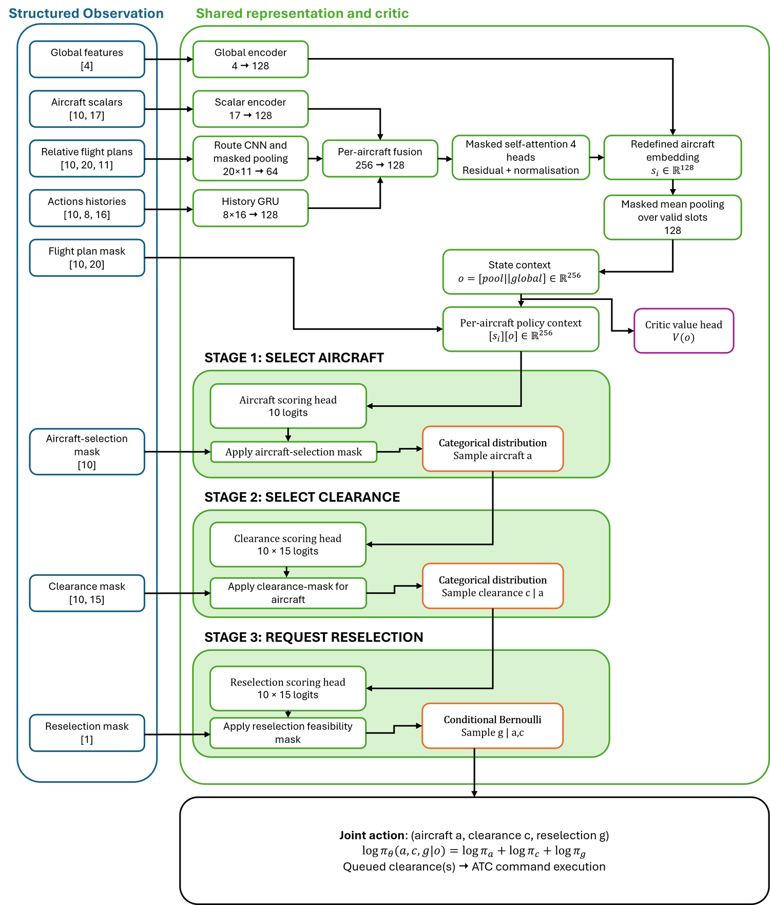

# Policy network

!!! abstract "Summary"
    One actor-critic network with 196,384 parameters is evaluated once per pick. It encodes each
    aircraft slot with the same weights (a scalar branch, a route branch and an action-history
    branch, fused into a 128-dimensional embedding), lets the slots exchange information through
    one masked self-attention block, and pools them with the encoded global features into a
    256-dimensional state context. The critic reads the context. Three policy heads read the
    context next to each aircraft embedding and are sampled in order: which aircraft, which
    clearance for that aircraft, and whether to pick again before simulated time advances. Each
    stage is masked to what is feasible. The TMB and PMS policies have the same architecture and
    differ only in their weights.

Source: `single-agent/network/rlm.py` (`ATCEncoder`, `FlightPlanConvEncoder`,
`AircraftSelfAttention`, `ATCAutoregressiveNetwork`), `single-agent/network/autoregressive_policy.py`
(`ATCAutoregressivePolicy`, `warm_start_policy`), `single-agent/jax_ppo/network.py` (the same
network as JAX functions), `single-agent/config/config.py` (sizes).

<figure class="tada-fig-wrap"><svg class="tada-dg" viewBox="0 0 760 640" role="img" aria-label="Policy network: per-aircraft encoders, self-attention, pooled context, four heads">
<defs>
  <marker id="pa" viewBox="0 0 8 8" refX="7" refY="4" markerWidth="7" markerHeight="7" orient="auto-start-reverse"><path class="arrowhead" d="M0,0 L8,4 L0,8 z"/></marker>
</defs>
<!-- regions -->
<rect class="box muted" x="8" y="8" width="548" height="430" rx="6"/>
<text class="h" x="18" y="26">per aircraft slot · ×10 · shared weights</text>
<rect class="box muted" x="568" y="8" width="184" height="430" rx="6"/>
<text class="h" x="578" y="26">per state</text>

<!-- inputs -->
<rect class="box in fill-in" x="20" y="38" width="164" height="46" rx="4"/>
<text class="t b" x="30" y="57">scalars</text><text class="s" x="30" y="74">17 features</text>
<rect class="box in fill-in" x="200" y="38" width="164" height="46" rx="4"/>
<text class="t b" x="210" y="57">flight plan</text><text class="s" x="210" y="74">20 waypoints × 11</text>
<rect class="box in fill-in" x="380" y="38" width="164" height="46" rx="4"/>
<text class="t b" x="390" y="57">action history</text><text class="s" x="390" y="74">last 8 × (1 + 15)</text>
<rect class="box in fill-in" x="580" y="38" width="160" height="46" rx="4"/>
<text class="t b" x="590" y="57">global</text><text class="s" x="590" y="74">4 features</text>

<!-- encoders -->
<rect class="box enc" x="20" y="108" width="164" height="58" rx="4"/>
<text class="t" x="30" y="127">Linear 17→128</text><text class="s" x="30" y="143">LayerNorm · ReLU</text><text class="s" x="30" y="158">2.6k params</text>
<rect class="box enc" x="200" y="108" width="164" height="58" rx="4"/>
<text class="t" x="210" y="127">Conv1d ×2 (64, k=3)</text><text class="s" x="210" y="143">mean over waypoints → 64</text><text class="s" x="210" y="158">18.7k params</text>
<rect class="box enc" x="380" y="108" width="164" height="58" rx="4"/>
<text class="t" x="390" y="127">GRU → 64</text><text class="s" x="390" y="143">last hidden state</text><text class="s" x="390" y="158">15.7k params</text>
<rect class="box enc" x="580" y="108" width="160" height="58" rx="4"/>
<text class="t" x="590" y="127">Linear 4→128</text><text class="s" x="590" y="143">ReLU</text><text class="s" x="590" y="158">0.6k params</text>
<g class="e"><path class="e" d="M102,84 V106" marker-end="url(#pa)"/><path class="e" d="M282,84 V106" marker-end="url(#pa)"/><path class="e" d="M462,84 V106" marker-end="url(#pa)"/><path class="e" d="M660,84 V106" marker-end="url(#pa)"/></g>

<!-- fuse -->
<rect class="box enc" x="20" y="190" width="524" height="44" rx="4"/>
<text class="t" x="30" y="209">concat 128 + 64 + 64 = 256 → Linear 256→128 · LayerNorm · ReLU</text>
<text class="s" x="30" y="225">per-aircraft embedding eᵢ (128) · 33.2k params</text>
<path class="e" d="M102,166 V188" marker-end="url(#pa)"/><path class="e" d="M282,166 V188" marker-end="url(#pa)"/><path class="e" d="M462,166 V188" marker-end="url(#pa)"/>

<!-- attention -->
<rect class="box enc fill-enc" x="20" y="258" width="524" height="56" rx="4"/>
<text class="t b" x="30" y="277">masked self-attention over the 10 slots</text>
<text class="s" x="30" y="293">4 heads · q, k, v 128→64 · residual + LayerNorm · empty slots masked as keys</text>
<text class="s" x="30" y="307">output projection starts at zero: the residual adds nothing at first · 33.2k params</text>
<path class="e" d="M282,234 V256" marker-end="url(#pa)"/>

<!-- pool and per-slot input -->
<rect class="box enc" x="300" y="338" width="244" height="40" rx="4"/>
<text class="t" x="310" y="356">masked mean over slots</text><text class="s" x="310" y="371">pooled summary of the window · 128</text>
<rect class="box" x="20" y="338" width="264" height="40" rx="4"/>
<text class="t" x="30" y="356">e′ᵢ, after attention</text><text class="s" x="30" y="371">128 per slot</text>
<path class="e" d="M150,314 V336" marker-end="url(#pa)"/><path class="e" d="M420,314 V336" marker-end="url(#pa)"/>

<!-- context -->
<rect class="box" x="300" y="398" width="440" height="30" rx="4"/>
<text class="t" x="310" y="418">context c = [pooled 128 ‖ global 128] = 256</text>
<path class="e" d="M420,378 V396" marker-end="url(#pa)"/><path class="e" d="M660,166 V396" marker-end="url(#pa)"/>

<rect class="box" x="20" y="398" width="264" height="30" rx="4"/>
<text class="t" x="30" y="418">head input per slot [e′ᵢ ‖ c] = 384</text>
<path class="e" d="M150,378 V396" marker-end="url(#pa)"/><path class="e dash" d="M300,413 H286" marker-end="url(#pa)"/>

<!-- heads -->
<rect class="box head fill-head" x="20" y="472" width="170" height="70" rx="4"/>
<text class="t b" x="30" y="491">aircraft</text><text class="s" x="30" y="507">384→64→1 per slot</text><text class="s" x="30" y="521">softmax over slots</text><text class="s" x="30" y="535">24.7k params</text>
<rect class="box head fill-head" x="200" y="472" width="170" height="70" rx="4"/>
<text class="t b" x="210" y="491">clearance</text><text class="s" x="210" y="507">384→64→15 per slot</text><text class="s" x="210" y="521">row of the chosen slot</text><text class="s" x="210" y="535">25.6k params</text>
<rect class="box head fill-head" x="380" y="472" width="170" height="70" rx="4"/>
<text class="t b" x="390" y="491">again (reselection)</text><text class="s" x="390" y="507">384→64→15 per slot</text><text class="s" x="390" y="521">Bernoulli at (slot, clr)</text><text class="s" x="390" y="535">25.6k params</text>
<rect class="box env fill-env" x="580" y="472" width="160" height="70" rx="4"/>
<text class="t b" x="590" y="491">value V(s)</text><text class="s" x="590" y="507">256→64→1</text><text class="s" x="590" y="521">reads c only</text><text class="s" x="590" y="535">16.5k params</text>
<path class="e" d="M105,428 V470" marker-end="url(#pa)"/><path class="e" d="M150,428 V448 H285 V470" marker-end="url(#pa)"/><path class="e" d="M200,428 V440 H465 V470" marker-end="url(#pa)"/><path class="e" d="M660,428 V470" marker-end="url(#pa)"/>

<!-- outputs -->
<text class="s" x="20" y="566">masked by mask_select</text>
<text class="s" x="200" y="566">masked by mask_action_per_ac</text>
<text class="s" x="380" y="566">masked by mask_again; never</text>
<text class="s" x="380" y="580">after DO_NOTHING</text>
<text class="s" x="580" y="566">critic, used by PPO</text>
<text class="t" x="20" y="616">196,384 parameters in all · every head: Linear → 64 · ReLU → output</text>
</svg>
</figure>

## Encoding one aircraft

Every slot passes through the same three branches, whichever flight it holds. The inputs are
described on the [Observations](observations.md) page.

| Branch | Input | Layers | Output |
|---|---|---|---|
| Scalar | 17 aircraft scalars | Linear 17→128, layer normalisation, ReLU | 128 |
| Route | 20 waypoints × 11 features | two one-dimensional convolutions along the route (64 channels, kernel 3, padding 1, ReLU after each), masked mean over the real waypoints, Linear 64→64, ReLU | 64 |
| Action history | 8 records × 16 | GRU with hidden size 64; its final hidden state | 64 |

The masked mean uses the flight-plan mask, so padded route rows do not contribute. The three
outputs are concatenated (128 + 64 + 64 = 256) and fused by Linear 256→128, layer normalisation
and ReLU into the aircraft embedding **eᵢ**.

The global features are encoded separately by Linear 4→128 and ReLU.

## Masked self-attention

Separation is a relation between pairs of aircraft, and a pooled average cannot represent which
two aircraft are converging. One multi-head self-attention block therefore runs over the ten
aircraft embeddings before anything is pooled (`AircraftSelfAttention`):

- 4 heads; queries, keys and values are bias-free linear projections 128→64, 16 dimensions per
  head; scaled dot-product attention;
- empty slots (`mask_aircraft = 0`) are masked as keys, so no aircraft attends to a slot without
  a flight;
- the attended values are projected back by Linear 64→128 and added to the input, followed by
  layer normalisation: **e′ᵢ = LayerNorm(eᵢ + W · attentionᵢ)**.

The refined embedding e′ᵢ of each aircraft thus carries information about the other aircraft in
the window.

## State context and critic

The refined embeddings are averaged over the occupied slots (128) and concatenated with the
encoded global features (128). The result is the **state context c** (256).

The critic is a value head on the context alone: Linear 256→64, ReLU, Linear 64→1. It estimates
the value of the current observation for PPO.

## The three policy heads

Each policy head receives, for every slot, the refined aircraft embedding next to the state
context, **[e′ᵢ ‖ c]** (128 + 256 = 384), and applies Linear 384→64, ReLU and an output layer with
the same weights at every slot.

| Head | Output | Read as |
|---|---|---|
| Aircraft | 1 logit per slot: 10 | categorical distribution over the slots |
| Clearance | 15 logits per slot: 10 × 15 | categorical distribution over the clearances of the chosen slot |
| Again | 15 logits per slot: 10 × 15 | Bernoulli distribution at the chosen (slot, clearance) |

The clearance and again heads produce an output for every slot, not only for the chosen one. With
ten slots this costs little, and it allows the entropy of the whole decision to be computed
exactly (below).

<figure class="tada-paper-fig" markdown>

<figcaption>The single-agent autoregressive policy network as drawn in the paper: the structured
observation, the shared representation with the critic, and the three stages of action
selection.</figcaption>
</figure>

## Sampling an action { #sampling }

The joint policy is factorised as

```
π(a, c, g | o) = π_A(a | o) · π_C(c | a, o) · π_G(g | a, c, o)
```

where `a` is the aircraft, `c` the clearance and `g` the *again* flag. The clearance is chosen
for the aircraft just selected, and the flag for the aircraft-clearance pair just selected.

<figure class="tada-fig-wrap"><svg class="tada-dg" viewBox="0 0 760 300" role="img" aria-label="Sampling one action: aircraft, then clearance conditioned on it, then the again flag">
<defs>
  <marker id="aa" viewBox="0 0 8 8" refX="7" refY="4" markerWidth="7" markerHeight="7" orient="auto-start-reverse"><path class="arrowhead" d="M0,0 L8,4 L0,8 z"/></marker>
</defs>
<!-- stage 1 -->
<text class="h" x="16" y="22">1 · which aircraft</text>
<rect class="box head" x="10" y="32" width="230" height="182" rx="5"/>
<g>
  <!-- ten slot logits as bars; masked ones hollow -->
  <rect class="slot" x="24" y="120" width="16" height="40"/><rect class="slot" x="44" y="95" width="16" height="65"/>
  <rect class="slot off" x="64" y="150" width="16" height="10"/><rect class="slot" x="84" y="70" width="16" height="90"/>
  <rect class="slot" x="104" y="130" width="16" height="30"/><rect class="slot off" x="124" y="150" width="16" height="10"/>
  <rect class="slot off" x="144" y="150" width="16" height="10"/><rect class="slot" x="164" y="110" width="16" height="50"/>
  <rect class="slot off" x="184" y="150" width="16" height="10"/><rect class="slot off" x="204" y="150" width="16" height="10"/>
</g>
<text class="s" x="24" y="176">slots 0 … 9 (AMAN order)</text>
<text class="s" x="24" y="192">hollow = masked: pending / cleared</text>
<text class="t b c-head" x="84" y="62">a</text>

<!-- stage 2 -->
<text class="h" x="276" y="22">2 · which clearance, given a</text>
<rect class="box head" x="270" y="32" width="230" height="182" rx="5"/>
<g>
  <rect class="slot" x="282" y="100" width="11" height="60"/><rect class="slot" x="296" y="120" width="11" height="40"/>
  <rect class="slot" x="310" y="135" width="11" height="25"/><rect class="slot off" x="324" y="152" width="11" height="8"/>
  <rect class="slot" x="338" y="140" width="11" height="20"/><rect class="slot off" x="352" y="152" width="11" height="8"/>
  <rect class="slot" x="366" y="145" width="11" height="15"/><rect class="slot" x="380" y="148" width="11" height="12"/>
  <rect class="slot" x="394" y="70" width="11" height="90"/><rect class="slot off" x="408" y="152" width="11" height="8"/>
  <rect class="slot" x="422" y="138" width="11" height="22"/><rect class="slot off" x="436" y="152" width="11" height="8"/>
  <rect class="slot off" x="450" y="152" width="11" height="8"/><rect class="slot off" x="464" y="152" width="11" height="8"/>
  <rect class="slot" x="478" y="146" width="11" height="14"/>
</g>
<text class="s" x="282" y="176">15 clearances · row a of the head</text>
<text class="s" x="282" y="192">hollow = infeasible for aircraft a</text>
<text class="t b c-head" x="390" y="62">c</text>
<text class="s" x="282" y="92">DO_NOTHING</text>

<!-- stage 3 -->
<text class="h" x="536" y="22">3 · pick again? (reselection)</text>
<rect class="box head" x="530" y="32" width="220" height="182" rx="5"/>
<rect class="slot" x="560" y="90" width="50" height="70"/><rect class="slot off" x="640" y="130" width="50" height="30"/>
<text class="s" x="560" y="176">again = 1 · again = 0</text>
<text class="s" x="544" y="192">Bernoulli at (a, c); 0 if no budget</text>
<text class="s" x="544" y="206">left or c = DO_NOTHING</text>

<path class="e" d="M240,117 H268" marker-end="url(#aa)"/>
<path class="e" d="M500,117 H528" marker-end="url(#aa)"/>

<!-- to env -->
<rect class="box env fill-env" x="10" y="232" width="740" height="52" rx="5"/>
<text class="t b" x="24" y="253">to the environment: (a, c, again)</text>
<text class="s" x="24" y="272">log π = log p(a) + log p(c | a) + log p(again | a, c) · entropy: exact, over the whole tree</text>
<path class="e" d="M640,214 V230" marker-end="url(#aa)"/>
</svg>
</figure>

1. **Stage 1, select aircraft.** The aircraft logits of slots outside the aircraft-selection mask
   (`mask_select`) are replaced by −10⁸ before the softmax. This excludes empty slots, flights
   that are not yet under control, and an aircraft already cleared in the current decision
   interval.
2. **Stage 2, select clearance.** The row of clearance logits of the chosen slot is masked in the
   same way with that slot's clearance mask (`mask_action_per_ac`).
3. **Stage 3, request reselection.** The again logit at the chosen (slot, clearance) defines a
   Bernoulli distribution. It is masked, so that the flag is 0, when the reselection mask
   (`mask_again`) is 0 or when the chosen clearance is *do nothing*, which always ends the
   decision interval.

The masks are part of the [observation](observations.md#masks). A masked choice has a probability
that is zero to floating-point precision, and no gradient flows through it. What the environment
does with the flag is described under [Reselection](actions.md#reselection).

The log-probability of the joint action is the sum of the three stages,
`log π = log π_A + log π_C + log π_G`. A stage in which only one outcome is possible contributes
zero. Deterministic evaluation takes the most probable aircraft and clearance and sets the flag
when its logit is positive.

**Entropy.** The entropy bonus of PPO uses the entropy of the whole decision tree, not that of
the sampled branch:

```
H = H(a) + Σ_a p(a) · [ H(c | a) + Σ_c p(c | a) · H(g | a, c) ]
```

It is a function of the observation only, so the same value is obtained when acting and when
training.

## Permutation equivariance

The same encoders are applied to every slot, the network has no positional input, self-attention
with a key mask commutes with a reordering of the slots, and the pooled context is a mean.
Reordering the slots therefore reorders the per-aircraft outputs (aircraft logits, clearance rows,
again rows) in the same way and leaves the value unchanged: the decision represented by the state
does not depend on which slot a flight occupies.

## Initialisation and warm starts

Linear layers of the encoder and the hidden layers of the heads are initialised orthogonally with
gain √2 and zero bias, the GRU with orthogonal weights and zero bias. The output layers of the
aircraft and clearance heads use gain 0.01, so the initial policy is close to uniform over the
feasible choices; the output layer of the value head uses gain 1.

Three choices make it possible to extend a trained policy without changing what it computes at
the moment of the extension (`single-agent/main_jax.py --init-weights`, which calls
`warm_start_policy`):

- **New input columns start with zero weights.** When the first scalar layer is widened, for
  example by the four AMAN-sequence columns or the clearance flag, the existing columns are copied
  and the new ones are set to zero.
- **The residual branch of the self-attention block starts at zero.** Its output projection is
  initialised to zero, so at first the block passes on only the normalised input embedding.
- **The again head starts with a small, uniform probability.** Its output weights are zero and its
  bias is −3 (`Config.AGAIN_INIT_LOGIT`), so every flag starts at sigmoid(−3) ≈ 4.7%.

Any other mismatch between a source checkpoint and the network raises an error. These choices are
a safeguard for warm starts; a from-scratch run begins from the random initialisation above.

## Parameters

Counted from the published checkpoints (`artifacts/single_agent/mxp/final_model.zip` and
`artifacts/single_agent/pms/final_model.zip`), which have identical shapes.

| Component | Parameters |
|---|---|
| Scalar branch (Linear, layer normalisation) | 2,560 |
| Route branch (two convolutions, Linear) | 18,688 |
| Action-history branch (GRU) | 15,744 |
| Fusion (Linear, layer normalisation) | 33,152 |
| Self-attention | 33,152 |
| Global encoder | 640 |
| Aircraft head | 24,705 |
| Clearance head | 25,615 |
| Again head | 25,615 |
| Value head | 16,513 |
| **Total** | **196,384** |

## Two implementations of the same network

The network exists twice, over one set of parameter names. `single-agent/network/` defines it in
PyTorch as a Stable-Baselines3 `ActorCriticPolicy`; evaluation and rollout search load the
published checkpoints through this class. `single-agent/jax_ppo/network.py` expresses the same
computation as JAX functions for training. `single-agent/tests/test_jax_equivalence.py` checks
that the two give the same outputs, and a JAX-trained policy is saved as an ordinary
Stable-Baselines3 checkpoint (`single-agent/jax_ppo/export.py`).
