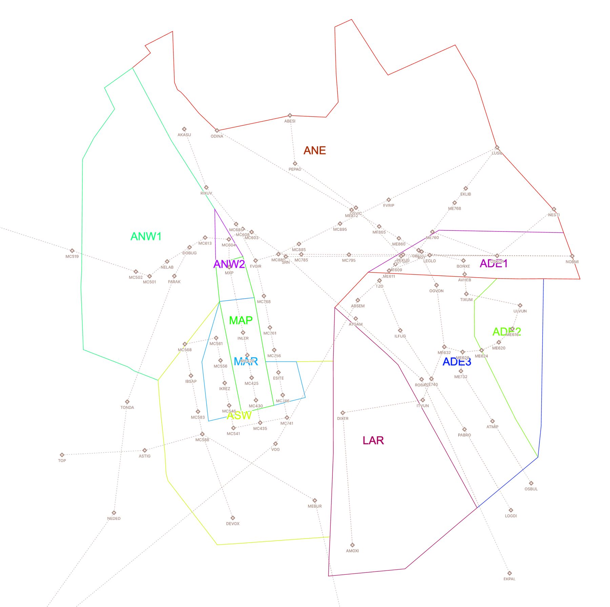
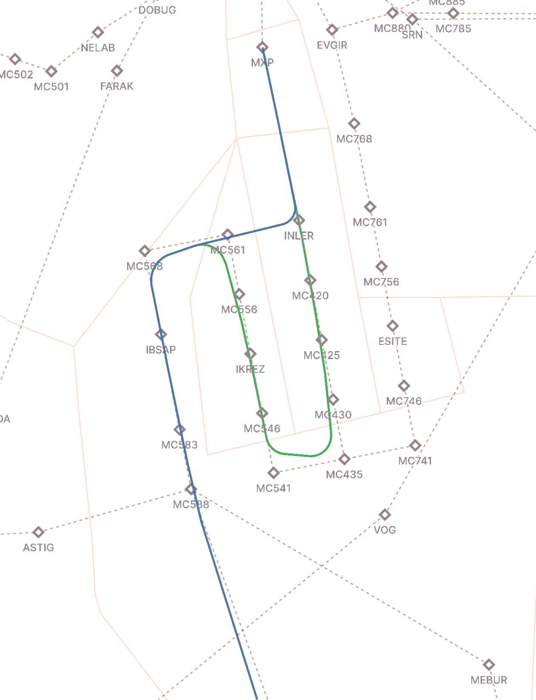
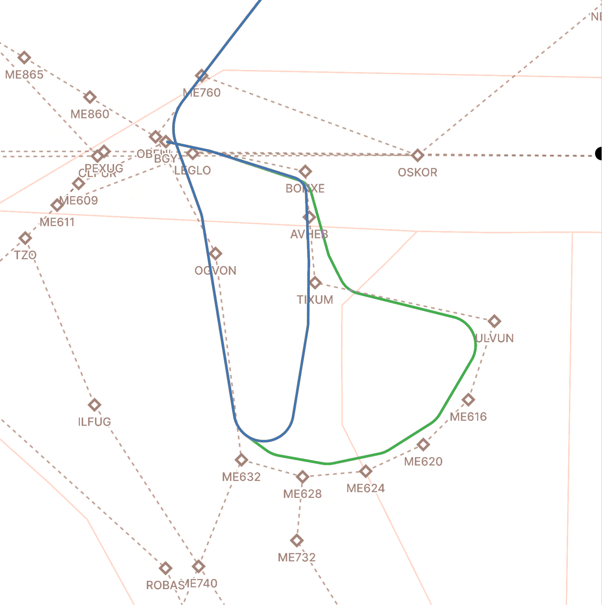

# The problem

!!! abstract "Summary"
    An arrival manager (AMAN) gives every arriving flight a place in the landing sequence and a
    target landing time. The task is to choose the clearances that make each flight meet its
    target while arrivals stay separated from one another, using as few clearances as possible.
    Two procedures are studied: the trombone at Milan Malpensa (LIMC, "TMB") and the point merge
    system at Milan Bergamo (LIME, "PMS"). Everything runs on a deterministic simulator of the
    Milan terminal airspace with Airbus A320 traffic and no wind.

## Arrival management

A scenario contains *N* arriving aircraft, all bound for the same airport. The airport fixes the
arrival procedure: flights to Malpensa fly a trombone, flights to Bergamo fly a point merge
system. A separate policy is trained for each.

Before anyone intervenes, each flight has an **estimated landing time** and an initial trajectory
that it would follow if it received no clearance. Arrivals are modelled as independent random
events, so the estimated landing times are drawn from a Poisson process. The mean time between
arrivals is

```
Δmin = R_H / V_end + Δmargin
```

where `R_H` is the required horizontal separation, `V_end` the speed at the end of the procedure
and `Δmargin` an extra safety margin. The rate is chosen so that the traffic can be separated at
landing by shifting individual arrival times, even when the random process produces a cluster.

The AMAN then fixes two things for the whole scenario:

- the **AMAN sequence**: the order in which the flights are to land;
- a **target landing time** for each flight.

The difference between a flight's target and its estimated landing time is the adjustment it
needs. If the target is later than the estimate, the flight has to be delayed, and the amount is
its **time-to-lose (TTL)**. If the target is earlier, the flight has to arrive sooner, and the
amount is its **time-to-gain (TTG)**. The AMAN says what each flight must achieve. It does not say
how: choosing the clearances is left to the controller, and here to the agent.

## Clearances and time deviation

Between its entry into the terminal manoeuvring area (TMA) and the end of its route, a flight can
receive a sequence of discrete **clearances**: speed changes, path extensions, shortcuts and
vectors. Not every clearance can be given to every aircraft at every moment. Waypoint constraints
and aircraft performance limit what is feasible, so each decision is restricted to the feasible
subset. The clearances available in the single-agent solution, and the rules that decide when each
one is legal, are on [Actions and reselection](actions.md).

Once a flight has landed, its **time deviation** is the difference between its target landing time
and its actual landing time. The sign tells early from late; most of what follows uses the
absolute value.

## Infringements and conflicts

Clearances must also keep the arrivals apart. Two levels of proximity are distinguished for a pair
of aircraft:

| | horizontal separation | | vertical separation |
|---|---|---|---|
| **infringement** | closer than 5 NM | and | closer than 1000 ft |
| **conflict** (loss of separation) | closer than 3 NM | and | closer than 500 ft |

A conflict is the more severe case of an infringement. Both are counted as events per pair, not
per time step: one pair contributes at most one infringement and at most one conflict to a
scenario. Only arrivals in the scenario are considered. Departures, overflights and other traffic
are outside the scope of this work. How the code detects and grades these events is on
[Separation rules](separation.md).

## Objectives and what "solved" means

A solution is a feasible sequence of clearances for every flight. It is judged on three
quantities, in this order of priority:

1. **Safety**: the number of infringements and conflicts.
2. **Landing precision**: the deviations from the AMAN target landing times.
3. **Action efficiency**: the number of clearances, which stands for controller and pilot
   workload.

An episode is **solved** when every flight lands within 60 s of its target and no conflict occurs.
The [Results](../results.md) page reports the percentage of episodes solved. The way the reward
encodes the priority order is on [Objective and reward](objective.md).

## The simulator

Reinforcement learning on this problem needs a simulator in which the same scenario and the same
clearances always produce the same trajectories. The one used here is written in Rust and exposed
to Python through bindings. The public repository ships it as prebuilt wheels
(`flight_simulator` 0.2.80 for CPython 3.12) in `artifacts/simulator/wheels/`, with builds for
Linux x86_64, macOS on Apple Silicon and Windows x86_64. The aircraft performance data is licensed
and is not included: you have to supply it yourself, as described in
[`docs/aircraft-designs.md`](https://github.com/monadoy/tada/blob/main/docs/aircraft-designs.md).

**Simulation loop.** The simulator advances in discrete time steps; the single-agent environment
runs it at 1 s per step. In each step it integrates every aircraft's position, heading, speed and
altitude, checks the separation of every pair, and records completed arrivals. An aircraft enters
the simulation at its scheduled start time and leaves when it has completed its route.

**Aircraft model.** All aircraft are Airbus A320s. The model uses the operating envelope from
EUROCONTROL's BADA data: maximum operating speed, stall speeds in clean and landing configuration,
maximum longitudinal acceleration, and maximum rates of climb and descent. Thrust, drag and mass
are not modelled. Positions are expressed in a flat Cartesian frame centred on Milan Linate (LIML),
x pointing east and y north. Speeds are indicated airspeeds; true airspeed is approximated by
adding 2% per 1000 ft of altitude. **Wind is not modelled**, so true airspeed equals ground speed.
Turns are flown at approximately standard rate with the bank angle capped at 25°.

**Guidance.** Each aircraft follows an ordered list of route points: waypoints of the published
procedure, or virtual waypoints created by a clearance. A route point may carry a minimum altitude,
a maximum altitude and a target speed, and the simulator flies the lateral, speed and vertical
profiles by itself:

- the aircraft steers towards the next waypoint and starts a fly-by turn when it comes within
  3 NM of it;
- the target speed of a route point is treated as a maximum, and the aircraft starts to
  decelerate early enough to meet it; a speed set by a clearance takes precedence unless it
  exceeds the constraint;
- when the aircraft would breach the altitude limits of a point ahead, it descends (or climbs) at
  a constant gradient so that it reaches the nearest bound on arrival at that point, within its
  maximum rates. The profile adapts when a clearance lengthens or shortens the route.

**Prediction.** Because the simulator is deterministic and fast, no separate trajectory predictor
is needed. The current state is copied and simulated forward without new clearances. This
**no-operation rollout** (a do-nothing forecast) gives the predicted landing time of every
aircraft and every predicted proximity event with its time. The agent's observation, the shaping
of its reward and several masks are built on it; see
[Episodes and temporal windowing](environments.md#live-and-predicted).

## The modelled airspace

The routes are built on the standard RNAV arrival routes of Malpensa and Bergamo. Each route
starts at a spawn point, where the aircraft appears, and ends with a short synthetic final
approach to the airport.

<figure class="tada-paper-fig" markdown>

<figcaption>The modelled airspace of Milan Malpensa (left) and Milan Bergamo (right), with
waypoints, standard routes and control sectors.</figcaption>
</figure>

At Malpensa the arrival routes join a **double trombone**: two downwind legs, one on each side of
the final approach, each of which can be extended by four levels. At Bergamo the routes join the
**sequencing arc** of a point merge system and turn from the arc to the merge point (waypoint
TIXUM in the configuration).

### The short AMAN route and the full procedure

The AMAN's estimate assumes that a flight uses the shortest version of the delay-absorption
structure, called the **short AMAN route**. At Malpensa it skips all trombone extension levels. At
Bergamo it turns to the merge point from the first point of the arc. The full procedure is the
longest version: all four trombone levels, or the whole arc.

<figure class="tada-paper-fig" markdown>

<figcaption>Malpensa trombone: the short AMAN route (blue) and the full procedure with all four
levels (green).</figcaption>
</figure>

<figure class="tada-paper-fig" markdown>

<figcaption>Bergamo point merge system: the short AMAN route (blue), which turns to the merge point
from the first arc point, and the full procedure along the whole arc (green).</figcaption>
</figure>

The space between the two is what the agent has to absorb delay with. The single-agent environment
exposes it differently for the two procedures:

- **Trombone.** At the start of an episode every route is cut to the short AMAN route and the
  removed trombone levels are stored. A *lengthen* clearance puts one level back; a *shorten*
  clearance removes it again.
- **Point merge.** Every flight keeps its whole sequencing leg in its route. A *direct to merge
  point* clearance takes it off the arc. The agent delays a flight by leaving it on the arc for
  longer.

Both routes of every arrival are listed in the airport definitions
(`single-agent/config/simulation_config_mxp/scenario_generator/airports/MXP.toml` and
`single-agent/config/simulation_config_bgy/scenario_generator/airports/BGY.toml`, fields `route` and
`aman_route`).

### Vertical stacking on the point merge

A point merge system leaves little room to separate aircraft horizontally: nearly every flight
flies along the arc or crosses it. The simulator therefore stacks them vertically. Each aircraft
is assigned one of three preferred levels automatically, spread evenly over the altitude window
that the waypoints allow, with no action required of the agent. Arrival times for the point merge
are also generated so that no more than three horizontally conflicting aircraft reach the arc at
the same time.

### Sectors and sector groups

The airspace is divided into control sectors, shown in the figure above. The sectors are combined
into three sector groups, on the assumption that one controller could handle one group:

| Sector group | Sectors |
|---|---|
| 1 | ANE, ANW1, ANW2 |
| 2 | ASW, MAP, MAR |
| 3 | ADE1, ADE2, ADE3, LAR |

The sector groups matter to the [multi-agent approach](multi-agent.md), which issues at most one
clearance per group in each decision step. The single-agent approach treats the airspace as one
unit and draws the sectors only when rendering an episode.

## Scenarios

Every episode starts from a new scenario generated from a seed:

1. **Routes.** Aircraft are assigned to the arrival routes in round-robin fashion. The order of
   the routes is random, except that two routes that join the delay-absorption structure at the
   same point are not placed next to each other. This avoids aircraft that are in conflict from
   the moment they appear, which area control would prevent in reality.
2. **Arrival times.** The Poisson process described above sets the estimated landing times.
3. **AMAN.** A simulated AMAN produces the sequence and a TTG or TTL for each aircraft. A flight
   gets a TTG if it would land too close to the flight behind it and there is room ahead of it to
   gain time. Otherwise it gets a TTL if it is predicted to land too close to the flight ahead.
   Applying these adjustments yields landing times with the required margin between successive
   aircraft.

The generator settings used for the published models are in
`single-agent/config/simulation_config_mxp/scenario_generator/config.toml` and its `_bgy`
counterpart. Both use a speed of 190 kt at the end of the procedure and an extra margin of 30 s,
and the environment passes a horizontal separation of 5 NM (`Config.MISSION_SAFEZONE_RADIUS_NM` in
`single-agent/config/config.py`). The time a flight may be asked to gain is capped at 120 s at
Malpensa. At Bergamo the cap is zero, so point merge flights are only ever asked to lose time.
How an episode is built from a scenario, and how the procedure is selected in the code, is on
[Episodes and temporal windowing](environments.md).
