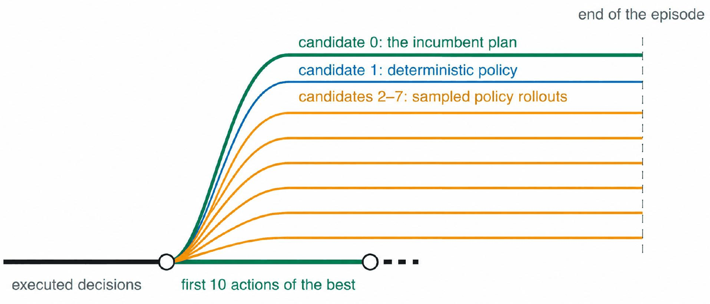

# Rollout search

!!! abstract "Summary"
    Rollout search is policy-guided model predictive control. Every 10 decisions it rolls out eight
    candidate continuations to the end of the episode in the simulator, scores each by its final outcome,
    executes the first 10 actions of the best one and keeps the rest as the *incumbent plan*. Because the
    incumbent always competes again, the outcome can only improve from one plan to the next, and the result
    is never worse than the deterministic policy. On the paper's episodes it raises the single-agent
    policy from 74 to 96 solved on the trombone and from 64 to 100 on the point merge, with no loss of
    separation.

Source: `single-agent/analysis/rollout_search.py`, run through `single-agent/evaluation/run_search.py`.

<figure class="tada-paper-fig" markdown>

<figcaption>Rollout search. At each planning point the incumbent, one deterministic and several stochastic continuations are rolled out; the first decisions of the best candidate are executed in the live world.</figcaption>
</figure>

## Why it works

The policy is a distribution over actions. Sampled attempts often solve episodes that the deterministic
policy misses (see [Results](../results.md#solved-episodes)), so good plans are within reach of the
policy; what is missing is a way to recognise them. The simulator provides it: the environment is
deterministic given the scenario and the actions, and its state can be saved and restored exactly, so a
candidate plan can be flown to the end and judged on what actually happens.

## The algorithm

At every planning point, which is every **M = 10** decisions (reselection picks count):

1. Save the state of the environment.
2. Roll out **K = 8** candidates to the end of the episode, restoring the saved state before each:
    - the **incumbent**: the rest of the plan chosen at the previous planning point, replayed (for the
      first plan, the deterministic policy);
    - one continuation with the **deterministic** policy from here (at the first planning point the
      incumbent already is the deterministic policy, so a further sample takes this place);
    - six continuations **sampled** from the policy.
3. Score every candidate by its final outcome, compared in this order:
    1. no loss of separation;
    2. the number of flights that land within 60 s of their target;
    3. the summed absolute landing-time deviation (a flight that never lands counts as 1000 s);
    4. the number of clearances.
4. Execute the first M actions of the best candidate in the live world. Its remainder becomes the
   incumbent. Ties go to the incumbent.

The order of the criteria is that of the [reward](objective.md): safety, then precision, then economy.

## Guarantees

- **Never worse than the policy.** The incumbent is always a candidate, so the predicted outcome cannot
  decrease from one plan to the next, and the first incumbent is the deterministic policy's own episode.
- **Checked on every plan.** The search counts any plan whose predicted outcome fell below its
  predecessor's and any executed segment whose real outcome differed from the prediction. Both counts are
  reported with the results.
- If a stored action is no longer legal when it is replayed, that step falls back to the deterministic
  policy.

## Cost

Two exact savings leave the chosen plans unchanged on the main criteria:

- **Stop when solved.** Candidate generation stops as soon as one candidate solves the episode
  (`--no-stop-solved` disables it).
- **Pruning.** A rollout is abandoned once too many of its flights have landed late for it to match the
  best candidate without a loss of separation (`--no-prune` disables it).

Search is practical only where the simulator runs much faster than real time, as it does here.

## Attempts

In the paper's evaluation, attempt 0 starts from the deterministic plan with the original seeding, and
attempts 1 to 20 re-seed the sampled candidates only. [Evaluate the models](../code/evaluate.md) gives the
commands.

## Caveats

- **Perfect model.** The rollouts use the same simulator as the execution: no wind, no pilot response
  time, no trajectory-prediction error. In a real system the gain depends on the accuracy of the
  trajectory predictor.
- The only exploration is the policy's own sampling: there is no tree search and no value function.
- The multi-agent search uses the same idea with a different schedule: K = 8 candidates, replanned at every
  decision.
