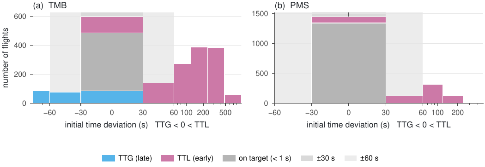
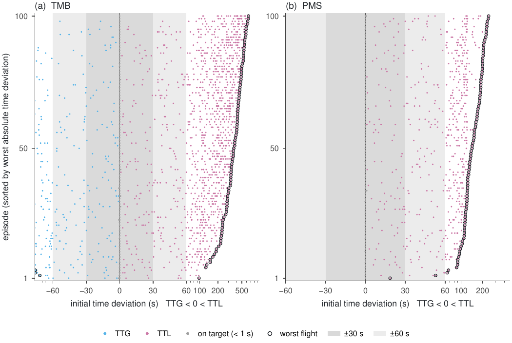
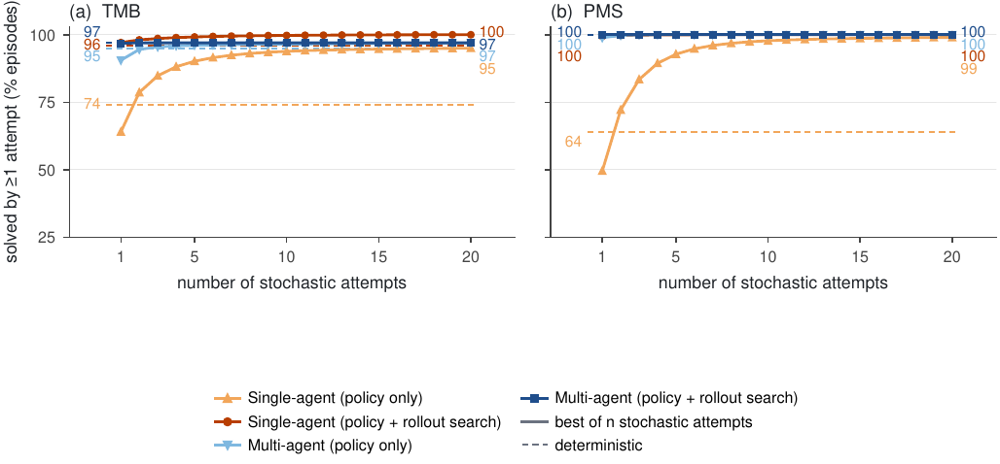
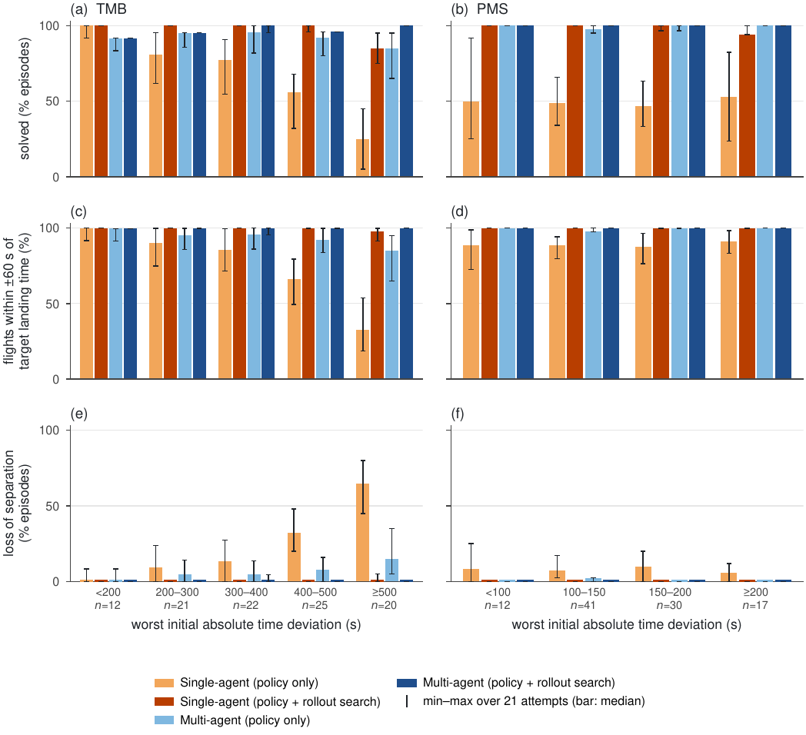
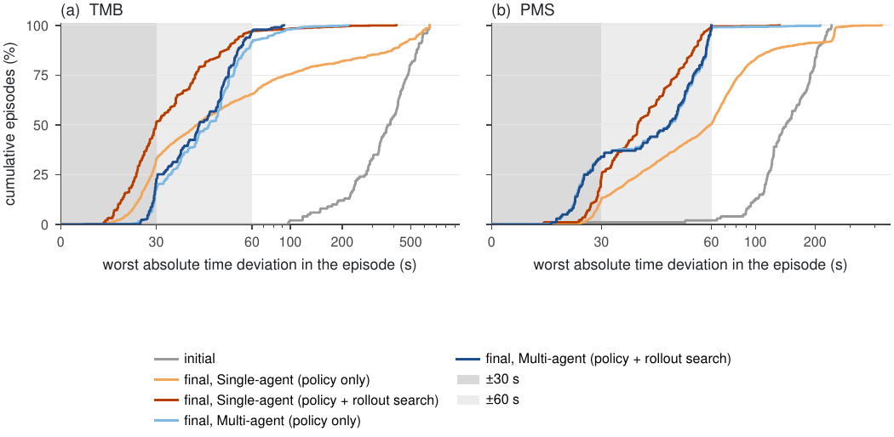
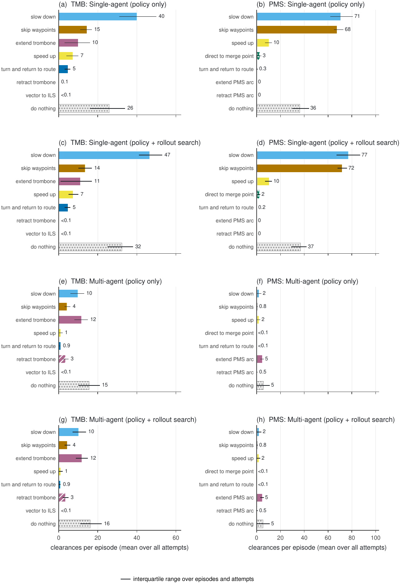
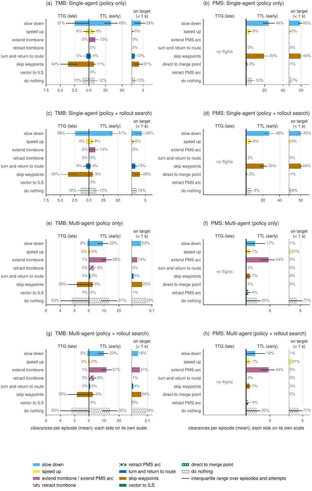
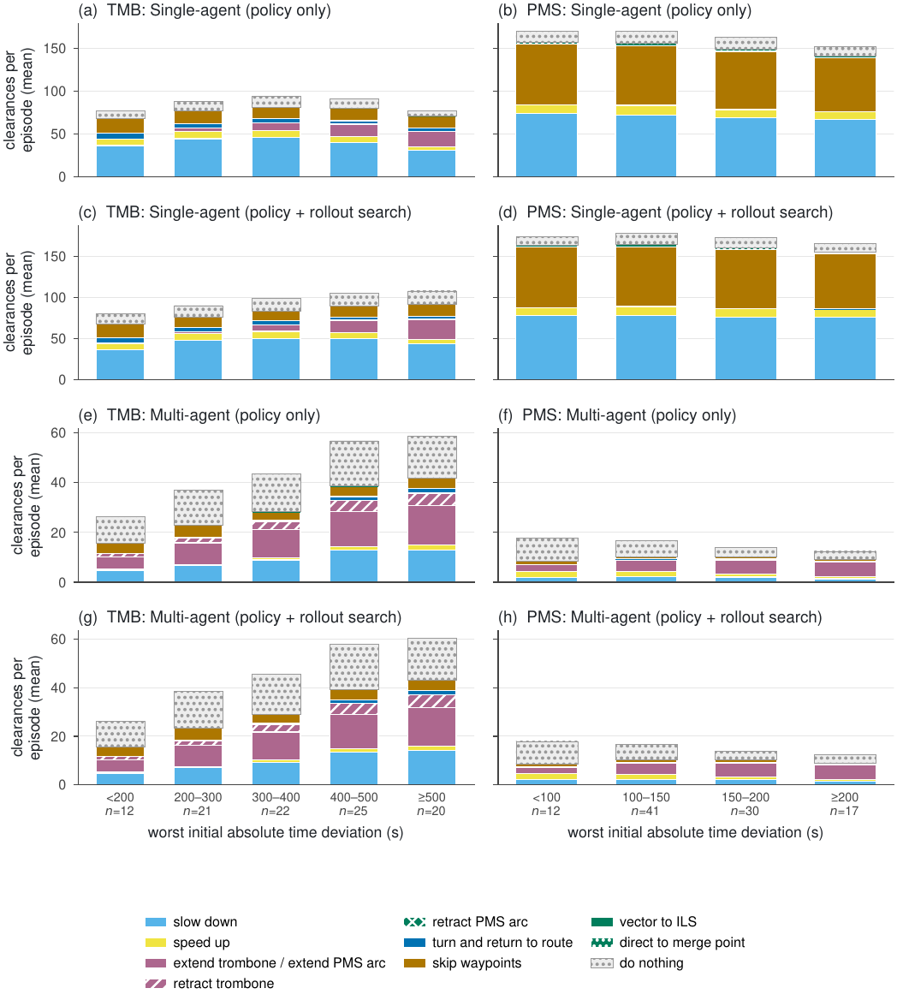
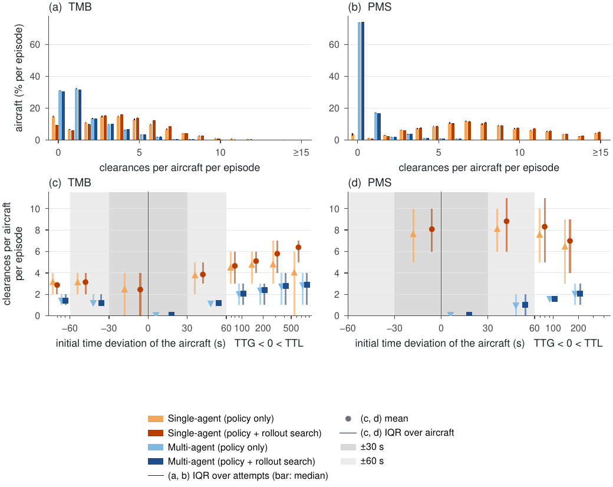

# Results

!!! abstract "Summary"
    Four policies (single-agent and multi-agent, each for the trombone and for the point merge) were
    evaluated on the same 100 scenarios of 20 arrivals per procedure. The multi-agent deterministic policy
    solves 95 of the trombone episodes and all 100 point-merge episodes, with fewer than 1.6 and 0.5
    clearances per aircraft. The single-agent deterministic policy solves 74 and 64; with rollout search it
    solves 96 and 100 without a single loss of separation, and with about ten stochastic attempts it solves
    about 95% and 99%. It needs more clearances to do so.

## How the policies were evaluated

- **Scenarios.** 100 seeded scenarios per procedure, with 20 arrivals each and about one landing every two
  minutes: a medium-to-high arrival rate for the two airports. Both teams fly the same episodes, checked
  flight by flight on the target landing times.
- **Attempts.** 21 episodes per policy and scenario: one **deterministic** (the highest-scoring legal
  action at every decision) and 20 **stochastic** (actions sampled from the policy).
- **Controllers.** Each policy is run on its own (*policy only*) and with
  [rollout search](how/search.md) (*policy + rollout search*).
- **Solved.** An episode is solved when every aircraft lands within 60 s of its AMAN target landing time
  and no conflict (loss of separation: closer than 3 NM and 500 ft) occurs.

The evaluation seeds were also used to select the checkpoints, so these numbers are not from a blind test
set. [Evaluate the models](code/evaluate.md) shows how to reproduce the single-agent numbers with the
public code.

## Headline numbers

Solved / loss of separation on the deterministic attempt; the median number of solved episodes over the 21
attempts; and the number of episodes solved by at least one of the 20 stochastic attempts.

<table class="tada-table tada-results">
<thead>
<tr><th rowspan="2">100 episodes per procedure</th><th colspan="3">TMB (Malpensa trombone)</th><th colspan="3">PMS (Bergamo point merge)</th></tr>
<tr><th>solved / LoS</th><th>median</th><th>any of 20</th><th>solved / LoS</th><th>median</th><th>any of 20</th></tr>
</thead>
<tbody>
<tr><td>Single-agent, policy only</td><td>74 / 20</td><td>65</td><td>95</td><td>64 / 6</td><td>50</td><td>99</td></tr>
<tr><td>Single-agent, policy + rollout search</td><td>96 / 0</td><td>97</td><td class="is-best">100</td><td class="is-best">100 / 0</td><td>99</td><td class="is-best">100</td></tr>
<tr><td>Multi-agent, policy only</td><td>95 / 3</td><td>91</td><td>97</td><td class="is-best">100 / 0</td><td>99</td><td class="is-best">100</td></tr>
<tr><td>Multi-agent, policy + rollout search</td><td class="is-best">97 / 0</td><td>97</td><td>97</td><td class="is-best">100 / 0</td><td class="is-best">100</td><td class="is-best">100</td></tr>
</tbody>
</table>

The two rollout searches differ in how often they replan: the single-agent search replans every 10
decisions (K = 8 candidates, M = 10), the multi-agent search at every decision (K = 8).

## The evaluation scenarios

The initial time deviation of a flight is its time-to-lose (TTL, it must be delayed) or time-to-gain (TTG,
it must arrive earlier). On the trombone most flights have a TTL, up to about 11 minutes, and TTGs reach
about 2 minutes. On the point merge no flight has a TTG and the largest TTL is about 4 minutes. Every
episode mixes TTL and TTG flights with flights that start on target (an initial absolute deviation below
1 s).

<figure class="tada-paper-fig" markdown>

<figcaption>Distribution of TTL and TTG values in the evaluation scenarios. Negative values are TTG.</figcaption>
</figure>

<figure class="tada-paper-fig" markdown>

<figcaption>Initial time deviation of every flight, episode by episode.</figcaption>
</figure>

## Solved episodes

In deterministic mode the single-agent policy solves the fewest episodes. It improves considerably with
rollout search and with more stochastic attempts: about ten attempts solve around 95% of trombone
episodes and 99% of point-merge episodes. The multi-agent deterministic policy is already close to its
ceiling, so attempts and search change little. With attempts or search, all policies do slightly better
on the point merge than on the trombone.

<figure class="tada-paper-fig" markdown>

<figcaption>Episodes solved by at least one of n stochastic attempts (solid) and by the deterministic policy (dashed).</figcaption>
</figure>

## Performance against scenario difficulty

On the point merge every policy performs evenly over the whole range of initial deviations. On the
trombone the deterministic policies solve fewer episodes, and lose separation more often, as the worst
initial deviation of the episode grows; this is clearest for the single-agent policy on its own. A larger
worst deviation means more flights with a large TTL, whose paths must be changed more, which creates more
predicted infringements to resolve. With rollout search the losses of separation almost disappear.

<figure class="tada-paper-fig" markdown>

<figcaption>Solved episodes, landing-time deviation and losses of separation against the worst initial absolute time deviation of the episode; n is the number of episodes in each bin.</figcaption>
</figure>

<figure class="tada-paper-fig" markdown>

<figcaption>Reduction of the worst absolute time deviation of an episode. With rollout search the worst deviation is within 60 s in more than 95% of TMB episodes and in all PMS episodes.</figcaption>
</figure>

## Clearances

The multi-agent solution issues far fewer active clearances per episode than the single-agent solution,
most of all on the point merge: on average fewer than 1.6 clearances per aircraft per TMB episode and
fewer than 0.5 per PMS episode. Rollout search barely changes the number or the mix of clearances.

- **Trombone.** For flights with a TTL both solutions rely on *slow down* and *extend trombone*; the
  single agent chooses *slow down* most, the multi-agent *extend trombone*. For flights with a TTG both
  prefer *skip waypoints*.
- **Point merge.** The single agent uses *slow down* and *skip waypoints*; the multi-agent uses *extend
  PMS arc* (not in the single-agent action set) and *slow down*.
- **Never chosen.** Some clearances, such as *retract trombone* and *vector to ILS*, are not selected by
  any policy.

Two design choices explain most of the difference in action efficiency. The multi-agent solution runs an
**auto-solver** at the start of an episode that absorbs much of a TTL with one route extension, and its
selection rule does not act on an aircraft whose predicted deviation is below 30 s unless it is in a
predicted infringement. The single agent has neither: it absorbs a large TTL with several speed
reductions where one extension would do, and it may act on flights that are already on target.

<figure class="tada-paper-fig" markdown>

<figcaption>Number and types of clearances per policy. Extend and retract PMS arc exist only in the multi-agent action set; its extend values include the clearances chosen by the auto-solver.</figcaption>
</figure>

<figure class="tada-paper-fig" markdown>

<figcaption>Clearances given to flights with a TTL, a TTG, and flights that start on target.</figcaption>
</figure>

<figure class="tada-paper-fig" markdown>

<figcaption>Clearances per episode against the worst initial absolute time deviation. The single- and multi-agent panels use different vertical scales.</figcaption>
</figure>

<figure class="tada-paper-fig" markdown>

<figcaption>Clearances per aircraft per episode, and how they vary with the aircraft's initial time deviation.</figcaption>
</figure>

## Watch the single-agent policies

Three of the evaluation episodes, rendered from the simulator. The left panel is the plan view, the right
panel the predicted altitude profiles under do-nothing with predicted infringements marked. These are
development renders: the tier bar along the bottom belongs to an earlier reward and can be ignored. To
replay any episode interactively, use the [Lab](lab/index.md).

<figure class="tada-render">
<video controls preload="none" poster="../assets/renders/tmb_policy_seed137869475.jpg" src="../assets/renders/tmb_policy_seed137869475.mp4"></video>
<figcaption>TMB · policy only · seed 137869475 · deterministic · 20 of 20 on time, worst deviation 22 s, 86 clearances</figcaption>
</figure>

<figure class="tada-render">
<video controls preload="none" poster="../assets/renders/tmb_search_seed1137651678.jpg" src="../assets/renders/tmb_search_seed1137651678.mp4"></video>
<figcaption>TMB · policy + rollout search · seed 1137651678 · 20 of 20 on time, worst deviation 36 s, 108 clearances</figcaption>
</figure>

<figure class="tada-render">
<video controls preload="none" poster="../assets/renders/pms_search_seed786551703.jpg" src="../assets/renders/pms_search_seed786551703.mp4"></video>
<figcaption>PMS · policy + rollout search · seed 786551703 · 20 of 20 on time, worst deviation 24 s, 148 clearances (the deterministic policy flies the same plan on this episode)</figcaption>
</figure>

## Limitations

- The simulator is assumed to be perfect and there is no wind. The no-operation rollout and the rollout
  search both depend on the quality of the simulation, and search is usable in operations only if it runs
  faster than real time.
- Only one aircraft type, the A320, is modelled.
- The AMAN sequences were not produced by a real AMAN tool.
- Fuel is not part of the reward.
- Overflights and departures are not considered for separation.
- Landing earlier than the AMAN target is penalised like landing late, which is not always desirable.

In operations the clearances would be suggestions to approach controllers through a human-machine
interface. Such an interface was built for the multi-agent solution and tested with controllers in a
real-time simulation, reported separately.
